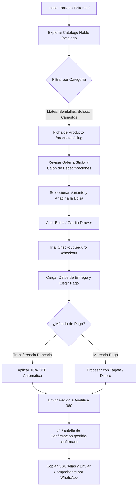

# 📖 Manual de Uso: Storefront Acacia Mates & Experiencia Editorial Snow Peak

> [!info] Objetivo de la Plataforma
> Este manual describe el flujo de navegación, selección de piezas artesanales nobles, consulta de especificaciones técnicas (*Wabi-Sabi* / *Snow Peak*) y proceso de compra en línea para los clientes de **Acacia Mates**, así como su integración operativa y sincronización directa de pedidos con el sistema **Analítica 360**.

> [!abstract] Requisitos Previos para el Usuario
> - **Navegador Web Compatible:** Cualquier navegador moderno (Chrome, Safari, Firefox, Edge) en dispositivos móviles, tablets o computadoras de escritorio.
> - **Conexión a Internet:** Para sincronizar el catálogo de piezas en tiempo real y emitir órdenes al taller.
> - **Canal de Comunicación:** WhatsApp habilitado para el envío asistido de comprobantes y coordinación de envíos.
> - **Permisos del Sistema:** Acceso público de comprador (no requiere registro ni inicio de sesión previo para navegar o comprar).

---

## 🗺️ Diagrama del Proceso de Compra y Experiencia

---

## 📍 Flujo de Navegación

Para recorrer las diferentes experiencias de la tienda:

1. **Portada Principal (`/`):**
   - Presentación de la colección 2026 en grilla asimétrica.
   - Manifiesto de forja criolla y filosofía de la pausa.
   - Acceso directo a la pieza insignia y anatomía de materiales nobles.
2. **Catálogo Completo (`/catalogo`):**
   - Archivo general de piezas clasificadas por categorías táctiles: `Mates`, `Bombillas`, `Bolsos`, `Canastos` y `Accesorios`.
3. **Bitácora "El Ritual" (`/el-ritual`):**
   - Guía interactiva sobre la ciencia térmica del agua (78°C), el curado tradicional de 72 horas y la geometría del cebado a 45°.
4. **Bolsa Lateral (Drawer):**
   - Accesible desde el ícono de bolsa en el encabezado superior en cualquier pantalla.
5. **Checkout Seguro (`/checkout`):**
   - Formulario directo en un solo paso para despacho nacional y métodos de pago.

---

## 📋 Guía Visual de Pantallas, Controles e Interacciones

### 1. Ficha de Producto Individual (`/productos/[slug]`)

| Elemento / Control | Tipo | Obligatorio | Descripción y Comportamiento Visual | Regla de Negocio |
| :--- | :--- | :---: | :--- | :--- |
| **Galería Fotográfica** | *Sticky Scroll* | Sí | Permanece anclada en pantalla en dispositivos de escritorio mientras los textos se deslizan. | Muestra imágenes reales de alta textura sin distorsión. |
| **Selector de Variantes** | Botones píldora | Opcional | Permite elegir entre tonalidades de cuero (ej. *Negro Azabache*, *Suela Natural*). | Actualiza el SKU y precio correspondiente. |
| **Contador de Cantidad** | Botones `+` / `-` | Sí | Ajusta las unidades a encargar (mínimo 1). | No permite números negativos ni cero. |
| **Botón "Añadir a la Bolsa"** | Botón de acción | Sí | Agrega la selección al carrito y despliega la bolsa lateral. | Dispara animación de confirmación inmediata. |
| **Spec Drawer ([01] Forja)** | Desplegable | No | Muestra espesores de pared (6–9 mm), calibre de alpaca (1.2 mm) y peso. | Información verificada por el artesano. |
| **Spec Drawer ([02] Curado)** | Desplegable | No | Proporciona la guía de mantenimiento y preservación de por vida. | Advertencia sobre no usar detergentes abrasivos. |

---

### 2. Proceso de Checkout y Despacho (`/checkout`)

| Campo / Control | Tipo | Obligatorio | Formato Esperado | Regla y Validación |
| :--- | :--- | :---: | :--- | :--- |
| **Nombre y Apellido** | Texto libre | **Sí** | Mínimo 2 palabras (ej. *Martín Fierro*) | Nombre del destinatario para la etiqueta de correo. |
| **WhatsApp / Teléfono** | Numérico/Tel | **Sí** | Código de área + número (ej. *261 555 1234*) | Requerido para coordinar el despacho y rastreo. |
| **Email** | Correo | No | `usuario@dominio.com` | Recepción de copia de comprobante digital. |
| **Calle y Número** | Texto | **Sí** | Nombre de calle y altura catastral exacta | Domicilio de entrega del correo. |
| **Piso / Departamento** | Texto | No | Torre, piso, depto (ej. *Piso 4 Dpto B*) | Opcional para propiedades horizontales. |
| **Ciudad / Localidad** | Texto | **Sí** | Localidad o municipio (ej. *Godoy Cruz*) | Valida destino de encomienda. |
| **Código Postal** | Numérico | **Sí** | 4 a 5 dígitos (ej. *5501*) | Asigna la sucursal de logística Andreani/Correo. |
| **Provincia** | Selector | **Sí** | Menú desplegable con las 24 provincias argentinas | Mendoza precargada por defecto. |
| **Forma de Pago** | Selector radial | **Sí** | `Transferencia Bancaria` o `Mercado Pago` | Si elige transferencia, aplica **10% de descuento directo**. |
| **Botón Confirmar Pedido** | Botón principal | **Sí** | Envía la orden a **Analítica 360** | Bloquea doble clic con indicador de carga. |

---

## 🔄 Paso a Paso: Ejecución de Casos de Uso

### Caso 1: Comprar un Mate Imperial con 10% OFF por Transferencia

1. **Ingreso y Selección:**
   - Ingrese a la portada de Acacia Mates y pulse sobre el botón **"Explorar Catálogo"** o navegue a `[[Catálogo Noble]]`.
   - Seleccione la pieza deseada (ej. *Mate Imperial de Calabaza y Cuero*).
2. **Personalización:**
   - En la ficha de producto, elija la terminación del cuero (ej. *Cuero Suela Natural*).
   - Revise el cajón de especificaciones técnicas para conocer las dimensiones y peso.
   - Presione **"Añadir a la Bolsa"**.
3. **Revisión en Bolsa Lateral:**
   - El drawer lateral mostrará el subtotal y el descuento estimado.
   - Haga clic en **"Iniciar Pedido"**.
4. **Carga de Datos de Envío:**
   - Complete su nombre, teléfono de contacto y dirección postal.
   - En la sección **"Forma de Pago"**, seleccione **"Transferencia Bancaria · 10% de Descuento Especial"**.
   - Verifique que el resumen aplique el descuento en pesos y muestre el total corregido.
5. **Confirmación:**
   - Presione **"Confirmar y Pagar"**.
   - El sistema guardará el pedido directamente en la base de datos de `[[Módulo de Pedidos Analítica 360]]`.
6. **Finalización:**
   > [!check] Pedido Exitoso
   > Se presentará la pantalla con el número de orden asignado (ej. `#AC-5421`).
   > Copie el **Alias** (`acacia.mates`) o **CBU** provisto con el botón de copiado rápido, efectúe la transferencia desde su banco o billetera virtual y presione el botón verde **"Enviar Comprobante por WhatsApp"** para notificar al taller.

---

### Caso 2: Consultar la Guía de Curado Tradicional

1. En el menú superior, presione **"El Ritual"** o diríjase a `[[El Ritual del Mate]]`.
2. Siga la metodología de 3 pasos:
   - **Paso 01 (Temperatura):** Calentar agua entre 75°C y 80°C.
   - **Paso 02 (Curado de 72h):** Llenar con yerba usada tibia, humedecer y dejar reposar 24h; vaciar y raspar suavemente el hollejo desprendido con cuchara de postre. Repetir por 3 días.
   - **Paso 03 (Geometría):** Invertir el mate para separar el polvo, colocar la yerba a 45° y clavar la bombilla sin volver a moverla.

---

## ⚠️ Solución de Problemas y Errores Frecuentes

> [!faq] Preguntas y Situaciones Inusuales

| Situación en Pantalla | Causa Probable | Solución Sugerida |
| :--- | :--- | :--- |
| **"No hay piezas seleccionadas" en checkout** | Se ingresó a `/checkout` con la bolsa vacía o se vació el navegador. | Regrese al catálogo y agregue al menos un producto antes de avanzar. |
| **"Por favor completá los campos obligatorios"** | Faltan datos esenciales como calle, número, ciudad o teléfono. | Revise los campos marcados con asterisco `*` en el formulario. |
| **El CBU o Alias no se copian al portapapeles** | El navegador tiene bloqueados los permisos de portapapeles. | Seleccione el texto manualmente o verifique los permisos del navegador. |
| **La API de Analítica 360 no responde** | Servidor backend temporalmente no disponible o en reinicio. | La web opera con catálogo de contingencia automático; el pedido se registrará con número de respaldo para coordinar por WhatsApp. |

---

## 🔗 Enlaces y Módulos Relacionados

- `[[Catálogo Noble]]`: Archivo completo de piezas de taller.
- `[[El Ritual del Mate]]`: Especificaciones de curado, templado y cebado.
- `[[Módulo de Pedidos Analítica 360]]`: Registro de órdenes en ERP con origen `tienda_online`.
- `[[Glosario de Materiales Nobles]]`: Calabaza brasilera, alpaca alemana, cuero curtido vegetal y algarrobo.

---

🔍 <b>Ficha Técnica y Trazabilidad (Para Equipos de Desarrollo, QA y Soporte)</b>

### 🖥️ Frontend (Interfaz de Usuario)
- **Repositorio Standalone:** `/home/deibon/deibon/acacia_web`
- **Mapeo en Monorepo:** `apps/acacia_web`
- **Componentes Clave:**
  - `components/layout/Header.tsx` (Navegación editorial)
  - `components/catalogo/ProductCard.tsx` (Tarjetas anti-grid)
  - `components/producto/ProductDetailView.tsx` (Sticky gallery & variantes)
  - `components/producto/SpecDrawer.tsx` (Desplegable técnico de especificaciones)
  - `components/carrito/CarritoDrawer.tsx` (Gestor de bolsa con `useSyncExternalStore`)
  - `components/checkout/CheckoutView.tsx` (Formulario de despacho y pasarela)
  - `components/pedido/PedidoConfirmadoView.tsx` (Integración WhatsApp + CBU)
- **Rutas de la App (Next.js 16 App Router):**
  - `/`: Portada inmersiva
  - `/catalogo`: Catálogo con query param `?categoria=...`
  - `/productos/[slug]`: Detalle con SSG y fallback dinámico
  - `/el-ritual`: Contenido editorial y científico del mate
  - `/checkout`: Proceso de pago
  - `/pedido-confirmado`: Resumen y datos bancarios

### ⚙️ Backend (API de Analítica 360 - NestJS :3001)
- **Controladores Involucrados:**
  - `TiendaSitioController` (`apps/api/src/modules/tienda/tienda-admin.controller.ts`)
  - `TiendaController` (`apps/api/src/modules/tienda/tienda.controller.ts`)
- **Endpoints Clave:**
  - `GET /tienda-sitio/:empresaId`: Carga identidad de marca y datos bancarios.
  - `GET /tienda/:empresaId/catalogo`: Entrega catálogo de productos y variantes.
  - `POST /tienda/:empresaId/pedidos`: Creación de la orden en PostgreSQL (`pedidos`, `pedidos_items`) con origen `tienda_online`.
- **Identificador de Empresa (Acacia Mates):** `47d60e49-bf3b-4ca4-915f-3269c5fdbcf9` (subdominio `acacia`).

### 🗺️ Mapeo UI ↔ Backend Payload
| Control en Frontend | Campo Payload Backend (`POST /pedidos`) | Regla de Negocio |
| :--- | :--- | :--- |
| Input "Nombre y Apellido" | `cliente.nombre` | Sanitización de caracteres, guardado en ficha de cliente. |
| Input "Teléfono / WhatsApp"| `cliente.telefono` | Identificador para notificaciones SMS/WhatsApp. |
| Input "Email" | `cliente.email` | Opcional, para facturación y envío de comprobante. |
| Calle + Número + Piso | `envio.direccion` | Normalización de domicilio para etiqueta de despacho. |
| Ciudad / Localidad | `envio.localidad` | Mapeo logístico para el transporte. |
| Selector "Provincia" | `envio.provincia` | Cálculo de zona de encomienda nacional. |
| Selector "Forma de Pago" | `metodoPago` | Si es `transferencia`, aplica 10% de descuento en backend. |
| Items de la Bolsa | `items[]` | Decrementa stock en tabla `productos` / `producto_variantes`. |

