# 📚 Manual de Usuario: Analítica 360

> [!info] Bienvenido a Analítica 360
> **Analítica 360** es una plataforma integral de gestión comercial, operativa y analítica diseñada para comercios, distribuidoras, talleres, ferias y empresas de servicios.
> Esta documentación está estructurada como una **Bóveda Interactiva de Obsidian**, permitiéndote navegar rápidamente entre conceptos mediante enlaces wiki entre notas, buscar por etiquetas (`#tags`) y explorar los diagramas de proceso.

> [!tip] Cómo usar esta Bóveda en Obsidian
> - Presioná `Ctrl + O` (o `Cmd + O` en macOS) para saltar rápidamente a cualquier manual por nombre.
> - Hacé clic en cualquier enlace wiki para navegar directamente al tema relacionado.
> - Abrí la vista de **Grafo** (`Ctrl + G`) para visualizar la interconexión entre ventas, inventario, clientes y facturación.
> - Al final de cada manual encontrarás una sección desplegable 🔍 **Ficha Técnica y Trazabilidad** pensada para el equipo de soporte técnico o administradores de sistemas.

> [!example] 🚀 Tours Interactivos con Driver.js Integrados en la Plataforma
> ¡No necesitás memorizar manuales extensos para operar el sistema!
> - En la barra lateral de la app web disponés de la pestaña **Guías y Manuales** (`/guias`).
> - Cada pantalla cuenta con un botón **"Paso a paso (Driver.js)"** en el encabezado superior que te guía visualmente paso por paso en tiempo real.
> - Podés iniciar el tour general o el tour específico de cada módulo (Ventas, Stock, Clientes, Facturación ARCA, etc.) en cualquier momento.

---

## 🗺️ Mapa de la Bóveda y Módulos del Sistema

```mermaid
graph TD
    A[Analítica 360] --> B[Plataforma y Acceso]
    A --> C[Ventas y Clientes]
    A --> D[Catálogo, Stock y Compras]
    A --> E[Gestión y Analítica]
    A --> F[Configuración y Cuenta]

    B --> B1["[[01 - Primeros Pasos, Registro y Acceso]]"]
    B --> B2["[[02 - Roles, Permisos y Gestión de Equipo]]"]
    B --> B3["[[03 - Dashboard de Inicio y Métricas en Tiempo Real]]"]
    B --> B4["[[04 - Copilot IA - Asistente Estratégico de Negocio]]"]

    C --> C1["[[05 - Punto de Venta (POS), Cobros y Facturación ARCA]]"]
    C --> C2["[[06 - Gestión de Clientes, Cuentas Corrientes y Difusiones]]"]
    C --> C3["[[07 - Gestión de Pedidos, Picking y Despachos]]"]
    C --> C4["[[08 - Agenda de Turnos y Reservas Online]]"]
    C --> C5["[[09 - Abonos Periódicos y Membresías Recurrentes]]"]
    C --> C6["[[10 - Órdenes de Trabajo y Servicio Técnico]]"]

    D --> D1["[[11 - Catálogo de Productos, Servicios y Variantes]]"]
    D --> D2["[[12 - Control de Inventario, Kardex y Lotes]]"]
    D --> D3["[[13 - Compras a Proveedores y Recepción de Mercadería]]"]
    D --> D4["[[14 - Directorio de Proveedores y Cuentas Corrientes]]"]
    D --> D5["[[15 - Producción, Fórmulas y Recetas de Fabricación]]"]

    E --> E1["[[16 - Analytics Comercial, Rentabilidad y Monotributo]]"]
    E --> E2["[[17 - Metas y Objetivos de Venta]]"]
    E --> E3["[[18 - Comisiones y Liquidaciones al Personal]]"]
    E --> E4["[[19 - Archivo Digital de Documentos y Contratos]]"]

    F --> F1["[[20 - Tienda Online y Storefront Multi-Negocio]]"]
    F --> F2["[[21 - Configuración General, Datos Fiscales y Parámetros]]"]
    F --> F3["[[22 - Suscripción, Planes y Límites del Sistema]]"]
    F --> F4["[[23 - Mesa de Ayuda y Soporte Técnico]]"]
    F --> F5["[[24 - Programa de Referidos (Recomendá y Ganá)]]"]
    F --> F6["[[25 - Glosario de Términos y Preguntas Frecuentes]]"]
```

---

## 📑 Índice Detallado por Módulos

### 🚀 1. Plataforma, Acceso e Inteligencia Artificial
1. **[[01 - Primeros Pasos, Registro y Acceso]]**
   - Cómo registrar un nuevo comercio, iniciar sesión, elegir organización y recuperar contraseñas.
2. **[[02 - Roles, Permisos y Gestión de Equipo]]**
   - Perfiles de Dueño, Colaborador y Contador. Asignación granular de módulos y restricciones.
3. **[[03 - Dashboard de Inicio y Métricas en Tiempo Real]]**
   - Ventas de hoy, semana y mes, compras mensuales, gráfico de 7 días y alertas de Monotributo.
4. **[[04 - Copilot IA - Asistente Estratégico de Negocio]]**
   - Inteligencia artificial Analítica IA para análisis de rentabilidad, proyecciones de stock y respuestas ejecutivas en lenguaje natural.

### 💰 2. Ventas, Clientes y Servicios
5. **[[05 - Punto de Venta (POS), Cobros y Facturación ARCA]]**
   - Carrito ágil, lector de código de barras, medios de pago (efectivo, débito, crédito, transferencias, MercadoPago), señas y facturación electrónica ARCA/AFIP (Facturas A, B, C y Notas de Crédito).
6. **[[06 - Gestión de Clientes, Cuentas Corrientes y Difusiones]]**
   - Ficha de clientes, límites de crédito, pagos parciales a cuenta, historial de compras, cumpleaños y difusión masiva por WhatsApp.
7. **[[07 - Gestión de Pedidos, Picking y Despachos]]**
   - Flujo de pedidos desde el ingreso hasta la entrega, picking de artículos con empaque y remito de traslado.
8. **[[08 - Agenda de Turnos y Reservas Online]]**
   - Calendario interactivo semanal y diario, asignación de profesionales/recursos y reservas públicas online.
9. **[[09 - Abonos Periódicos y Membresías Recurrentes]]**
   - Gestión de suscripciones mensuales, generación masiva de cuotas y seguimiento de cobranza.
10. **[[10 - Órdenes de Trabajo y Servicio Técnico]]**
    - Recepción de equipos, diagnóstico de falla, asignación de repuestos, estados de orden y entrega con cobro.

### 📦 3. Catálogo, Stock y Compras
11. **[[11 - Catálogo de Productos, Servicios y Variantes]]**
    - Creación de artículos físicos y servicios, talles y colores, fotos, listas de precios, promociones y carga masiva desde Excel.
12. **[[12 - Control de Inventario, Kardex y Lotes]]**
    - Gestión multidepósito, transferencias entre sucursales, auditoría de stock físico, kardex valorizado y vencimientos.
13. **[[13 - Compras a Proveedores y Recepción de Mercadería]]**
    - Registro de facturas de compra, costos adicionales prorrateados (flete/seguro), escaneo OCR de facturas y actualización de costos de venta.
14. **[[14 - Directorio de Proveedores y Cuentas Corrientes]]**
    - Padrón de proveedores comerciales, plazos de pago y seguimiento de saldos pendientes.
15. **[[15 - Producción, Fórmulas y Recetas de Fabricación]]**
    - Definición de recetas (BOM), explosión de insumos de stock, cálculo de costo unitario y registro de órdenes de fabricación.

### 📈 4. Gestión, Control y Finanzas
16. **[[16 - Analytics Comercial, Rentabilidad y Monotributo]]**
    - Reportes de ventas por canal, margen de ganancia real, matriz BCG (estrellas, vacas, perros), semáforo fiscal de Monotributo y libros contables.
17. **[[17 - Metas y Objetivos de Venta]]**
    - Establecimiento de metas comerciales semanales y mensuales, medidor de avance y ranking de vendedores.
18. **[[18 - Comisiones y Liquidaciones al Personal]]**
    - Reglas automáticas de comisión por ventas o servicios, cálculo de devengados y cierre de liquidación periódica.
19. **[[19 - Archivo Digital de Documentos y Contratos]]**
    - Resguardo en la nube de contratos, remitos firmados, pólizas y garantías con alertas de caducidad.

### ⚙️ 5. Configuración, Tienda y Cuenta
20. **[[20 - Tienda Online y Storefront Multi-Negocio]]**
    - Configuración de la tienda web pública, diseño, carrito de autoservicio, cupones y checkout MercadoPago.
21. **[[21 - Configuración General, Datos Fiscales y Parámetros]]**
    - Razón social, CUIT, certificados de facturación ARCA, rubros de actividad, puntos de venta y medios de pago con cuotas.
22. **[[22 - Suscripción, Planes y Límites del Sistema]]**
    - Comparativa de planes (Starter, Básico, Pro, E-commerce), límites de usuarios/ubicaciones y gestión de pagos.
23. **[[23 - Mesa de Ayuda y Soporte Técnico]]**
    - Apertura y seguimiento de tickets con el equipo de soporte oficial de Analítica 360.
24. **[[24 - Programa de Referidos (Recomendá y Ganá)]]**
    - Enlace personal de recomendación, créditos acumulados y descuentos en la cuota de abono.
25. **[[25 - Glosario de Términos y Preguntas Frecuentes]]**
    - Definición de siglas y conceptos clave (CAE, SKU, BOM, Kardex, etc.) y resolución rápida de dudas.

---

## 🏷️ Navegación por Etiquetas (Tags)

Si utilizás el plugin de **Tags** en Obsidian, podés filtrar notas según los siguientes grupos:
- `#manual/usuario`: Todas las guías de usuario final.
- `#modulo/ventas`: Temas relacionados a ventas, POS, clientes, abonos y turnos.
- `#modulo/inventario`: Todo sobre catálogo, stock, movimientos y compras.
- `#modulo/produccion`: Recetas, insumos y órdenes de elaboración.
- `#modulo/analytics`: Métricas, rentabilidad, monotributo y metas.
- `#modulo/configuracion`: Parámetros del comercio, usuarios y tienda online.
- `#modulo/ia`: Asistente Copilot y funciones con inteligencia artificial.
