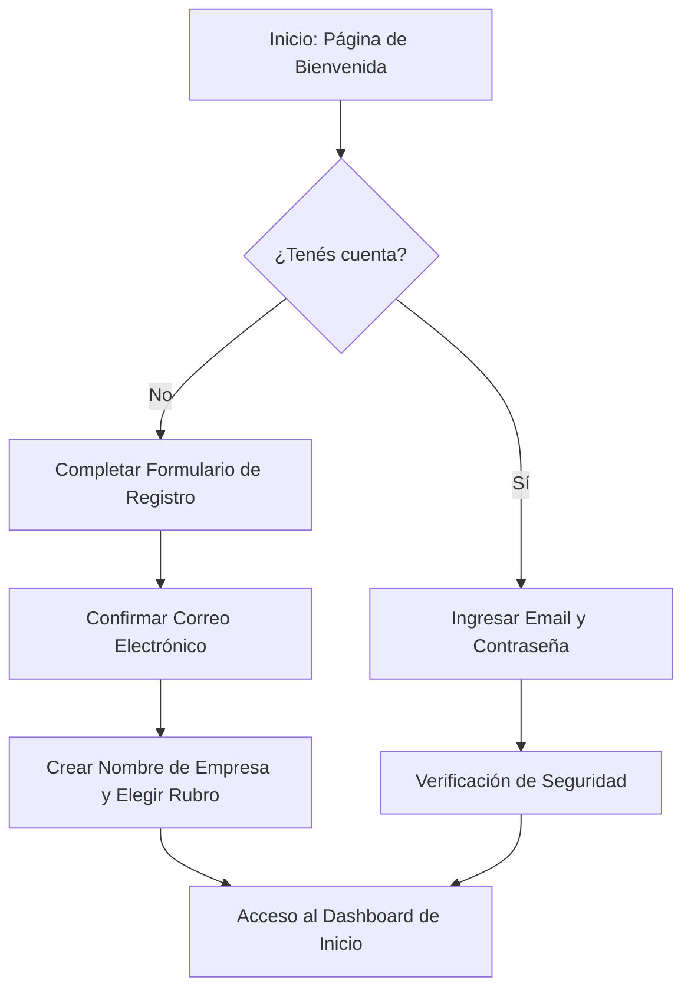

# 🚀 Manual de Uso: Primeros Pasos, Registro y Acceso

> [!info] Objetivo de la Funcionalidad
> Este manual te guía para crear tu cuenta en **Analítica 360**, dar de alta tu empresa, iniciar sesión de forma segura y acceder al panel de control desde cualquier navegador web o dispositivo móvil.

> [!abstract] Requisitos Previos
> - Conexión a internet estable.
> - Correo electrónico personal o corporativo accesible para validación.
> - Navegador web moderno (Google Chrome, Mozilla Firefox, Safari, Microsoft Edge).

---

## 🗺️ Diagrama del Proceso de Registro y Acceso

---

## 📍 Flujo de Navegación

1. Abrí tu navegador e ingresá a la dirección oficial de la plataforma: `https://app.analitica360.com` (o la URL de tu instancia local/privada).
2. Si es tu primera vez, hacé clic en **"Registrarme"** o **"Comenzar prueba gratis"**.
3. Si ya tenés credenciales, ingresá directamente desde la pantalla de **"Iniciar Sesión"**.

> [!TIP]
> **Tour Interactivo Guiado (Driver.js)**: Al ingresar al sistema por primera vez, se iniciará automáticamente una **Guía Rápida interactiva** que resalta los elementos clave de la pantalla (Inicio, Copilot IA, Ventas, Catálogo, Analytics y Switcher de Empresa). Si deseás volver a verla en cualquier momento, podés presionar el botón **"Guía rápida"** (ícono de brújula) ubicado en la barra superior de la aplicación.

---

## 📋 Guía Visual de Campos e Interacciones

### 1. Formulario de Registro Inicial

| Campo / Control | Tipo | Obligatorio | Descripción / Formato Esperado | Reglas y Validaciones |
| :--- | :--- | :---: | :--- | :--- |
| **Nombre Completo** | Texto | Sí | Tu nombre y apellido para la cuenta. | Mínimo 2 caracteres. |
| **Correo Electrónico** | Email | Sí | Casilla donde recibirás notificaciones y avisos. | Formato válido `usuario@dominio.com`. |
| **Contraseña** | Clave | Sí | Clave de acceso personal. | Mínimo 8 caracteres, al menos 1 número o símbolo. |
| **Nombre del Comercio** | Texto | Sí | Nombre de fantasía o razón social de tu negocio. | Se utilizará en presupuestos, remitos y tickets. |
| **Rubro Principal** | Selector | Sí | Productos, Servicios o Producción/Taller. | Ajusta automáticamente los módulos visibles iniciales. |
| **Botón "Crear Cuenta"** | Botón | N/A | Procesa la solicitud e inicia tu período de prueba. | Se activa tras completar los campos obligatorios. |

---

## 🔄 Paso a Paso: Ejecución del Caso de Uso

### Caso 1: Alta de una Nueva Empresa (Comercio Nuevo)

1. **Completar datos de contacto:**
   - Ingresá tu nombre, correo y contraseña deseada.
2. **Definir el comercio:**
   - Escribí el nombre comercial de tu negocio.
   - Marcá las actividades que realiza tu empresa:
     - 🛒 *Venta de productos físicos* (habilita Stock, Compras y Pedidos).
     - ✂️ *Prestación de servicios* (habilita Agenda de turnos, Abonos y Órdenes de trabajo).
     - 🔨 *Fabricación o elaboración propia* (habilita Fórmulas y Órdenes de Producción).
3. **Confirmar creación:**
   - Presioná **"Crear Cuenta"**.
   - El sistema configurará en segundos tu base de datos aislada y te otorgará un período de prueba con todas las funciones Pro activas.

### Caso 2: Unirte a una Empresa Existente vía Invitación

1. **Recibir invitación:**
   - Si un administrador de tu equipo te invitó, recibirás un correo o enlace directo con el código de invitación.
2. **Aceptar y vincular:**
   - Al hacer clic en el enlace, completá tu contraseña personal.
   - El sistema te asignará de forma automática el rol y los permisos autorizados por el dueño (ver `[[02 - Roles, Permisos y Gestión de Equipo]]`).

### Caso 3: Cambio de Comercio (Multi-Organización)

1. En la esquina superior izquierda del menú lateral, hacé clic en el selector de organización.
2. Seleccioná el comercio con el que deseás operar en esta sesión. Todo el stock, facturación y clientes se conmutarán al instante.

---

## ⚠️ Solución de Problemas y Errores Frecuentes

> [!faq] ¿Qué ocurre si falla la autenticación?

| Mensaje de Error en Pantalla | Causa Probable | Solución Sugerida |
| :--- | :--- | :--- |
| **"Credenciales incorrectas"** | La contraseña o el email no coinciden con los registrados. | Revisá mayúsculas/minúsculas o usá el enlace "Olvidé mi contraseña". |
| **"Email ya registrado"** | Ya existe una cuenta asociada a esa dirección de correo. | Hacé clic en "Iniciar sesión" en lugar de registrarte nuevamente. |
| **"Acceso revocado o cuenta inactiva"** | El dueño de la empresa pausó tu perfil de colaborador. | Comunicate con el administrador de tu negocio para reactivar el acceso. |

---

## 🔗 Manuales y Documentos Relacionados

- `[[00 - Índice General y Guía de Navegación]]`
- `[[02 - Roles, Permisos y Gestión de Equipo]]`
- `[[03 - Dashboard de Inicio y Métricas en Tiempo Real]]`
- `[[21 - Configuración General, Datos Fiscales y Parámetros]]`

---

🔍 <b>Ficha Técnica y Trazabilidad (Para Equipos de Soporte y QA)</b>

### 🖥️ Frontend (Interfaz de Usuario)
- **Componentes:** `apps/web/src/app/(auth)/sign-in/page.tsx`, `apps/web/src/features/registro/`
- **Gestión de Sesión:** Proveedor Clerk Auth SDK + Tokens JWT en Cookies seguras HTTP-Only.
- **Ruta de Navegación (URL):** `/sign-in`, `/sign-up`, `/inicio`

### ⚙️ Backend (Servicio y API)
- **Endpoints:**
  - `POST /registro/empresa` (Alta de nueva empresa con suscripción inicial de prueba).
  - `GET /usuarios/mi-acceso` (Resolución de permisos, rol y módulos habilitados).
- **Controladores:** `RegistroController`, `MiAccesoController`
- **DTOs:** `RegistroEmpresaDto`, `AceptarInvitacionDto`
- **Códigos HTTP:**
  - `201 Created`: Empresa y usuario creados exitosamente.
  - `400 Bad Request`: Datos de contacto o validación incorrectos.
  - `409 Conflict`: Email ya en uso en el proveedor de identidad.

