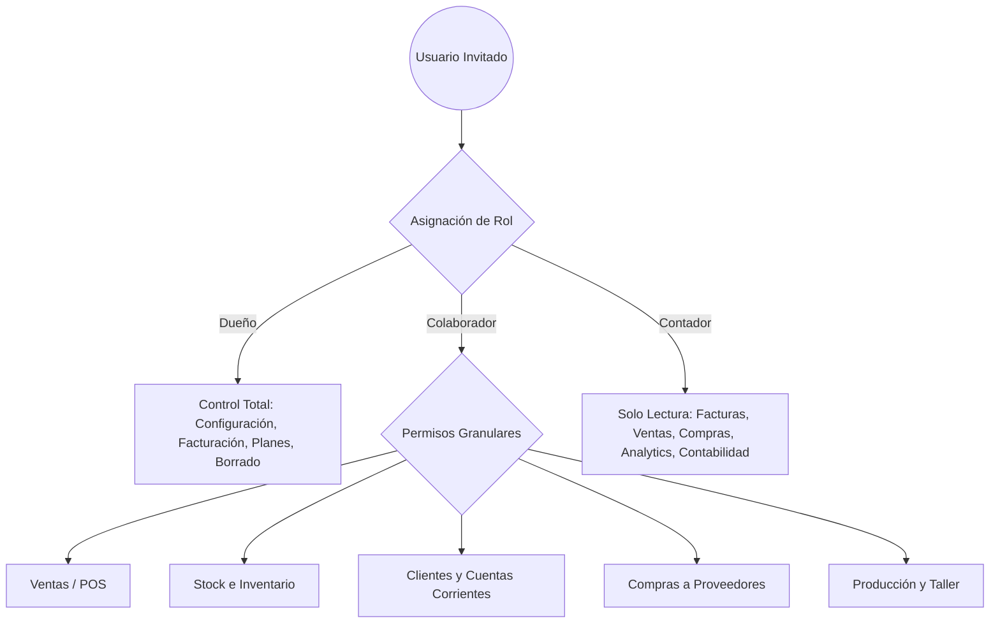

# 👥 Manual de Uso: Roles, Permisos y Gestión de Equipo

> [!info] Objetivo de la Funcionalidad
> Este módulo permite al dueño del negocio invitar a su personal (vendedores, cajeros, encargados de depósito, socios y contadores), asignando perfiles de acceso específicos para proteger información sensible y optimizar el trabajo colaborativo.

> [!abstract] Requisitos Previos y Permisos
> - **Rol de Usuario Requerido:** `Dueño` (o colaborador con permiso expreso sobre `Configuración`).
> - Contar con cupo disponible de usuarios en el plan contratado (ver `[[22 - Suscripción, Planes y Límites del Sistema]]`).
> - *Nota:* El rol de **Contador** no consume cupo de usuarios en ningún plan.

---

## 🗺️ Matriz de Roles y Perfiles de Acceso

---

## 📍 Flujo de Navegación

1. En el menú lateral izquierdo, dirijase a la sección inferior **Cuenta** > **Configuración**.
2. En las pestañas superiores de configuración, haga clic en **"Equipo y Permisos"**.
3. Verá el listado actual de integrantes activos y el botón **"+ Invitar colaborador"**.

---

## 📋 Guía Visual de Campos e Interacciones

| Campo / Control | Tipo | Obligatorio | Descripción / Formato Esperado | Reglas y Validaciones |
| :--- | :--- | :---: | :--- | :--- |
| **Email del Colaborador** | Email | Sí | Casilla del empleado a quien se enviará la invitación. | Debe ser un email válido no registrado en otra empresa. |
| **Nombre o Apodo** | Texto | Sí | Identificador interno para el equipo (ej: "Juan - Caja 1"). | Mínimo 2 caracteres. |
| **Rol Principal** | Selector | Sí | `Dueño`, `Colaborador`, o `Contador`. | Define el nivel base de privilegios. |
| **Módulos Permitidos** | Checkboxes | No | Lista de módulos a los que tendrá acceso (si es Colaborador). | Si no se marca ninguno, el colaborador no verá el menú. |
| **Permisos de Edición/Borrado** | Toggles | No | Define si puede crear, editar o solo consultar. | Protege contra anulaciones o bajas accidentales de stock. |
| **Botón "Enviar Invitación"** | Botón | N/A | Genera el token de seguridad y envía el link por correo. | Requiere completar email y rol. |

---

## 🔄 Paso a Paso: Ejecución del Caso de Uso

### Caso 1: Invitar a un Vendedor o Cajero

1. **Ingresar a Equipo:**
   - Diríjase a **Configuración** > **Equipo y Permisos**.
2. **Hacer clic en "Invitar colaborador":**
   - Escriba el correo del empleado (ej. `vendedor@tucomercio.com`).
   - Seleccione el rol **Colaborador**.
3. **Configurar accesos específicos:**
   - Marque los casilleros de los módulos de trabajo diario:
     - ✅ **Ventas** (para emitir tickets y cobrar).
     - ✅ **Clientes** (para consultar cuentas corrientes o buscar clientes).
     - ❌ **Compras** (desmarcado: no verá costos de proveedores).
     - ❌ **Analytics** (desmarcado: no verá rentabilidad global ni balances).
     - ❌ **Configuración** (desmarcado: no podrá modificar datos fiscales).
4. **Enviar invitación:**
   - Presione **"Enviar Invitación"**. El colaborador recibirá un enlace para crear su contraseña y empezar a operar.

### Caso 2: Dar Acceso al Estudio Contable (Rol Contador)

1. En **Equipo y Permisos**, haga clic en **"Invitar colaborador"**.
2. Ingrese el correo del contador o estudio impositivo.
3. Seleccione el rol **Contador**.
4. > [!tip] Beneficio Fiscal y Operativo
   > El contador tendrá acceso de **solo lectura** a comprobantes emitidos, compras, libro diario y al semáforo de facturación para control del Monotributo, sin poder alterar precios ni emitir ventas. ¡Y no te descuenta usuarios de tu plan!

---

## ⚠️ Solución de Problemas y Errores Frecuentes

> [!faq] Consultas Frecuentes sobre Usuarios y Accesos

| Situación / Error en Pantalla | Causa Probable | Solución Sugerida |
| :--- | :--- | :--- |
| **"Límite de usuarios alcanzado"** | El plan actual no admite más colaboradores concurrentes. | Mejorá tu plan desde `[[22 - Suscripción, Planes y Límites del Sistema]]` o desactiva un usuario que ya no trabaje en el negocio. |
| **"El colaborador no ve ciertos módulos"** | No se le tildaron los permisos de esos módulos al invitarlo. | Hacé clic en el lápiz de edición junto a su nombre en la lista y marcá los casilleros correspondientes. |
| **"Invitación expirada"** | Pasaron más de 7 días sin que el colaborador abra el enlace. | Presioná el botón **"Reenviar invitación"** para generar un nuevo enlace seguro. |

---

## 🔗 Manuales y Documentos Relacionados

- `[[00 - Índice General y Guía de Navegación]]`
- `[[01 - Primeros Pasos, Registro y Acceso]]`
- `[[21 - Configuración General, Datos Fiscales y Parámetros]]`
- `[[22 - Suscripción, Planes y Límites del Sistema]]`

---

🔍 <b>Ficha Técnica y Trazabilidad (Para Equipos de Soporte y QA)</b>

### 🖥️ Frontend (Interfaz de Usuario)
- **Componente:** `apps/web/src/features/configuracion/components/PermisosEquipo.tsx`
- **Hook de Control:** `useAcceso()` en `apps/web/src/hooks/use-acceso.ts`
- **Ruta de Navegación (URL):** `/configuracion?tab=equipo`

### ⚙️ Backend (Servicio y API)
- **Controlador:** `EquipoController` en `apps/api/src/modules/usuarios/equipo.controller.ts`
- **Endpoints:**
  - `GET /usuarios/equipo` (Listado de integrantes y estado de invitaciones).
  - `POST /usuarios/equipo/invitar` (Generación de invitación y asignación de permisos).
  - `PUT /usuarios/equipo/:id/permisos` (Actualización de matriz de accesos).
  - `DELETE /usuarios/equipo/:id` (Revocación inmediata de acceso a la organización).
- **DTOs:** `InvitarColaboradorDto`, `ActualizarPermisosDto`

