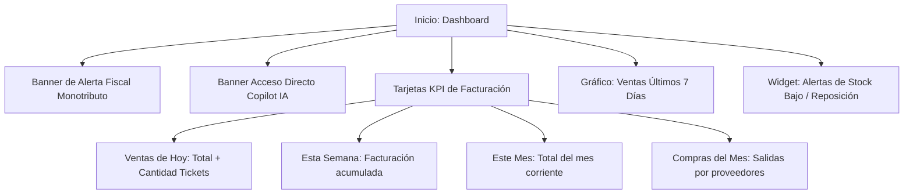

# 📊 Manual de Uso: Dashboard de Inicio y Métricas en Tiempo Real

> [!info] Objetivo de la Funcionalidad
> El **Dashboard de Inicio** es la central de mando de tu negocio. Al ingresar al sistema te ofrece una fotografía instantánea del rendimiento comercial: facturación del día, semana y mes, gastos de compras, evolución gráfica de los últimos 7 días, alertas fiscales de Monotributo y avisos de reposición de mercadería crítica.

> [!abstract] Requisitos Previos y Permisos
> - **Rol de Usuario Requerido:** `Dueño`, `Contador`, o `Colaborador` con permiso asignado sobre `Inicio`.
> - Haber registrado al menos una venta o movimiento de compra para visualizar datos consolidados.

---

## 🗺️ Estructura Visual del Tablero Principal

---

## 📍 Flujo de Navegación

1. En el menú lateral izquierdo, hacé clic en **"Inicio"** (el primer ítem con ícono de casa 🏠).
2. Es la pantalla a la que el sistema te dirige de forma automática tras iniciar sesión.

---

## 📋 Guía Visual de Componentes y Paneles

| Panel / Indicador | Tipo de Dato | Utilidad Operativa | Acción al Clic |
| :--- | :--- | :--- | :--- |
| **Ventas de hoy** | Moneda ($) y Conteo | Facturación total recaudada en el día y número de operaciones realizadas. | Muestra el desglose de ventas del día. |
| **Esta semana** | Moneda ($) | Monto acumulado de ventas desde el lunes hasta la hora actual. | Te permite comparar el ritmo semanal. |
| **Este mes** | Moneda ($) | Ingresos brutos de ventas en el mes calendario en curso. | Enlaza a `[[16 - Analytics Comercial, Rentabilidad y Monotributo]]`. |
| **Compras del mes** | Moneda ($) | Total de facturas de compra y reposiciones cargadas este mes. | Enlaza a `[[13 - Compras a Proveedores y Recepción de Mercadería]]`. |
| **Gráfico 7 días** | Gráfico de Barras | Compara día por día la recaudación para detectar picos (fines de semana, promociones). | Pasa el mouse para ver el valor exacto de cada día. |
| **Alerta Monotributo** | Semáforo / Barra | Muestra el % de facturación anual acumulada respecto al límite de tu categoría ARCA. | Avisa si estás cerca de una recategorización o exclusión. |
| **Banner Copilot IA** | Acceso Inteligente | Invita a consultar al asistente inteligente en lenguaje natural. | Te lleva directo a `[[04 - Copilot IA - Asistente Estratégico de Negocio]]`. |
| **Productos por Agotarse** | Lista de Alertas | Muestra hasta 10 productos que están por debajo de su stock mínimo de seguridad. | Enlaza a `[[12 - Control de Inventario, Kardex y Lotes]]`. |

---

## 🔄 Paso a Paso: Rutina Diaria del Administrador

1. **Revisión al abrir el negocio:**
   - Observá el saldo de **Ventas de hoy** (arranca en $0,00).
   - Verificá el widget de **Productos por Agotarse** para saber si debés solicitar mercadería a proveedores o transferir stock desde depósito.
2. **Monitoreo durante el día:**
   - Cada vez que un cajero o vendedor finaliza un ticket en el POS (`[[05 - Punto de Venta (POS), Cobros y Facturación ARCA]]`), el contador de ventas y la cifra total aumentan en tiempo real sin necesidad de recargar la página.
3. **Control fiscal preventivo:**
   - > [!warning] Semáforo de Facturación ARCA
   - Si la barra de **Monotributo** cambia a color amarillo o rojo, significa que estás alcanzando el tope de tu categoría impositiva. Podés consultar a tu contador o a Copilot IA para proyectar los próximos meses.
4. **Cierre de jornada:**
   - Cotejá el total de **Ventas de hoy** contra el arqueo de caja físico y transferencias bancarias.

---

## ⚠️ Solución de Problemas y Errores Frecuentes

> [!faq] Consultas Frecuentes del Dashboard

| Situación en Pantalla | Causa Probable | Solución Sugerida |
| :--- | :--- | :--- |
| **"Las ventas de hoy no se actualizan"** | Pérdida momentánea de conexión a internet o navegador desincronizado. | Presioná el botón de reintentar o actualizá la pestaña (`F5`). |
| **"El gráfico muestra $0 en días anteriores"** | No se registraron ventas en esas fechas o se operó bajo otra sucursal. | Verificá en el selector superior que estés en la organización correcta. |
| **"No veo el bloque de Monotributo"** | Tu comercio está registrado como Responsable Inscripto o no configuraste tu categoría en `[[21 - Configuración General, Datos Fiscales y Parámetros]]`. | Ingresá a Configuración para definir tu categoría de Monotributo vigente. |

---

## 🔗 Manuales y Documentos Relacionados

- `[[00 - Índice General y Guía de Navegación]]`
- `[[04 - Copilot IA - Asistente Estratégico de Negocio]]`
- `[[05 - Punto de Venta (POS), Cobros y Facturación ARCA]]`
- `[[16 - Analytics Comercial, Rentabilidad y Monotributo]]`

---

🔍 <b>Ficha Técnica y Trazabilidad (Para Equipos de Soporte y QA)</b>

### 🖥️ Frontend (Interfaz de Usuario)
- **Componente:** `apps/web/src/features/dashboard/components/InicioDashboard.tsx`
- **Ruta de Navegación (URL):** `/inicio`
- **Hook de Datos:** `useDashboard()` en `apps/web/src/features/dashboard/hooks/use-dashboard.ts`
- **Gráficos:** Recharts con componente adaptado `ChartContainer`.

### ⚙️ Backend (Servicio y API)
- **Controlador:** `DashboardController` en `apps/api/src/modules/analytics/dashboard.controller.ts`
- **Endpoint:** `GET /analytics/dashboard`
- **Respuestas devueltas:**
  - `hoy`: `{ total: number, cantidad: number }`
  - `semana`: `number`
  - `mes`: `number`
  - `comprasMes`: `number`
  - `ultimos7Dias`: `Array<{ fecha: string, total: number }>`
  - `stockBajo`: `Array<{ id: string, nombre: string, stock: number, stockMinimo: number }>`
- **Códigos HTTP:**
  - `200 OK`: Datos agregados calculados correctamente mediante agregaciones de Prisma.

