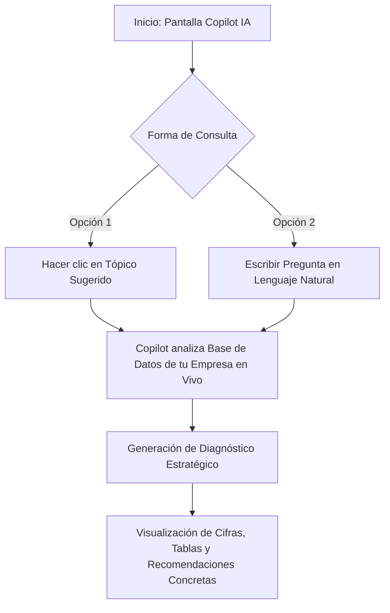

# 🤖 Manual de Uso: Copilot IA - Asistente Estratégico de Negocio

> [!info] Objetivo de la Funcionalidad
> **Analítica Copilot** es tu asesor estratégico de inteligencia artificial integrado en la plataforma. Potenciado por **Analítica IA**, analiza en tiempo real todas las transacciones de tu negocio (ventas, compras, rotación de stock, cuentas corrientes y márgenes) para responder tus dudas operativas y estratégicas en lenguaje natural, tal como si hablaras con un consultor financiero personal.

> [!abstract] Requisitos Previos y Permisos
> - **Rol de Usuario Requerido:** `Dueño` o colaborador con acceso a métricas analíticas.
> - Plan de suscripción con módulo IA activo (disponible en planes Pro y E-commerce).

---

## 🗺️ Diagrama del Flujo de Consulta con Copilot IA

---

## 📍 Flujo de Navegación

Podés acceder al asistente inteligente desde tres vías:
1. **Pantalla Principal (/ia):** En el menú lateral izquierdo, hacé clic en **"Copilot IA"** (destacado con brillo esmeralda ✨).
2. **Dashboard de Inicio:** Presioná el botón *"Preguntar a la IA →"* en el banner superior de métricas.
3. **Burbuja Flotante Arrastrable (Widget Global):** Presente en la esquina inferior de cualquier pantalla de la plataforma. Hacé clic sobre la bolita o presioná el atajo de teclado `⌘ + J` (o `Ctrl + J`) para abrir el chat emergente sin abandonar tu tarea actual.

---

## 📋 Guía Visual de Componentes y Funciones

| Elemento Visual | Tipo | Descripción | Ejemplo de Uso |
| :--- | :--- | :--- | :--- |
| **Burbuja Flotante Arrastrable** | Botón Flotante | Botón circular con brillo ✨ disponible en toda la app. En mobile se compacta a 44px y podés arrastrarlo a cualquier punto de la pantalla con el dedo para que no tape botones. | Mover la burbuja a una esquina mientras cobrás en el POS. |
| **Ventana Modal Flotante** | Chat Emergente | Ventana superpuesta de conversación rápida sin recargar la página. | Despejar una duda rápida de stock mientras cargás un pedido. |
| **Banner KPI En Vivo** | Cinta Superior | Muestra cifras consolidadas en tiempo real: Facturación mes, Margen %, Tickets promedio y Saldo por cobrar. | Validar rápidamente los datos sobre los que razona la IA. |
| **Botón "📊 Tópicos"** | Botón / Selector | Despliega una grilla con preguntas frecuentes prediseñadas organizadas por categoría de negocio. | Si no sabés qué preguntar, tocá un tópico con un solo clic. |
| **Caja de Texto (Prompt)** | Campo de Escritura | Permite formular cualquier consulta libremente (texto abierto). | *"¿Cuáles fueron los 3 productos menos vendidos del último trimestre?"* |
| **Burbujas de Respuesta** | Chat Interactivo | Mensajes de respuesta estructurados con negritas, listas y sugerencias de seguimiento. | La IA te responde con números exactos y consejos. |
| **Sugerencias Rápidas** | Chips Clickeables | Preguntas contextuales que aparecen debajo de cada respuesta para profundizar el análisis. | *"¿Cómo resuelvo la deuda del cliente X?"* |

---

## 🔄 Paso a Paso: Casos de Uso Frecuentes

### Caso 1: Detección de Quiebres de Stock Inminentes

1. Abrí **Copilot IA** desde el menú lateral.
2. Hacé clic en el tópico **"Stock y Reposición"** o escribí:
   > *"¿Qué productos corren riesgo de agotarse en los próximos 10 días según el ritmo de ventas?"*
3. **Resultado:**
   - Copilot cruzará el stock actual con el promedio de ventas diarias y te listará los productos críticos recomendándote la cantidad exacta a comprar a cada proveedor (`[[13 - Compras a Proveedores y Recepción de Mercadería]]`).

### Caso 2: Auditoría de Clientes Deudores

1. Escribí en el chat:
   > *"¿Quiénes son mis 5 clientes con mayor deuda en cuenta corriente y cuánto deben?"*
2. **Resultado:**
   - Copilot te devolverá una tabla con nombres, teléfonos y saldos adeudados, sugiriendo enviar recordatorios de pago por WhatsApp (`[[06 - Gestión de Clientes, Cuentas Corrientes y Difusiones]]`).

### Caso 3: Evaluación de Rentabilidad de Productos

1. Preguntá:
   > *"¿Cuál es mi margen de ganancia real este mes descontando compras y costos adicionales?"*
2. **Resultado:**
   - Copilot desglosará el margen bruto y neto, indicándote si algún producto tiene un margen negativo o requiere un ajuste de lista de precios (`[[11 - Catálogo de Productos, Servicios y Variantes]]`).

---

## ⚠️ Solución de Problemas y Buenas Prácticas

> [!tip] Consejos para obtener mejores respuestas
> - Sé específico con las fechas: en lugar de *"¿cómo vendo?"*, preguntá *"¿cuánto vendí este mes comparado con el mes anterior?"*.
> - Podés pedirle que agrupe por rubros, marcas o canales de venta.

> [!faq] Consultas Frecuentes sobre el Asistente

| Situación en Pantalla | Causa Probable | Solución Sugerida |
| :--- | :--- | :--- |
| **"Función bloqueada con candado"** | Tu plan actual no incluye el módulo Analítica IA. | Mejorá a un plan Pro o E-commerce desde `[[22 - Suscripción, Planes y Límites del Sistema]]`. |
| **"La respuesta tarda unos segundos"** | La IA está realizando consultas analíticas profundas sobre grandes volúmenes de ventas. | Aguardá a que finalice el indicador de escritura en tiempo real. |
| **"No tengo ventas suficientes para responder"** | El comercio es nuevo y cuenta con pocas transacciones históricas. | A medida que registres ventas y compras, las proyecciones se volverán más precisas. |

---

## 🔗 Manuales y Documentos Relacionados

- `[[00 - Índice General y Guía de Navegación]]`
- `[[03 - Dashboard de Inicio y Métricas en Tiempo Real]]`
- `[[05 - Punto de Venta (POS), Cobros y Facturación ARCA]]`
- `[[12 - Control de Inventario, Kardex y Lotes]]`
- `[[16 - Analytics Comercial, Rentabilidad y Monotributo]]`

---

🔍 <b>Ficha Técnica y Trazabilidad (Para Equipos de Soporte y QA)</b>

### 🖥️ Frontend (Interfaz de Usuario)
- **Componentes:** `apps/web/src/features/copilot/components/copilot-chat-view.tsx`, `copilot-floating-widget.tsx`, `copilot-kpi-banner.tsx`, `copilot-topics-grid.tsx`
- **Ruta de Navegación (URL):** `/ia` (o modal emergente con `⌘J` / `Ctrl+J`)
- **Hook de Chat:** `useCopilotChat()` en `apps/web/src/features/copilot/hooks/use-copilot-chat.ts`
- **Mecanismo Móvil:** Arrastre táctil mediante *Pointer Events* (`onPointerDown`, `onPointerMove`, `onPointerUp`) con detección de desplazamiento > 5px (`hasDragged`), viewport clamping y reducción a 44px (`h-11 w-11`).

### ⚙️ Backend (Servicio y API)
- **Controlador:** `CopilotIaController` en `apps/api/src/modules/copilot-ia/copilot-ia.controller.ts`
- **Servicio Principal:** `CopilotIaService` en `apps/api/src/modules/copilot-ia/copilot-ia.service.ts`
- **Endpoints:**
  - `POST /copilot-ia/chat` (Envío de mensajes con contexto transaccional en streaming/JSON).
  - `GET /copilot-ia/kpis` (Obtención de métricas en vivo para el banner).
  - `GET /copilot-ia/sugerencias` (Tópicos analíticos recomendados según el rubro).
- **Modelo de IA:** Motor interno calibrado de Analítica IA con prompts estructurados y RLS por empresa.

