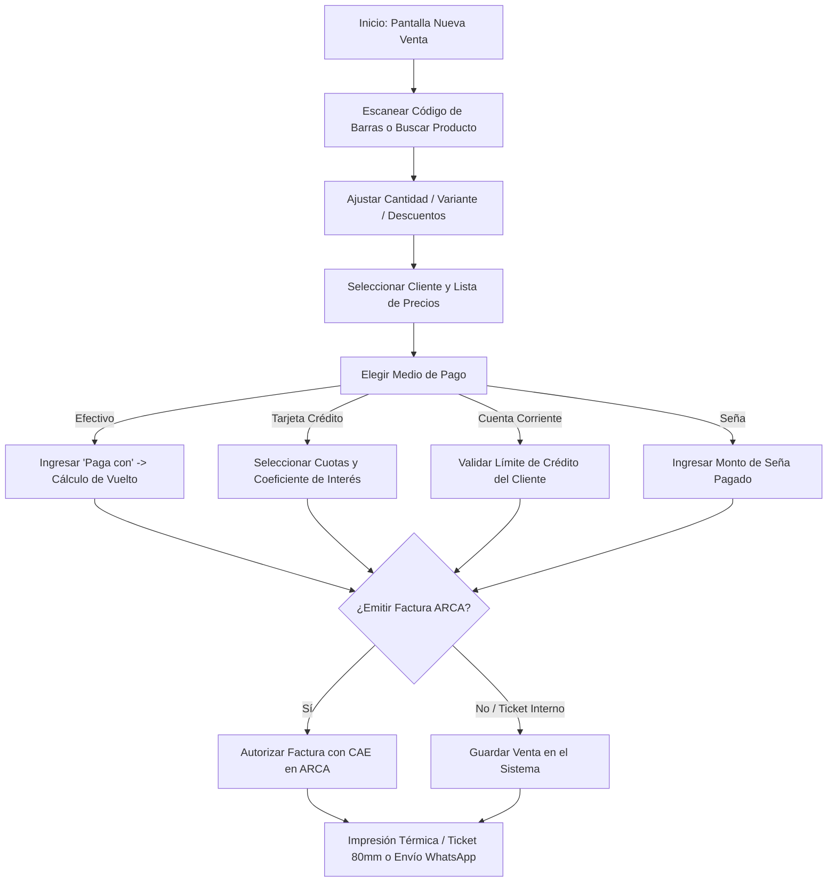

# 🛒 Manual de Uso: Punto de Venta (POS), Cobros y Facturación ARCA

> [!info] Objetivo de la Funcionalidad
> El módulo de **Ventas y Punto de Venta (POS)** te permite registrar ventas de mostrador de forma ultra rápida: agregar productos mediante lector de código de barras o buscador predictivo, aplicar listas de precios, calcular vueltos en efectivo, procesar pagos con tarjeta en cuotas, registrar señas y emitir comprobantes o **Facturas Electrónicas oficiales ante ARCA (ex-AFIP)** con obtención instantánea de CAE.

> [!abstract] Requisitos Previos y Permisos
> - **Rol de Usuario Requerido:** `Dueño` o `Colaborador` con permiso sobre el módulo `Ventas`.
> - Tener al menos un producto o servicio cargado en el catálogo (`[[11 - Catálogo de Productos, Servicios y Variantes]]`).
> - Si se desea emitir facturas electrónicas con CAE, tener cargado el certificado fiscal en `[[21 - Configuración General, Datos Fiscales y Parámetros]]`.

---

## 🗺️ Diagrama del Flujo de Venta y Cobro

---

## 📍 Flujo de Navegación

1. En el menú lateral izquierdo, sección **Ventas**, hacé clic en **"Ventas"**.
2. Presioná el botón principal **"+ Nueva Venta"** (o utilizá el atajo de teclado en pantalla).
3. La pantalla recordará en tu dispositivo la última caja/ubicación y medio de pago utilizado para agilizar las operaciones recurrentes.

---

## 📋 Guía Visual de Campos e Interacciones

### 1. Panel de Carrito de Productos

| Control / Campo | Tipo | Obligatorio | Descripción / Regla |
| :--- | :--- | :---: | :--- |
| **Buscador de Artículos** | Entrada rápida | Sí | Escribí el nombre, código interno o escaneá con lector de barra. |
| **Variante (Talle/Color)** | Selector | Condicional | Aparece si el producto cuenta con combinaciones de stock. |
| **Cantidad** | Número entero | Sí | Unidades vendidas. Descuenta automáticamente del inventario. |
| **Precio Unitario** | Moneda ($) | Sí | Toma el precio de lista seleccionado; se puede ajustar manualmente si tenés permisos. |
| **Descuento General** | Moneda ($) | No | Descuento total aplicado a la venta antes de impuestos. |

### 2. Panel de Cobro y Facturación

| Control / Campo | Tipo | Obligatorio | Descripción / Regla |
| :--- | :--- | :---: | :--- |
| **Forma de Pago** | Selector | Sí | Efectivo, Débito, Crédito, Transferencia, MercadoPago, Cuenta Corriente. |
| **Paga con** | Moneda ($) | No | Solo en Efectivo: calcula el vuelto exacto a entregar al cliente. |
| **Cuotas e Interés** | Selectores | Condicional | En Crédito: número de cuotas (ej. 1, 3, 6) e interés financiero configurado. |
| **Es Seña** | Toggle | No | Activá este botón si el cliente deja un anticipo y retira luego. |
| **Monto Seña** | Moneda ($) | Condicional | Importe recibido como adelanto. El resto queda como saldo pendiente. |
| **Cliente** | Predictivo | No | Nombre del cliente. Si no existe, se crea automáticamente al guardar la venta. |
| **Ubicación / Sucursal** | Selector | Sí | Local o depósito de donde sale físicamente la mercadería. |
| **Facturar en ARCA** | Checkbox | No | Solicita el CAE a AFIP/ARCA emitiendo Factura A, B o C legal. |

---

## 🔄 Paso a Paso: Ejecución del Caso de Uso

### Caso Principal: Venta en Mostrador con Efectivo

1. **Cargar artículos:**
   - Pasá el lector de código de barras por los productos o tipeá *"Remera"* en el buscador.
   - Hacé clic sobre el producto para sumarlo al carrito.
2. **Definir el cobro:**
   - En el panel derecho de cobro, seleccioná **Efectivo**.
   - En **"Paga con"**, ingresá el billete recibido (ej: `$20.000` para un total de `$14.500`).
   - El sistema te mostrará en verde grande: **Vuelto a entregar: $5.500**.
3. **Confirmar operación:**
   - Presioná **"Confirmar Venta"**.
   - El stock se descuenta en el acto (`[[12 - Control de Inventario, Kardex y Lotes]]`) y la transacción se suma a tus métricas de **Ventas de hoy** (`[[03 - Dashboard de Inicio y Métricas en Tiempo Real]]`).
4. **Comprobante:**
   - Hacé clic en **Imprimir Ticket** (compatible con impresoras térmicas de 58mm y 80mm) o **Enviar por WhatsApp** directo al celular del cliente.

### Caso 2: Emisión de Factura Electrónica ARCA (Factura A / B)

1. En el campo **Cliente**, seleccioná o escribí el cliente con CUIT registrado (`[[06 - Gestión de Clientes, Cuentas Corrientes y Difusiones]]`).
2. Marcá la casilla **"Emitir Factura Electrónica ARCA"**.
3. El sistema determinará automáticamente la letra del comprobante:
   - **Factura A:** Si tu comercio es Responsable Inscripto y el cliente también lo es.
   - **Factura B:** Si sos Responsable Inscripto y el cliente es Consumidor Final o Monotributista.
   - **Factura C:** Si tu comercio está adherido al Monotributo.
4. Presioná **"Autorizar en ARCA"**. En 1 a 2 segundos recibirás el **CAE**, la fecha de vencimiento y el código QR fiscal para imprimir en la factura.

### Caso 3: Devoluciones y Anulaciones de Venta

1. En el listado de ventas (`/ventas`), localizá la operación y hacé clic en **"Ver detalle"**.
2. Presioná **"Devolver artículos"** o **"Anular Venta"**.
3. Seleccioná qué ítems regresan físicamente al stock.
4. Indicá el motivo de la anulación. El sistema reintegrará el stock y generará la Nota de Crédito correspondiente si la venta había sido facturada.

---

## ⚠️ Solución de Problemas y Errores Frecuentes

> [!faq] Consultas Frecuentes en el Punto de Venta

| Error / Mensaje | Causa Probable | Solución Sugerida |
| :--- | :--- | :--- |
| **"Stock insuficiente para el producto X"** | La cantidad en carrito supera las existencias de esa sucursal. | Verificá si tenés stock en otro depósito o ajustá la existencia en `[[12 - Control de Inventario, Kardex y Lotes]]`. |
| **"Error ARCA: CUIT del cliente no activo o inválido"** | El CUIT ingresado no existe en el padrón de AFIP/ARCA o está dado de baja. | Validá el número de CUIT del cliente o emití a Consumidor Final. |
| **"El cliente supera el límite de crédito"** | Se intentó vender en Cuenta Corriente y el cliente adeuda más de lo permitido. | Cobrá parte del saldo pendiente en `[[06 - Gestión de Clientes, Cuentas Corrientes y Difusiones]]` o ampliá su límite en la ficha. |

---

## 🔗 Manuales y Documentos Relacionados

- `[[00 - Índice General y Guía de Navegación]]`
- `[[06 - Gestión de Clientes, Cuentas Corrientes y Difusiones]]`
- `[[11 - Catálogo de Productos, Servicios y Variantes]]`
- `[[12 - Control de Inventario, Kardex y Lotes]]`
- `[[21 - Configuración General, Datos Fiscales y Parámetros]]`

---

🔍 <b>Ficha Técnica y Trazabilidad (Para Equipos de Soporte y QA)</b>

### 🖥️ Frontend (Interfaz de Usuario)
- **Componentes:** `apps/web/src/features/ventas/components/NuevaVentaForm.tsx`, `CobroVenta.tsx`, `VentasListado.tsx`, `DevolucionForm.tsx`
- **Ruta de Navegación (URL):** `/ventas`, `/ventas/nueva`, `/ventas/:id`
- **Hooks:** `useConfirmarVenta()`, `useClientes()`, `useUbicaciones()`

### ⚙️ Backend (Servicio y API)
- **Controlador Principal:** `VentasController` en `apps/api/src/modules/ventas/ventas.controller.ts`
- **Controlador Fiscal:** `FacturacionController` en `apps/api/src/modules/arca/facturacion.controller.ts`
- **Endpoints:**
  - `POST /ventas` (Creación de venta con validación de stock y actualización de saldos).
  - `GET /ventas` (Listado paginado con filtros por fecha, forma de pago y cliente).
  - `POST /ventas/:id/anular` (Anulación con restitución de inventario).
  - `POST /arca/emitir` (Comunicación SOAP/REST con servidores de ARCA para obtención de CAE).
- **DTOs:** `ConfirmarVentaInput`, `AnularVentaInput`, `EmitirComprobanteArcaDto`
- **Códigos HTTP:**
  - `201 Created`: Venta registrada con éxito.
  - `400 Bad Request`: Error en DTO o falta de stock.
  - `422 Unprocessable Entity`: Rechazo de validación impositiva por parte de ARCA.

