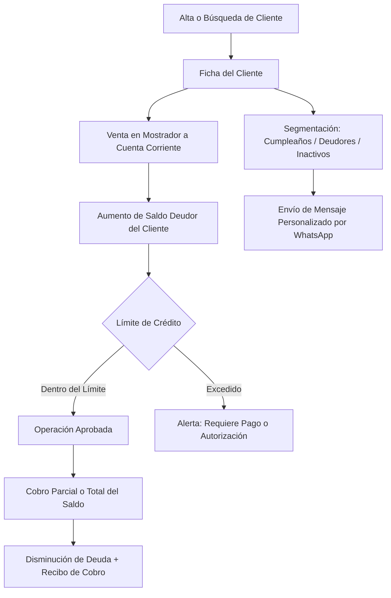

# 👥 Manual de Uso: Gestión de Clientes, Cuentas Corrientes y Difusiones

> [!info] Objetivo de la Funcionalidad
> Este módulo centraliza la libreta de contactos de tu empresa, el historial de operaciones de cada comprador, el seguimiento de **Cuentas Corrientes y cobro de saldos adeudados**, y herramientas de fidelización para enviar campañas de WhatsApp masivas o saludos de cumpleaños.

> [!abstract] Requisitos Previos y Permisos
> - **Rol de Usuario Requerido:** `Dueño` o `Colaborador` con permiso asignado sobre `Clientes`.
> - Para habilitar ventas a crédito o límites de deuda, contar con plan Básico, Pro o E-commerce.

---

## 🗺️ Diagrama del Ciclo de Vida del Cliente y Cuenta Corriente

---

## 📍 Flujo de Navegación

1. En el menú lateral izquierdo, sección **Ventas**, hacé clic en **"Clientes"**.
2. Verás la lista completa con buscador rápido por nombre, DNI/CUIT o número de teléfono.
3. Para registrar un cliente manualmente, presioná el botón **"+ Nuevo Cliente"**.

---

## 📋 Guía Visual de Campos e Interacciones

### 1. Ficha y Datos del Cliente

| Campo / Control | Tipo | Obligatorio | Descripción / Formato Esperado | Reglas y Validaciones |
| :--- | :--- | :---: | :--- | :--- |
| **Nombre Completo** | Texto | Sí | Razón social o nombre y apellido del cliente. | Mínimo 2 caracteres. |
| **Teléfono / Celular** | Teléfono | No | Número con código de área para envíos directos de WhatsApp. | Ej: `+5492611234567`. |
| **Email** | Correo | No | Casilla para envío digital de presupuestos y facturas. | Formato válido de email. |
| **CUIT / DNI** | Numérico | No | Clave fiscal para facturación ARCA (Facturas A y B). | 11 dígitos para CUIT, 7-8 para DNI. |
| **Condición Fiscal** | Selector | Sí | Consumidor Final, Monotributo, Responsable Inscripto, Exento. | Determina el tipo de comprobante legal. |
| **Lista de Precios** | Selector | No | Asigna una lista automática (Minorista, Mayorista, Gremio). | Ver `[[11 - Catálogo de Productos, Servicios y Variantes]]`. |
| **Límite de Crédito** | Moneda ($) | No | Saldo máximo permitido en cuenta corriente. | Si está en $0, solo compra de contado. |
| **Fecha de Cumpleaños**| Fecha | No | Día y mes para campañas automáticas de fidelización. | Permite filtrar cumpleañeros del mes. |

---

## 🔄 Paso a Paso: Ejecución de Casos de Uso

### Caso 1: Registrar un Pago a Cuenta Corriente (Cobro de Saldo)

1. En **Clientes**, buscá al cliente por su nombre o filtrá por *"Solo deudores"*.
2. Hacé clic sobre el cliente para abrir su **Ficha de Cuenta Corriente**.
3. Verás el saldo adeudado total destacado en rojo.
4. Presioná el botón **"Registrar Cobro"**:
   - Ingresá el monto abonado (puede ser un pago total o parcial).
   - Elegí la forma de pago recibida (Efectivo, Transferencia bancaria o Mercado Pago).
   - Indicá una nota u observación si corresponde (ej. *"Pago transferencia comprobante N° 8492"*).
5. Hacé clic en **"Confirmar Cobro"**:
   - El saldo adeudado se reducirá inmediatamente.
   - El sistema generará el comprobante de recibo para enviar por WhatsApp o imprimir.

### Caso 2: Campaña de WhatsApp a Segmentos de Clientes

1. En la parte superior de la pantalla de Clientes, hacé clic en la pestaña **"Difusiones y Segmentos"**.
2. Elegí el segmento objetivo:
   - 🎂 **Cumpleañeros del mes:** Clientes que celebran este mes para enviarles un cupón de regalo.
   - ⚠️ **Clientes con deuda vencida:** Para recordar deudas pendientes con cordialidad.
   - 💤 **Clientes inactivos:** Que hace más de 45 días no compran en tu negocio.
3. El sistema preparará la lista filtrada con un botón verde de **WhatsApp** junto a cada contacto:
   - Al presionarlo, se abrirá WhatsApp Web o la App con un mensaje prediseñado que incluye el nombre del cliente y el detalle correspondiente listo para enviar en un clic.

---

## ⚠️ Solución de Problemas y Errores Frecuentes

> [!faq] Consultas Frecuentes sobre Clientes

| Error / Duda | Causa Probable | Solución Sugerida |
| :--- | :--- | :--- |
| **"El cliente no aparece en el buscador de ventas"** | El nombre se ingresó con faltas ortográficas o espacios de más. | Escribí las primeras 3 letras o buscalo por su número de teléfono. |
| **"No se puede vender a crédito a este cliente"** | Su límite de crédito está en $0 o su saldo actual superó el tope fijado. | Editá su ficha para autorizar un límite mayor o registrá un cobro a cuenta. |
| **"Error al abrir WhatsApp Web"** | El número de teléfono no incluye el código de país o tiene guiones/espacios. | Asegurate de que el teléfono tenga el formato estándar (ej: `549...`). |

---

## 🔗 Manuales y Documentos Relacionados

- `[[00 - Índice General y Guía de Navegación]]`
- `[[05 - Punto de Venta (POS), Cobros y Facturación ARCA]]`
- `[[07 - Gestión de Pedidos, Picking y Despachos]]`
- `[[20 - Tienda Online y Storefront Multi-Negocio]]`

---

🔍 <b>Ficha Técnica y Trazabilidad (Para Equipos de Soporte y QA)</b>

### 🖥️ Frontend (Interfaz de Usuario)
- **Componentes:** `apps/web/src/features/clientes/components/ClientesListado.tsx`, `ClienteForm.tsx`, `CuentaCliente.tsx`, `SegmentosDifusion.tsx`
- **Ruta de Navegación (URL):** `/clientes`, `/clientes/:id`, `/clientes/difusiones`

### ⚙️ Backend (Servicio y API)
- **Controlador Clientes:** `ClientesController` en `apps/api/src/modules/clientes/clientes.controller.ts`
- **Controlador Cuenta Corriente:** `CuentaCorrienteController` en `apps/api/src/modules/cuenta-corriente/cuenta-corriente.controller.ts`
- **Controlador Difusiones:** `DifusionesController` en `apps/api/src/modules/clientes/difusiones.controller.ts`
- **Endpoints:**
  - `GET /clientes` (Listado y filtros de búsqueda).
  - `POST /clientes` (Creación de cliente y parámetros fiscales).
  - `GET /cuenta-corriente/:clienteId` (Historial de movimientos y saldo consolidado).
  - `POST /cuenta-corriente/cobro` (Registro de cobranza y cancelación de deuda).
- **DTOs:** `CrearClienteDto`, `CobroCuentaCorrienteDto`

