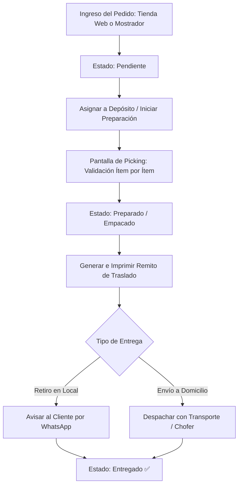

# 📦 Manual de Uso: Gestión de Pedidos, Picking y Despachos

> [!info] Objetivo de la Funcionalidad
> El módulo de **Pedidos** coordina las ventas que requieren preparación previa, armado de paquetes o envío a domicilio (ya sean pedidos tomados por vendedores, compras provenientes de la `[[20 - Tienda Online y Storefront Multi-Negocio]]` o pedidos mayoristas). Incluye una pantalla táctil de **Picking** para el depósito y la emisión de **Remitos de Entrega**.

> [!abstract] Requisitos Previos y Permisos
> - **Rol de Usuario Requerido:** `Dueño` o `Colaborador` con permiso asignado sobre `Pedidos`.
> - Negocio con actividades de productos físicos o elaboración (`productos` o `produccion`).
> - Función disponible en planes Pro y E-commerce.

---

## 🗺️ Diagrama del Ciclo de Vida de un Pedido

---

## 📍 Flujo de Navegación

1. En el menú lateral izquierdo, sección **Ventas**, hacé clic en **"Pedidos"**.
2. Verás las tarjetas o columnas de pedidos clasificadas por estado: **Pendientes**, **En preparación**, **Listos** y **Entregados**.
3. Para crear un pedido manualmente, presioná **"+ Nuevo Pedido"**.

---

## 📋 Guía Visual de Campos e Interacciones

| Campo / Control | Tipo | Obligatorio | Descripción / Regla de Uso |
| :--- | :--- | :---: | :--- |
| **Cliente y Contacto** | Predictivo | Sí | Nombre del comprador y teléfono para coordinar la entrega. |
| **Dirección de Envío** | Texto | Condicional | Calle, número, piso y localidad (si es con entrega a domicilio). |
| **Método de Envío** | Selector | Sí | `Retiro en tienda`, `Cadete propio`, o `Transporte / Encomienda`. |
| **Lista de Artículos** | Carrito | Sí | Productos seleccionados con cantidades, variantes y notas especiales. |
| **Estado del Pago** | Badge | Automático | `Pagado`, `Señado` o `Pago contra entrega`. |
| **Botón "Iniciar Picking"**| Acción | N/A | Abre la interfaz de chequeo físico para el personal de depósito. |
| **Botón "Imprimir Remito"**| Acción | N/A | Genera el comprobante de entrega en formato A4 o ticket. |

---

## 🔄 Paso a Paso: Ejecución de Casos de Uso

### Caso 1: Preparación de Pedido con Chequeo de Picking

1. En el tablero de **Pedidos**, seleccioná un pedido en estado **"Pendiente"**.
2. Hacé clic en **"Iniciar Picking"**:
   - Se abrirá la pantalla de armado de pedidos pensada para celulares o tablets en depósito.
   - Cada artículo muestra su foto, ubicación en góndola/estante y cantidad solicitada.
3. A medida que tomás cada producto físico de la estantería, hacé clic en el casillero o escaneá su código de barras.
4. Cuando todos los casilleros estén en verde, presioná **"Finalizar Preparación"**:
   - El estado del pedido cambiará automáticamente a **"Listo para despachar"**.
   - El stock queda reservado y descontado definitivamente del depósito (`[[12 - Control de Inventario, Kardex y Lotes]]`).

### Caso 2: Emisión del Remito de Entrega

1. Con el pedido listo, hacé clic en el botón **"Remito"**.
2. Podés elegir entre:
   - **Remito Valorizado:** Muestra precios e importes para cobrar en destino.
   - **Remito Sin Valorizar:** Solo lista cantidades y bultos, ideal para choferes o transportes externos.
3. Imprimí el remito o adjuntalo en PDF al despachar el paquete.

### Caso 3: Confirmación de Entrega

1. Cuando el cliente retira su paquete en el local o el cadete confirma la entrega:
   - Ingresá al pedido y presioná **"Marcar como Entregado"**.
   - Si había saldo pendiente (pago contra entrega), el sistema te pedirá ingresar el medio de pago recibido y registrará el cobro en el acto.

---

## ⚠️ Solución de Problemas y Errores Frecuentes

> [!faq] Consultas Frecuentes sobre Logística de Pedidos

| Situación en Pantalla | Causa Probable | Solución Sugerida |
| :--- | :--- | :--- |
| **"No permite finalizar picking: faltan unidades"** | No se encontraron físicamente en el depósito todos los artículos pedidos. | Podés hacer una entrega parcial o comunicarte con el cliente para ofrecer un reemplazo. |
| **"Pedido cancelado: ¿qué pasa con el stock?"** | Si se anula un pedido antes de entregarse. | El sistema reincorpora automáticamente las cantidades al inventario disponible. |

---

## 🔗 Manuales y Documentos Relacionados

- `[[00 - Índice General y Guía de Navegación]]`
- `[[05 - Punto de Venta (POS), Cobros y Facturación ARCA]]`
- `[[06 - Gestión de Clientes, Cuentas Corrientes y Difusiones]]`
- `[[12 - Control de Inventario, Kardex y Lotes]]`
- `[[20 - Tienda Online y Storefront Multi-Negocio]]`

---

🔍 <b>Ficha Técnica y Trazabilidad (Para Equipos de Soporte y QA)</b>

### 🖥️ Frontend (Interfaz de Usuario)
- **Componentes:** `apps/web/src/features/pedidos/components/PedidosListado.tsx`, `PickingPedido.tsx`, `RemitoPedido.tsx`, `SeguimientoPedido.tsx`
- **Ruta de Navegación (URL):** `/pedidos`, `/pedidos/:id`, `/pedidos/:id/picking`

### ⚙️ Backend (Servicio y API)
- **Controlador Pedidos:** `PedidosController` en `apps/api/src/modules/pedidos/pedidos.controller.ts`
- **Controlador Envíos:** `EnviosController` en `apps/api/src/modules/envios/envios.controller.ts`
- **Endpoints:**
  - `GET /pedidos` (Listado y filtros de estado).
  - `POST /pedidos` (Creación de pedido y reserva de unidades).
  - `PUT /pedidos/:id/estado` (Transición de estados: pendiente, picking, despachado, entregado).
  - `GET /pedidos/:id/remito` (Generación de PDF de remito oficial).
- **DTOs:** `CrearPedidoDto`, `CambiarEstadoPedidoDto`

