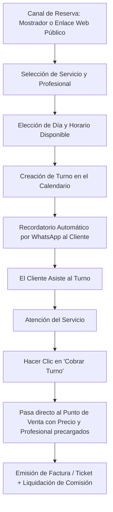

# 📅 Manual de Uso: Agenda de Turnos y Reservas Online

> [!info] Objetivo de la Funcionalidad
> Diseñada para empresas de servicios (estéticas, peluquerías, spas, consultorios, talleres y centros de estética), la **Agenda de Turnos** organiza citas por profesional o puesto de trabajo, envía recordatorios por WhatsApp y ofrece un enlace público para que tus clientes reserven por internet sin tener que llamar por teléfono.

> [!abstract] Requisitos Previos y Permisos
> - **Actividad del Negocio:** Tener tildada la actividad `servicios` en `[[21 - Configuración General, Datos Fiscales y Parámetros]]`.
> - **Plan Requerido:** Disponible en planes Pro y E-commerce (función `agenda`).

---

## 🗺️ Diagrama del Flujo de Agendamiento y Atención

---

## 📍 Flujo de Navegación

1. En el menú lateral izquierdo, sección **Ventas**, hacé clic en **"Agenda"**.
2. Si tenés nuevas reservas realizadas por clientes desde la web, verás un **badge numérico** rojo alertando sobre turnos pendientes de revisión.
3. Podés alternar entre vista **Semanal** (panorama general de la semana) y vista **Diaria** (desglose por columnas para cada profesional).

---

## 📋 Guía Visual de Campos e Interacciones

### 1. Creación / Edición de Turno

| Campo / Control | Tipo | Obligatorio | Descripción / Regla |
| :--- | :--- | :---: | :--- |
| **Cliente** | Predictivo | Sí | Nombre del cliente; si es nuevo se registra automáticamente con su celular. |
| **Servicio** | Selector | Sí | Servicio a realizar (ej: *"Corte de cabello"*, *"Tratamiento facial"*). |
| **Profesional / Recurso** | Selector | Sí | Especialista o cabina asignada para la atención. |
| **Fecha y Horario** | Selector | Sí | Día y hora de inicio. La duración se calcula según el servicio. |
| **Estado del Turno** | Selector | Sí | `Confirmado`, `En espera`, `Atendido`, `Cancelado`. |
| **Notas / Observaciones** | Texto | No | Indicaciones especiales (ej: *"Alergia a tinturas"*, *"Llega 10 min tarde"*). |
| **Botón "Cobrar"** | Acción rápida | N/A | Envía el turno al POS para cobrarlo en un solo clic. |

---

## 🔄 Paso a Paso: Ejecución de Casos de Uso

### Caso 1: Dar de Alta un Turno en Mostrador o por Teléfono

1. En la pantalla de **Agenda**, hacé clic en el casillero horario libre del profesional deseado (o presioná **"+ Nuevo Turno"**).
2. Buscá o escribí el nombre del cliente y su número de WhatsApp.
3. Seleccioná el servicio a realizar:
   - El sistema completará automáticamente el tiempo estimado (ej: 45 minutos) y bloqueará el intervalo en el calendario.
4. Presioná **"Guardar Turno"**:
   - Aparecerá una tarjeta de color con el nombre del cliente y el servicio en la grilla horaria.
   - Podés hacer clic en el ícono de WhatsApp para enviarle la confirmación al instante.

### Caso 2: Atender y Cobrar un Turno

1. Cuando el cliente finaliza la atención:
   - Hacé clic sobre su tarjeta de turno en la agenda.
   - En el panel lateral, presioná el botón verde **"Cobrar Turno"**.
2. **Integración automática:**
   - Se abrirá la pantalla de **Nueva Venta** (`[[05 - Punto de Venta (POS), Cobros y Facturación ARCA]]`) con el servicio y el cliente ya cargados, asignando además al profesional para el cálculo de su comisión (`[[18 - Comisiones y Liquidaciones al Personal]]`).
3. Seleccioná el medio de pago recibido y confirmá.
4. El turno cambiará a estado **"Atendido"** automáticamente.

### Caso 3: Compartir tu Enlace de Reservas Online

1. En **Agenda**, hacé clic en el botón superior **"Configurar Reservas Online"**.
2. Copiá tu enlace público (ej: `https://tucomercio.analitica360.com/reservas`).
3. Pegalo en tu biografía de Instagram o envialo por WhatsApp:
   - Tus clientes verán los servicios disponibles, elegirán el profesional y reservarán en los horarios en que tu local esté abierto, evitando solapamientos.

---

## ⚠️ Solución de Problemas y Errores Frecuentes

> [!faq] Consultas Frecuentes de la Agenda

| Error / Duda | Causa Probable | Solución Sugerida |
| :--- | :--- | :--- |
| **"Horario no disponible / Solapamiento"** | El profesional ya tiene un turno reservado en ese mismo rango horario. | Elegí otro horario o asigná el turno a otro profesional disponible. |
| **"No aparece el botón de Agenda en el menú"** | Tu negocio no tiene activada la actividad de `Servicios` o tu plan no incluye Agenda. | Verificá tus rubros en `[[21 - Configuración General, Datos Fiscales y Parámetros]]` y tu plan en `[[22 - Suscripción, Planes y Límites del Sistema]]`. |

---

## 🔗 Manuales y Documentos Relacionados

- `[[00 - Índice General y Guía de Navegación]]`
- `[[05 - Punto de Venta (POS), Cobros y Facturación ARCA]]`
- `[[06 - Gestión de Clientes, Cuentas Corrientes y Difusiones]]`
- `[[09 - Abonos Periódicos y Membresías Recurrentes]]`
- `[[18 - Comisiones y Liquidaciones al Personal]]`

---

🔍 <b>Ficha Técnica y Trazabilidad (Para Equipos de Soporte y QA)</b>

### 🖥️ Frontend (Interfaz de Usuario)
- **Componentes:** `apps/web/src/features/agenda/Agenda.tsx`, `TurnoForm.tsx`, `TurnoPanel.tsx`, `AgendaConfig.tsx`
- **Ruta de Navegación (URL):** `/agenda`, `/agenda/config`
- **Hook:** `useAgenda()`, `useTurno()`, `useRecursos()`

### ⚙️ Backend (Servicio y API)
- **Controlador:** `AgendaController` en `apps/api/src/modules/agenda/agenda.controller.ts`
- **Endpoints:**
  - `GET /agenda/turnos` (Turnos por rango de fechas y filtros por profesional).
  - `POST /agenda/turnos` (Creación de turno con validación anti-solapamiento).
  - `PUT /agenda/turnos/:id/estado` (Cambio de estado: atendido, cancelado).
  - `GET /agenda/online/nuevas` (Consulta de reservas web no leídas para el badge).
- **DTOs:** `CrearTurnoDto`, `ConfiguracionAgendaDto`

