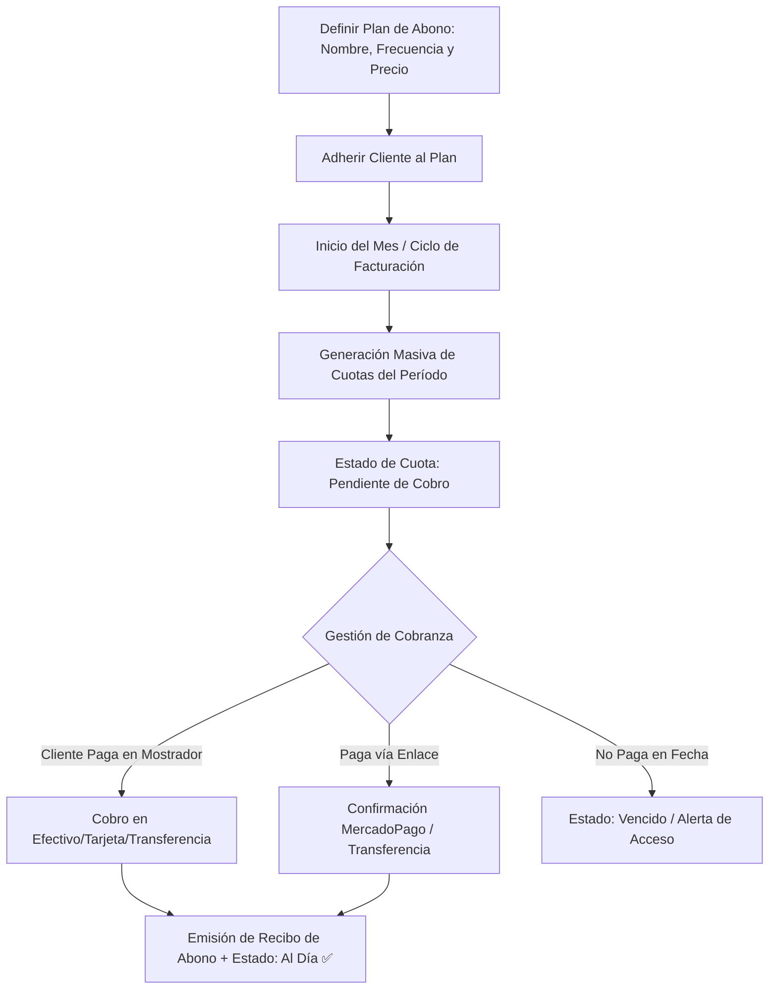

# 🔁 Manual de Uso: Abonos Periódicos y Membresías Recurrentes

> [!info] Objetivo de la Funcionalidad
> Si tu negocio ofrece servicios con cobro mensual o periódico (gimnasios, academias de baile, clubes, servicios de mantenimiento técnico, software o abonos de estética), el módulo de **Abonos** automatiza la generación de cuotas, el control de socios al día y la cobranza recurrente.

> [!abstract] Requisitos Previos y Permisos
> - **Actividad del Negocio:** Actividad `servicios` habilitada en `[[21 - Configuración General, Datos Fiscales y Parámetros]]`.
> - **Plan Requerido:** Disponible en planes Pro y E-commerce (función `abonos`).
> - Tener al menos un plan de abono definido y clientes registrados en `[[06 - Gestión de Clientes, Cuentas Corrientes y Difusiones]]`.

---

## 🗺️ Diagrama del Ciclo de Cuotas y Membresías

---

## 📍 Flujo de Navegación

1. En el menú lateral izquierdo, sección **Ventas**, hacé clic en **"Abonos"**.
2. Verás dos pestañas principales:
   - **Abonados y Cuotas:** Estado de cada cliente (Al día, Por vencer, Vencido).
   - **Planes de Abono:** Configuración de los tipos de suscripción ofrecidos.

---

## 📋 Guía Visual de Campos e Interacciones

### 1. Configuración de un Plan de Abono

| Campo / Control | Tipo | Obligatorio | Descripción / Regla |
| :--- | :--- | :---: | :--- |
| **Nombre del Plan** | Texto | Sí | Ej: *"Pase Libre Gimnasio"*, *"Mantenimiento Preventivo Mensual"*. |
| **Importe de Cuota** | Moneda ($) | Sí | Precio fijado por período para este tipo de membresía. |
| **Frecuencia** | Selector | Sí | `Mensual`, `Bimestral`, `Semestral`, `Anual`. |
| **Día de Vencimiento** | Número (1-31) | Sí | Día del mes en que vence el pago de la cuota (ej: día 10). |
| **Sesiones / Clases** | Número | No | Límite de accesos por período (dejar vacío si es ilimitado). |

---

## 🔄 Paso a Paso: Ejecución de Casos de Uso

### Caso 1: Crear un Plan y Adherir un Cliente

1. En la pestaña **"Planes de Abono"**, presioná **"+ Nuevo Plan"**.
2. Completá el nombre (ej. *"Abono Mensual Yoga 3x por semana"*), el importe (ej. `$25.000`) y el vencimiento (ej. día 10 de cada mes). Guardá el plan.
3. Ahora dirijase a la pestaña **"Abonados"** y presioná **"+ Suscribir Cliente"**:
   - Seleccioná al cliente desde el buscador (`[[06 - Gestión de Clientes, Cuentas Corrientes y Difusiones]]`).
   - Elegí el plan creado.
   - Indicá la fecha de inicio del servicio.
4. El cliente quedará activo en el padrón de abonados.

### Caso 2: Emisión Masiva de Cuotas al Comenzar el Mes

1. Al inicio de cada mes, ingresá a **Abonos**.
2. Presioná el botón superior **"Generar Cuotas del Mes"**:
   - El sistema generará automáticamente la cuota correspondiente a todos los clientes suscritos activos.
   - Podés revisar en segundos cuántos socios están pendientes y el monto total proyectado a recaudar en el mes.

### Caso 3: Cobrar la Cuota de un Abonado

1. En la lista de abonados, buscá al cliente.
2. Junto a su cuota en estado *"Pendiente"*, presioná el botón verde **"Cobrar"**:
   - Se abrirá la ventana de cobro rápido.
   - Seleccioná la forma de pago (Efectivo, Débito, Transferencia bancaria, etc.).
   - Podés marcar si deseás emitir Factura Electrónica ARCA (`[[05 - Punto de Venta (POS), Cobros y Facturación ARCA]]`).
3. Al confirmar, la cuota pasará a estado **"Pagada"**, el cliente quedará registrado como **"Al Día"** y se enviará el recibo por WhatsApp.

---

## ⚠️ Solución de Problemas y Errores Frecuentes

> [!faq] Consultas Frecuentes de Abonos

| Situación en Pantalla | Causa Probable | Solución Sugerida |
| :--- | :--- | :--- |
| **"El cliente figura como Vencido"** | Pasó la fecha límite del mes sin registrar el cobro de la cuota. | Registrá el pago pendiente o pausá temporalmente su membresía si solicitó licencia. |
| **"Aumento de precio de abono: ¿cómo actualizar a todos?"** | El precio del abono subió para el nuevo mes. | Editá el plan en *"Planes de Abono"*; las nuevas cuotas que generes saldrán con el nuevo importe actualizado. |

---

## 🔗 Manuales y Documentos Relacionados

- `[[00 - Índice General y Guía de Navegación]]`
- `[[05 - Punto de Venta (POS), Cobros y Facturación ARCA]]`
- `[[06 - Gestión de Clientes, Cuentas Corrientes y Difusiones]]`
- `[[08 - Agenda de Turnos y Reservas Online]]`

---

🔍 <b>Ficha Técnica y Trazabilidad (Para Equipos de Soporte y QA)</b>

### 🖥️ Frontend (Interfaz de Usuario)
- **Componentes:** `apps/web/src/features/abonos/AbonosListado.tsx`, `AbonoFicha.tsx`, `PlanesAbono.tsx`
- **Ruta de Navegación (URL):** `/abonos`, `/abonos/planes`, `/abonos/:id`
- **Hook:** `useAbonos()` en `apps/web/src/features/abonos/use-abonos.ts`

### ⚙️ Backend (Servicio y API)
- **Controlador:** `AbonosController` en `apps/api/src/modules/abonos/abonos.controller.ts`
- **Endpoints:**
  - `GET /abonos` (Listado consolidado de suscripciones y cuotas).
  - `POST /abonos/planes` (Alta y edición de planes de abono).
  - `POST /abonos/suscribir` (Asociación de cliente a plan).
  - `POST /abonos/generar-cuotas` (Generación por lote para el período activo).
  - `POST /abonos/cuotas/:id/cobrar` (Registro del pago y conciliación).
- **DTOs:** `CrearPlanAbonoDto`, `SuscribirClienteDto`, `CobrarCuotaAbonoDto`

