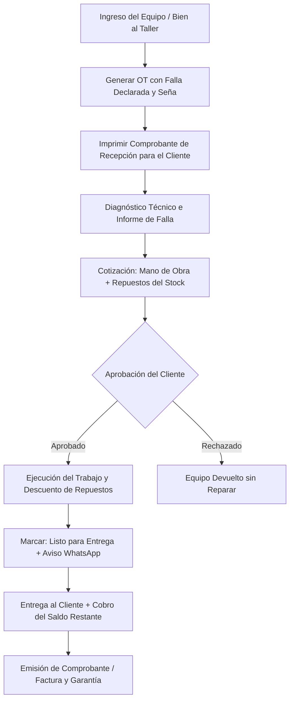

# 🔧 Manual de Uso: Órdenes de Trabajo y Servicio Técnico

> [!info] Objetivo de la Funcionalidad
> Diseñado para talleres mecánicos, servicios técnicos de computación y celulares, laboratorios, cerrajerías y servicios de postventa, el módulo de **Órdenes de Trabajo (OT)** gestiona el ciclo integral de reparaciones: desde la recepción del bien con remito de ingreso, diagnóstico de fallas, cotización de repuestos y mano de obra, hasta la entrega final con cobro y garantía.

> [!abstract] Requisitos Previos y Permisos
> - **Actividad del Negocio:** Tener habilitada la actividad de `servicios` en `[[21 - Configuración General, Datos Fiscales y Parámetros]]`.
> - **Plan Requerido:** Disponible en planes Pro y E-commerce (función `ordenes_trabajo`).

---

## 🗺️ Diagrama del Flujo de una Orden de Trabajo

---

## 📍 Flujo de Navegación

1. En el menú lateral izquierdo, sección **Ventas**, hacé clic en **"Órdenes de trabajo"**.
2. Verás el tablero de órdenes agrupadas por estado o en lista tabular.
3. Para recibir un nuevo trabajo, presioná el botón **"+ Nueva Orden de Trabajo"**.

---

## 📋 Guía Visual de Campos e Interacciones

### 1. Formulario de Ingreso de la Orden

| Campo / Control | Tipo | Obligatorio | Descripción / Regla |
| :--- | :--- | :---: | :--- |
| **Cliente** | Predictivo | Sí | Nombre y celular del cliente para notificarle el avance. |
| **Equipo / Bien** | Texto | Sí | Descripción (ej: *"Notebook Dell Inspiron 15"*, *"Bicicleta Venzo R29"*). |
| **N° de Serie / Patente** | Texto | No | Identificador único del objeto para trazabilidad de garantía. |
| **Falla Reportada** | Texto libre | Sí | Descripción exacta de lo que informa el cliente (ej: *"No enciende tras corte de luz"*). |
| **Accesorios Dejados** | Texto libre | No | Cosas que quedan en el taller (ej: *"Cargador original, funda azul"*). |
| **Seña / Anticipo** | Moneda ($) | No | Importe cobrado al ingresar para solventar costos iniciales o diagnóstico. |
| **Técnico Asignado** | Selector | No | Colaborador responsable de la reparación. |

---

## 🔄 Paso a Paso: Ejecución de Casos de Uso

### Caso 1: Recepción de un Equipo y Emisión de Ticket de Ingreso

1. En **Órdenes de trabajo**, presioná **"+ Nueva Orden de Trabajo"**.
2. Seleccioná el cliente (`[[06 - Gestión de Clientes, Cuentas Corrientes y Difusiones]]`).
3. Indicá el bien a reparar, serie y los accesorios dejados.
4. Escribí detalladamente la falla informada. Si cobrás un valor mínimo de revisión, completá el campo **Seña**.
5. Presioná **"Crear Orden de Trabajo"**:
   - Se creará la orden con numeración correlativa (ej. `OT-00142`).
   - Podés imprimir el comprobante térmico o en hoja A4 con los términos de resguardo para que el cliente firme su conformidad.

### Caso 2: Carga de Repuestos y Mano de Obra

1. Cuando el técnico desarma el equipo y detecta la falla:
   - Abrí la orden de trabajo y hacé clic en **"Editar Presupuesto / Materiales"**.
   - Agregá los **Repuestos** utilizados desde tu inventario (`[[11 - Catálogo de Productos, Servicios y Variantes]]`) (ej. *"Batería original 4500mAh"*).
   - Agregá el ítem de **Mano de Obra**.
2. Presioná **"Enviar Cotización por WhatsApp"**:
   - El cliente recibirá un mensaje formal con el detalle de lo que costará la reparación para dar el visto bueno.

### Caso 3: Entrega y Cobro Final

1. Una vez reparado el bien, cambiá el estado a **"Listo para entregar"**.
2. Cuando el cliente se presenta a retirar:
   - Presioná el botón **"Entregar Orden"**.
   - El sistema calculará el saldo restante (Total presupuestado menos la seña previa).
   - Seleccioná la forma de pago (Efectivo, Tarjeta, Mercado Pago) y emití la factura si el cliente lo requiere (`[[05 - Punto de Venta (POS), Cobros y Facturación ARCA]]`).
3. El estado de la orden pasará a **"Entregada"**, cerrando el ciclo operativo.

---

## ⚠️ Solución de Problemas y Errores Frecuentes

> [!faq] Consultas Frecuentes sobre Servicio Técnico

| Situación en Pantalla | Causa Probable | Solución Sugerida |
| :--- | :--- | :--- |
| **"El repuesto no tiene stock suficiente"** | El inventario de ese repuesto está en cero. | Podés ingresar una compra rápida en `[[13 - Compras a Proveedores y Recepción de Mercadería]]` o forzar el ajuste si tenés permisos de administrador. |
| **"El cliente perdió el ticket de ingreso"** | Busca la orden por el nombre, teléfono del cliente o número de serie del equipo. | Podés validar su identidad y entregar la orden dejando asentada la firma en el sistema. |

---

## 🔗 Manuales y Documentos Relacionados

- `[[00 - Índice General y Guía de Navegación]]`
- `[[05 - Punto de Venta (POS), Cobros y Facturación ARCA]]`
- `[[06 - Gestión de Clientes, Cuentas Corrientes y Difusiones]]`
- `[[11 - Catálogo de Productos, Servicios y Variantes]]`
- `[[12 - Control de Inventario, Kardex y Lotes]]`

---

🔍 <b>Ficha Técnica y Trazabilidad (Para Equipos de Soporte y QA)</b>

### 🖥️ Frontend (Interfaz de Usuario)
- **Componentes:** `apps/web/src/features/ordenes-trabajo/OrdenesTrabajoListado.tsx`, `OrdenTrabajoForm.tsx`, `OrdenTrabajoFicha.tsx`, `EntregaOrden.tsx`
- **Ruta de Navegación (URL):** `/ordenes-trabajo`, `/ordenes-trabajo/nueva`, `/ordenes-trabajo/:id`
- **Hook:** `useOrdenesTrabajo()` en `apps/web/src/features/ordenes-trabajo/use-ordenes-trabajo.ts`

### ⚙️ Backend (Servicio y API)
- **Controlador:** `OrdenesTrabajoController` en `apps/api/src/modules/ordenes-trabajo/ordenes-trabajo.controller.ts`
- **Endpoints:**
  - `GET /ordenes-trabajo` (Listado y filtros por estado y técnico).
  - `POST /ordenes-trabajo` (Alta de nueva orden y generación de número correlativo).
  - `PUT /ordenes-trabajo/:id/estado` (Transición: en_diagnostico, presupuestada, aprobada, entregada).
  - `POST /ordenes-trabajo/:id/entregar` (Pase a cobranza y egreso final del equipo).
- **DTOs:** `CrearOrdenTrabajoDto`, `ActualizarEstadoOtDto`

