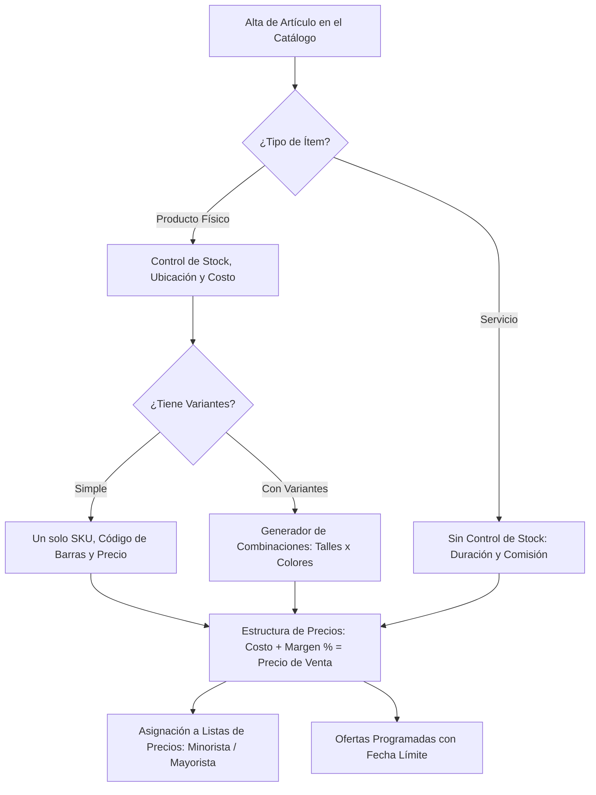

# 🏷️ Manual de Uso: Catálogo de Productos, Servicios y Variantes

> [!info] Objetivo de la Funcionalidad
> El **Catálogo** es el corazón de tu oferta comercial. Te permite administrar todo lo que vendés: artículos físicos con control de stock, servicios intangibles, variantes de talle/color, galerías fotográficas, listas de precios diferenciadas (minorista, mayorista), ofertas por fecha y actualización masiva de precios para hacer frente a la inflación en segundos.

> [!abstract] Requisitos Previos y Permisos
> - **Rol de Usuario Requerido:** `Dueño` o `Colaborador` con permiso asignado sobre `Productos`.

---

## 🗺️ Estructura del Catálogo y Matriz de Precios

---

## 📍 Flujo de Navegación

1. En el menú lateral izquierdo, sección **Stock y compras** (o **Catálogo** si tu negocio solo brinda servicios), hacé clic en **"Productos"**.
2. Verás el listado con buscador por nombre, código de barras o categoría.
3. Para dar de alta un producto individual, presioná **"+ Nuevo Producto"**.
4. En el menú superior encontrarás las herramientas de **"Aumento Masivo de Precios"** e **"Importar desde Excel"**.

---

## 📋 Guía Visual de Campos e Interacciones

### 1. Ficha Principal del Producto

| Campo / Control | Tipo | Obligatorio | Descripción / Regla de Negocio |
| :--- | :--- | :---: | :--- |
| **Nombre del Producto** | Texto | Sí | Denominación comercial clara (ej: *"Remera Oversize Algodón 24/1"*). |
| **Tipo de Ítem** | Selector | Sí | `Producto` (descuenta inventario) o `Servicio` (mano de obra/atención). |
| **Código de Barras / SKU** | Texto | No | Código EAN-13 o identificador interno. Si lo dejás vacío, el sistema genera uno único. |
| **Categoría** | Selector | No | Rubro interno (ej: *"Bebidas"*, *"Indumentaria"*, *"Repuestos"*). |
| **Costo de Compra** | Moneda ($) | Sí (Prod.) | Cuánto te cuesta reponer una unidad (sin IVA o con IVA según tu criterio). |
| **Margen de Ganancia (%)**| Porcentaje | No | Porcentaje de rentabilidad deseado (ej: `50%`). Calcula el precio de venta. |
| **Precio de Venta Final** | Moneda ($) | Sí | Precio al público en mostrador. |
| **Stock Mínimo** | Número | No | Umbral para que el sistema emita alertas de reposición urgente. |
| **Fotos del Producto** | Galería | No | Arrastrá fotos para el POS y la `[[20 - Tienda Online y Storefront Multi-Negocio]]`. |

---

## 🔄 Paso a Paso: Ejecución de Casos de Uso

### Caso 1: Crear un Producto con Variantes de Talles y Colores

1. En **Productos**, presioná **"+ Nuevo Producto"**.
2. Completá el nombre base (ej: *"Zapatillas Urbanas Classic"*).
3. Activá el interruptor **"Este producto tiene variantes (talles, colores, medidas)"**:
   - En el editor de atributos, agregá el atributo **Talle** con los valores: `39, 40, 41, 42`.
   - Agregá el atributo **Color** con los valores: `Negro, Blanco`.
4. Presioná **"Generar Combinaciones"**:
   - El sistema creará automáticamente las 8 variantes (`39 - Negro`, `39 - Blanco`, etc.).
   - Podés ingresar el stock inicial y código de barras individual para cada variante.
5. Presioná **"Guardar Producto"**. Al vender en el POS (`[[05 - Punto de Venta (POS), Cobros y Facturación ARCA]]`), el cajero podrá elegir talle y color fácilmente.

### Caso 2: Aumento Masivo de Precios por Porcentaje

1. En la parte superior de la pantalla de Productos, hacé clic en **"Precios Masivos"**.
2. Definí el filtro del aumento:
   - Podés aplicar el aumento a **Todos los productos**, o filtrar por una **Categoría** específica o un **Proveedor**.
3. Ingresá el porcentaje de ajuste (ej: `+12%`).
4. Seleccioná qué listas de precios se modifican (Minorista, Mayorista o ambas).
5. Podés elegir una regla de redondeo (ej. redondear a los `$50` o `$100` más cercanos).
6. Presioná **"Aplicar Aumento Masivo"**:
   - En 1 segundo todos los precios quedarán actualizados en el sistema, catálogo y tienda online.

### Caso 3: Carga Masiva desde Planilla Excel (Importador)

1. En **Productos**, hacé clic en **"Importar Excel / CSV"**.
2. Descargá la plantilla modelo de Analítica 360.
3. Copiá tus productos con columnas: *Nombre, Código, Costo, Precio, Stock Inicial, Categoría*.
4. Arrastrá el archivo a la plataforma:
   - El asistente inteligente verificará que no haya códigos repetidos.
   - Hacé clic en **"Procesar Importación"** para dar de alta cientos o miles de productos en un paso.

---

## ⚠️ Solución de Problemas y Errores Frecuentes

> [!faq] Consultas Frecuentes del Catálogo

| Situación en Pantalla | Causa Probable | Solución Sugerida |
| :--- | :--- | :--- |
| **"Código de barras ya existente"** | Ya hay otro producto o variante con ese mismo código EAN/SKU. | Verificá el código con el lector o asignale un sufijo único (ej: `-N` para negro). |
| **"El margen de ganancia da negativo"** | El precio de venta ingresado es inferior al costo de compra del producto. | Ajustá el precio de venta o revisá el costo cargado. |
| **"Error al importar archivo Excel"** | Hay celdas con caracteres no numéricos en columnas de precio o stock. | Asegurate de que precios y cantidades contengan únicamente números sin signos monetarios (`$`). |

---

## 🔗 Manuales y Documentos Relacionados

- `[[00 - Índice General y Guía de Navegación]]`
- `[[05 - Punto de Venta (POS), Cobros y Facturación ARCA]]`
- `[[12 - Control de Inventario, Kardex y Lotes]]`
- `[[13 - Compras a Proveedores y Recepción de Mercadería]]`
- `[[20 - Tienda Online y Storefront Multi-Negocio]]`

---

🔍 <b>Ficha Técnica y Trazabilidad (Para Equipos de Soporte y QA)</b>

### 🖥️ Frontend (Interfaz de Usuario)
- **Componentes:** `apps/web/src/features/productos/components/ProductosListado.tsx`, `ProductoForm.tsx`, `VariantesEditor.tsx`, `PreciosMasivosVista.tsx`, `ImportarProductosVista.tsx`
- **Ruta de Navegación (URL):** `/productos`, `/productos/nuevo`, `/productos/masivos`, `/productos/importar`

### ⚙️ Backend (Servicio y API)
- **Controlador Productos:** `ProductosController` en `apps/api/src/modules/productos/productos.controller.ts`
- **Controlador Variantes:** `VariantesController` en `apps/api/src/modules/productos/variantes.controller.ts`
- **Controlador Precios:** `PreciosMasivosController` en `apps/api/src/modules/productos/precios-masivos.controller.ts`
- **Controlador Importación:** `ProductosImportController` en `apps/api/src/modules/import-export/productos-import.controller.ts`
- **Endpoints:**
  - `GET /productos` (Listado paginado con filtros combinados).
  - `POST /productos` (Creación transaccional de producto y variantes).
  - `POST /productos/precios-masivos` (Ajuste por lote en base de datos).
  - `POST /import-export/productos` (Procesamiento en streaming de hojas XLSX).
- **DTOs:** `CrearProductoDto`, `PreciosMasivosDto`

