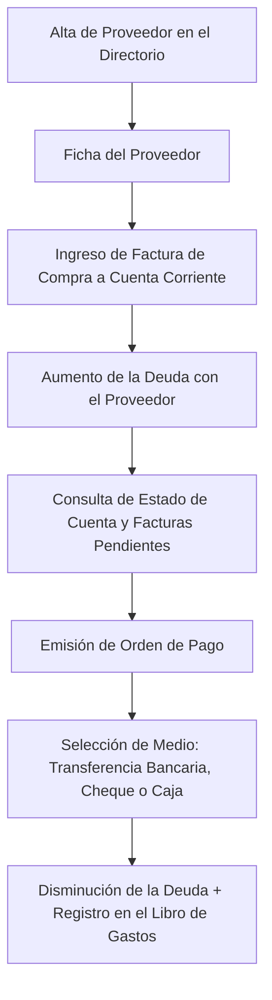

# 🏭 Manual de Uso: Directorio de Proveedores y Cuentas Corrientes

> [!info] Objetivo de la Funcionalidad
> El módulo de **Proveedores** administra la agenda de fabricantes, mayoristas y distribuidores con los que opera tu negocio. Te permite llevar el control exacto de **Cuentas por Pagar (saldos adeudados)**, vencimientos de facturas de compra y registro de pagos realizados por banco o caja.

> [!abstract] Requisitos Previos y Permisos
> - **Rol de Usuario Requerido:** `Dueño` o `Colaborador` con permiso asignado sobre `Proveedores`.
> - Negocio con actividades de productos o elaboración (`productos` o `produccion`).

---

## 🗺️ Diagrama del Flujo de Proveedores y Cuentas por Pagar

---

## 📍 Flujo de Navegación

1. En el menú lateral izquierdo, sección **Stock y compras**, hacé clic en **"Proveedores"**.
2. Verás el listado de proveedores registrados con su CUIT, teléfono de contacto y el **saldo actual adeudado**.
3. Para registrar un nuevo proveedor, presioná **"+ Nuevo Proveedor"**.

---

## 📋 Guía Visual de Campos e Interacciones

| Campo / Control | Tipo | Obligatorio | Descripción / Regla |
| :--- | :--- | :---: | :--- |
| **Razón Social** | Texto | Sí | Denominación legal de la empresa proveedora. |
| **Nombre Comercial** | Texto | No | Nombre de fantasía habitual con el que identificás al distribuidor. |
| **CUIT** | Numérico | Sí | Identificador tributario (11 dígitos, sin guiones). |
| **Contacto Comercial** | Texto | No | Nombre del viajante, preventista o ejecutivo de cuenta asignado. |
| **Teléfono / WhatsApp** | Teléfono | No | Número para cursar pedidos o coordinar pagos. |
| **Email de Pedidos** | Email | No | Casilla de correo para remisión de órdenes de compra. |
| **Plazo de Pago Habitual**| Selector | No | Días habituales de crédito comercial (ej: 15, 30, 60 días). |

---

## 🔄 Paso a Paso: Ejecución de Casos de Uso

### Caso 1: Dar de Alta un Proveedor Mayorista

1. En **Proveedores**, presioná **"+ Nuevo Proveedor"**.
2. Ingresá la Razón Social y el CUIT:
   - El sistema validará el formato del CUIT.
3. Indicá el nombre y teléfono del vendedor asignado.
4. Presioná **"Guardar Proveedor"**. A partir de ese momento estará disponible en el formulario de `[[13 - Compras a Proveedores y Recepción de Mercadería]]`.

### Caso 2: Pagar una Factura de Compra Pendiente

1. En la lista de proveedores, hacé clic sobre el nombre del distribuidor para abrir su **Ficha de Cuenta Corriente**.
2. Verás el detalle de todas las facturas impagas y el saldo total pendiente.
3. Presioná el botón **"Registrar Pago"**:
   - Ingresá el importe abonado (puede ser el total o una entrega a cuenta).
   - Indicá el medio de pago utilizado (Transferencia bancaria, Efectivo de caja, Cheque).
   - Escribí el número de comprobante o referencia bancaria para conciliación.
4. Presioná **"Confirmar Pago"**:
   - El saldo adeudado con el proveedor disminuirá inmediatamente.
   - El movimiento financiero quedará registrado en `[[16 - Analytics Comercial, Rentabilidad y Monotributo]]`.

---

## ⚠️ Solución de Problemas y Errores Frecuentes

> [!faq] Consultas Frecuentes sobre Proveedores

| Error / Duda | Causa Probable | Solución Sugerida |
| :--- | :--- | :--- |
| **"CUIT ya existente en el sistema"** | Ya habías registrado a ese proveedor anteriormente. | Buscalo por su CUIT o razón social en el listado para no duplicar fichas. |
| **"El saldo adeudado no coincide con el resumen del proveedor"** | Falta registrar alguna nota de crédito o comprobante de compra previo. | Revisá el historial de comprobantes en la ficha del proveedor y cargá las facturas faltantes. |

---

## 🔗 Manuales y Documentos Relacionados

- `[[00 - Índice General y Guía de Navegación]]`
- `[[11 - Catálogo de Productos, Servicios y Variantes]]`
- `[[12 - Control de Inventario, Kardex y Lotes]]`
- `[[13 - Compras a Proveedores y Recepción de Mercadería]]`
- `[[16 - Analytics Comercial, Rentabilidad y Monotributo]]`

---

🔍 <b>Ficha Técnica y Trazabilidad (Para Equipos de Soporte y QA)</b>

### 🖥️ Frontend (Interfaz de Usuario)
- **Componentes:** `apps/web/src/features/proveedores/components/ProveedoresListado.tsx`, `ProveedorForm.tsx`, `ProveedorFichaVista.tsx`
- **Ruta de Navegación (URL):** `/proveedores`, `/proveedores/:id`

### ⚙️ Backend (Servicio y API)
- **Controlador Proveedores:** `ProveedoresController` en `apps/api/src/modules/proveedores/proveedores.controller.ts`
- **Endpoints:**
  - `GET /proveedores` (Listado y saldos de deuda consolidada).
  - `POST /proveedores` (Alta y edición de datos de proveedor).
  - `GET /proveedores/:id/cuenta-corriente` (Historial de compras y pagos cruzados).
  - `POST /proveedores/:id/pagos` (Cancelación de saldos y egreso de fondos).
- **DTOs:** `CrearProveedorDto`, `PagoProveedorDto`

