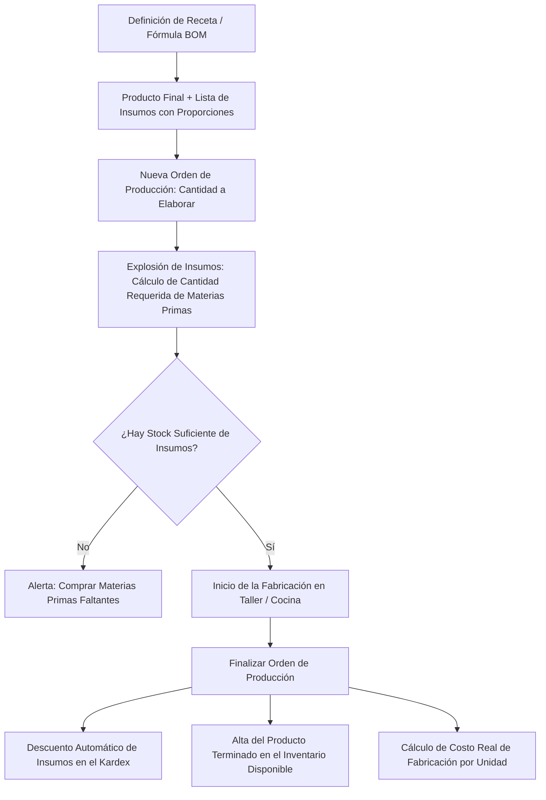

# 🔨 Manual de Uso: Producción, Fórmulas y Recetas de Fabricación

> [!info] Objetivo de la Funcionalidad
> Diseñado para panaderías, pastelerías, fábricas de pastas, cervecerías artesanales, talleres textiles, carpinterías y ensambladoras de combos/kits, el módulo de **Producción** gestiona fórmulas maestras de elaboración (**BOM - Bill of Materials**), calcula el costo exacto de insumos y mano de obra, y ejecuta órdenes de fabricación que descuentan materias primas e ingresan el producto terminado al stock en un solo paso.

> [!abstract] Requisitos Previos y Permisos
> - **Actividad del Negocio:** Tener tildada la actividad `produccion` en `[[21 - Configuración General, Datos Fiscales y Parámetros]]`.
> - **Plan Requerido:** Disponible en planes Pro y E-commerce (función `produccion`).
> - Tener cargadas en el catálogo las materias primas o insumos (`[[11 - Catálogo de Productos, Servicios y Variantes]]`).

---

## 🗺️ Diagrama del Proceso de Fabricación y Explosión de Insumos

---

## 📍 Flujo de Navegación

1. En el menú lateral izquierdo, sección **Stock y compras**, hacé clic en **"Producción"**.
2. Verás dos pestañas principales:
   - **Órdenes de Producción:** Estado de las tandas de fabricación en curso o finalizadas.
   - **Recetas y Fórmulas:** Catálogo de fórmulas maestras de productos terminados.
3. Para iniciar una tanda de elaboración, presioná **"+ Nueva Orden de Producción"**.

---

## 📋 Guía Visual de Campos e Interacciones

### 1. Editor de Fórmulas y Recetas (BOM)

| Campo / Control | Tipo | Obligatorio | Descripción / Regla |
| :--- | :--- | :---: | :--- |
| **Producto Terminado** | Selector | Sí | Artículo que se obtiene al finalizar la receta (ej: *"Torta de Chocolate 1kg"*). |
| **Rendimiento Base** | Número | Sí | Cantidad estándar producida con esta receta (ej: `1 unidad`, `10 unidades`). |
| **Lista de Insumos** | Tabla dinámica | Sí | Materias primas requeridas con cantidad y unidad de medida (kg, gr, lts, mts, un). |
| **Costo de Mano de Obra**| Moneda ($) | No | Costo estimado de horas hombre dedicadas a la tanda de elaboración. |
| **Costos Indirectos** | Moneda ($) | No | Estimación de gastos de gas, energía eléctrica o envases. |
| **Costo Unitario Resultante**| Automático | N/A | Suma de insumos + mano de obra + gastos dividido el rendimiento. |

---

## 🔄 Paso a Paso: Ejecución de Casos de Uso

### Caso 1: Crear una Receta de Elaboración

1. En **Producción**, hacé clic en la pestaña **"Recetas"** y luego en **"+ Nueva Receta"**.
2. Seleccioná el producto final que vas a elaborar (ej. *"Cerveza IPA 50L"*).
3. Agregá uno a uno los insumos necesarios:
   - *Malta Pale Ale:* `12 kg` (toma el costo unitario de tu última compra).
   - *Lúpulo Cascade:* `250 gr`.
   - *Levadura Ale:* `2 sobres`.
4. Indicá los costos extras de mano de obra y gas/energía si deseás contemplarlos.
5. Presioná **"Guardar Receta"**:
   - El sistema te mostrará el costo exacto por litro o por unidad terminada.

### Caso 2: Lanzar y Finalizar una Orden de Producción

1. En la pestaña **"Órdenes de Producción"**, presioná **"+ Nueva Orden"**.
2. Elegí la receta a elaborar (ej: *"Pan de Campo Artesanal"*).
3. Ingresá cuántas unidades vas a cocinar hoy (ej: `40 panes`).
4. **Validación automática:**
   - El sistema multiplicará las proporciones de la receta por 40 y comparará contra el inventario disponible de harina, levadura y sal (`[[12 - Control de Inventario, Kardex y Lotes]]`).
   - Si todo está disponible, la orden pasa a estado **"En Fabricación"**.
5. Cuando la producción sale del horno o del taller:
   - Abrí la orden y presioná **"Finalizar Producción"**.
   - En ese mismo instante:
     - Se descuentan del stock los kilos exactos de harina y levadura utilizados.
     - Se suman 40 panes al inventario listos para vender en el mostrador (`[[05 - Punto de Venta (POS), Cobros y Facturación ARCA]]`).

---

## ⚠️ Solución de Problemas y Errores Frecuentes

> [!faq] Consultas Frecuentes sobre Fabricación

| Situación en Pantalla | Causa Probable | Solución Sugerida |
| :--- | :--- | :--- |
| **"Insumos insuficientes para la cantidad solicitada"** | El depósito no tiene stock suficiente de alguna materia prima para cubrir la tanda. | Podés ingresar una compra rápida de insumos en `[[13 - Compras a Proveedores y Recepción de Mercadería]]` o reducir la cantidad a elaborar. |
| **"El costo del producto terminado cambió"** | Aumentó el costo de compra de algún insumo en la última factura de proveedor. | La receta se recalcula automáticamente con los costos vigentes, garantizando que tu precio de venta nunca quede desfasado. |

---

## 🔗 Manuales y Documentos Relacionados

- `[[00 - Índice General y Guía de Navegación]]`
- `[[05 - Punto de Venta (POS), Cobros y Facturación ARCA]]`
- `[[11 - Catálogo de Productos, Servicios y Variantes]]`
- `[[12 - Control de Inventario, Kardex y Lotes]]`
- `[[13 - Compras a Proveedores y Recepción de Mercadería]]`

---

🔍 <b>Ficha Técnica y Trazabilidad (Para Equipos de Soporte y QA)</b>

### 🖥️ Frontend (Interfaz de Usuario)
- **Componentes:** `apps/web/src/features/produccion/ProduccionVista.tsx`, `RecetaEditor.tsx`, `NuevaOrden.tsx`
- **Ruta de Navegación (URL):** `/produccion`, `/produccion/nueva`, `/produccion/recetas/:id`
- **Hook:** `useProduccion()` en `apps/web/src/features/produccion/hooks.ts`

### ⚙️ Backend (Servicio y API)
- **Controlador:** `ProduccionController` en `apps/api/src/modules/produccion/produccion.controller.ts`
- **Endpoints:**
  - `GET /produccion/recetas` (Listado de fórmulas maestras y desglose BOM).
  - `POST /produccion/recetas` (Creación y edición de recetas con insumos).
  - `POST /produccion/ordenes` (Creación de orden y validación de existencias de insumos).
  - `POST /produccion/ordenes/:id/finalizar` (Transacción atómica: baja de insumos + alta de producto terminado).
- **DTOs:** `CrearRecetaDto`, `CrearOrdenProduccionDto`

