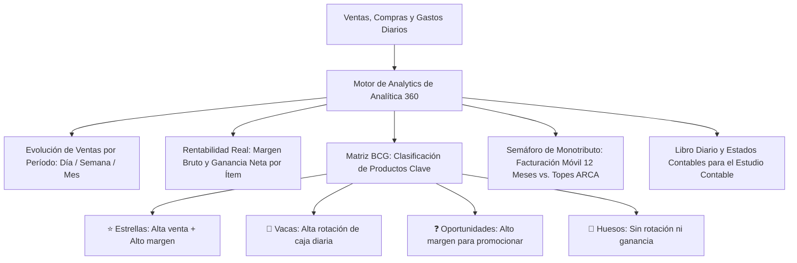

# 📈 Manual de Uso: Analytics Comercial, Rentabilidad y Monotributo

> [!info] Objetivo de la Funcionalidad
> El módulo de **Analytics** transforma los datos cotidianos de tu negocio en decisiones inteligentes. Analiza la evolución de la facturación en distintos períodos, revela qué productos generan tu verdadera ganancia neta, clasifica tu catálogo mediante la **Matriz BCG**, audita gastos operativos y controla en tiempo real tu **Semáforo Fiscal de Monotributo ante ARCA** para evitar exclusiones sorpresivas.

> [!abstract] Requisitos Previos y Permisos
> - **Rol de Usuario Requerido:** `Dueño`, `Contador`, o colaborador con permiso expreso sobre `Analytics`.
> - Para acceder a informes avanzados de rentabilidad y matriz de productos, contar con plan Pro o superior.

---

## 🗺️ Mapa de Inteligencia de Negocio y Finanzas

---

## 📍 Flujo de Navegación

1. En el menú lateral izquierdo, sección **Gestión**, hacé clic en **"Analytics"**.
2. Podés alternar entre las distintas pestañas de análisis:
   - **Ventas por Período:** Facturación global y comparativas temporales.
   - **Rentabilidad de Productos:** Ganancia neta y márgenes porcentuales.
   - **Matriz de Productos:** Visualización estratégica de cuadrantes.
   - **Gastos y Finanzas:** Control de salidas operativas no comerciales.
   - **Monotributo y Fiscal:** Estado impositivo ante ARCA.
   - **Contabilidad:** Libro diario y asientos para el contador.

---

## 📋 Guía Visual de Indicadores y Paneles

| Panel / Pestaña | Tipo de Visualización | Información que Aporta al Negocio |
| :--- | :--- | :--- |
| **Ventas por Período** | Gráfico de Líneas / Barras | Curva de facturación, ticket promedio y cantidad de operaciones. Permite comparar contra el mes o año anterior. |
| **Margen de Ganancia** | Tabla con Porcentajes | Resta el costo real de compra al precio de venta para mostrar la ganancia en pesos ($) y en porcentaje (%). |
| **Matriz BCG** | Gráfico de 4 Cuadrantes | Identifica productos estrella, productos ancla de alto volumen y artículos estancados que conviene liquidar. |
| **Gastos Operativos** | Gráfico de Torta / Lista | Alquiler, luz, sueldos, seguros, packaging. Permite calcular el punto de equilibrio mensual. |
| **Semáforo Monotributo**| Barra Progresiva y Alerta | Suma la facturación oficial de los últimos 365 días móviles y muestra la distancia al límite de tu categoría ARCA. |

---

## 🔄 Paso a Paso: Análisis Estratégico Mensual

### Caso 1: Detección de Productos Más Rentables vs. Menos Rentables

1. En **Analytics**, ingresá a la pestaña **"Rentabilidad de Productos"**.
2. Filtrá por el último mes cerrado.
3. Ordená la tabla por la columna **"Ganancia Total ($)"**:
   - Descubrirás cuáles son los artículos que más dinero neto dejaron en el bolsillo de tu comercio.
4. Ahora ordená por **"Margen %"** de menor a mayor:
   - Si detectás artículos con margen menor al 15% o 20%, evaluá aplicar un aumento desde `[[11 - Catálogo de Productos, Servicios y Variantes]]` o renegociar costos con el proveedor (`[[14 - Directorio de Proveedores y Cuentas Corrientes]]`).

### Caso 2: Control Preventivo del Semáforo de Monotributo

1. En la pestaña **"Monotributo"** (o en la tarjeta del `[[03 - Dashboard de Inicio y Métricas en Tiempo Real]]`):
2. Revisá el indicador:
   - 🟢 **Verde:** Facturación acumulada menor al 70% del tope de tu categoría. Operación sin riesgo.
   - 🟡 **Amarillo:** Facturación entre 70% y 90% del tope. Próximo a recategorización en el siguiente período semestral.
   - 🔴 **Rojo:** Facturación superior al 90% del límite de la categoría máxima. ¡Riesgo inminente de pase a Responsable Inscripto!
3. Podés compartir el informe con tu contador (`[[02 - Roles, Permisos y Gestión de Equipo]]`) para planificar ventas o emitir comprobantes a nombre de socios si corresponde.

### Caso 3: Carga de Gastos Fijos (Alquiler, Servicios, Sueldos)

1. En la pestaña **"Gastos y Finanzas"**, presioná **"+ Registrar Gasto"**.
2. Seleccioná la categoría: *Alquiler, Servicios públicos (Luz/Gas), Sueldos, Impuestos*.
3. Ingresá el importe abonado y la forma de pago (Caja local o Banco).
4. El sistema restará este gasto de la ganancia bruta de ventas para mostrarte la **Ganancia Neta Real de la Empresa**.

---

## ⚠️ Solución de Problemas y Errores Frecuentes

> [!faq] Consultas Frecuentes sobre Analytics

| Situación en Pantalla | Causa Probable | Solución Sugerida |
| :--- | :--- | :--- |
| **"El margen de ganancia figura en 100%"** | Los productos vendidos no tenían cargado su costo de compra en el catálogo. | Editá los costos de compra en `[[11 - Catálogo de Productos, Servicios y Variantes]]` o cargá las facturas de proveedores en `[[13 - Compras a Proveedores y Recepción de Mercadería]]`. |
| **"No coincide la facturación con los extractos bancarios"** | Parte de las ventas fueron a crédito o en cuotas diferidas pendientes de liquidación. | Consultá el informe de movimientos por medio de pago para aislar lo recaudado en mano vs. a cobrar. |

---

## 🔗 Manuales y Documentos Relacionados

- `[[00 - Índice General y Guía de Navegación]]`
- `[[03 - Dashboard de Inicio y Métricas en Tiempo Real]]`
- `[[04 - Copilot IA - Asistente Estratégico de Negocio]]`
- `[[05 - Punto de Venta (POS), Cobros y Facturación ARCA]]`
- `[[17 - Metas y Objetivos de Venta]]`

---

🔍 <b>Ficha Técnica y Trazabilidad (Para Equipos de Soporte y QA)</b>

### 🖥️ Frontend (Interfaz de Usuario)
- **Componentes:** `apps/web/src/features/analytics/components/VentasPeriodo.tsx`, `GananciaProductos.tsx`, `MatrizProductos.tsx`, `MonotributoCard.tsx`, `ContabilidadVista.tsx`
- **Ruta de Navegación (URL):** `/analytics`, `/analytics/rentabilidad`, `/analytics/matriz`, `/analytics/gastos`

### ⚙️ Backend (Servicio y API)
- **Controlador Período:** `PeriodoController` en `apps/api/src/modules/analytics/periodo.controller.ts`
- **Controlador Insights:** `InsightsController` en `apps/api/src/modules/analytics/insights.controller.ts`
- **Controlador Monotributo:** `MonotributoController` en `apps/api/src/modules/contabilidad/monotributo.controller.ts`
- **Controlador Gastos:** `GastoController` en `apps/api/src/modules/contabilidad/gasto.controller.ts`
- **Endpoints:**
  - `GET /analytics/periodo` (Agregación SQL de ventas, compras y costos agrupados por día/semana/mes).
  - `GET /analytics/rentabilidad` (Cálculo de margen bruto y ponderado por producto).
  - `GET /contabilidad/monotributo` (Cálculo de facturación móvil de 12 meses respecto a escalas ARCA).
- **DTOs:** `FiltroPeriodoDto`, `CrearGastoDto`

