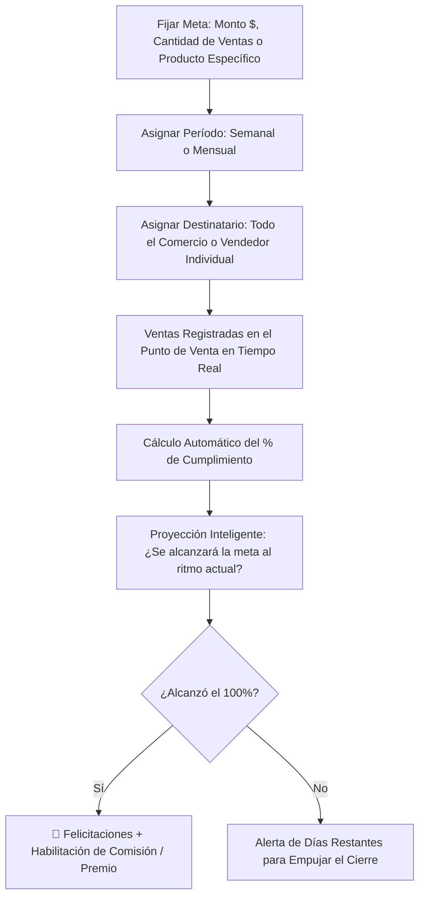

# 🎯 Manual de Uso: Metas y Objetivos de Venta

> [!info] Objetivo de la Funcionalidad
> El módulo de **Objetivos** motiva y orienta el esfuerzo de tu equipo comercial estableciendo metas claras y medibles (por facturación en pesos, cantidad de tickets o unidades de un producto clave). Cuenta con un velocímetro de avance en vivo y un **Ranking de Rendimiento** para incentivar a los colaboradores.

> [!abstract] Requisitos Previos y Permisos
> - **Rol de Usuario:** Cada colaborador puede ver sus propios objetivos; el `Dueño` puede crear y supervisar las metas de todo el equipo.
> - **Plan Requerido:** Disponible a partir del plan Básico (función `objetivos`).

---

## 🗺️ Diagrama del Flujo de Metas y Progreso Comercial

---

## 📍 Flujo de Navegación

1. En el menú lateral izquierdo, sección **Gestión**, hacé clic en **"Objetivos"**.
2. Verás las tarjetas de metas activas del mes con sus barras de avance.
3. Para definir un nuevo objetivo, presioná **"+ Nueva Meta"**.

---

## 📋 Guía Visual de Campos e Interacciones

| Campo / Control | Tipo | Obligatorio | Descripción / Regla |
| :--- | :--- | :---: | :--- |
| **Título del Objetivo** | Texto | Sí | Ej: *"Facturación Sucursal Centro - Octubre"*, *"Vender 50 membresías"*. |
| **Tipo de Meta** | Selector | Sí | `Monto Total ($)`, `Cantidad de Ventas (tickets)`, o `Unidades de un Producto`. |
| **Valor Objetivo** | Numérico | Sí | Cifra a alcanzar (ej: `$5.000.000` o `120 operaciones`). |
| **Período** | Selector | Sí | `Semanal`, `Mensual` o rango de fechas personalizado. |
| **Responsable** | Selector | Sí | `Toda la empresa` (meta compartida) o un vendedor específico (`[[02 - Roles, Permisos y Gestión de Equipo]]`). |
| **Barra de Progreso** | Porcentual | Automático | Se pinta de color según el ritmo (Rojo: bajo, Amarillo: medio, Verde: meta cumplida). |

---

## 🔄 Paso a Paso: Ejecución de Casos de Uso

### Caso 1: Crear una Meta de Facturación Mensual para el Negocio

1. En **Objetivos**, presioná **"+ Nueva Meta"**.
2. Escribí el título (ej: *"Objetivo Facturación Noviembre"*).
3. Seleccioná el tipo **Monto Total ($)** e ingresá el valor deseado (ej. `$10.000.000`).
4. Elegí el período mensual y asignalo a **Toda la Empresa**.
5. Guardá la meta:
   - A partir de ese momento, cada venta cobrada en mostrador (`[[05 - Punto de Venta (POS), Cobros y Facturación ARCA]]`) o en la tienda online hará subir la barra de avance automáticamente.

### Caso 2: Competencia de Vendedores y Ranking Comercial

1. Si tenés 3 vendedores en el equipo, podés crear una meta individual para cada uno (ej. 30 ventas en el mes).
2. Hacé clic en la pestaña **"Ranking de Rendimiento"**:
   - Verás un podio con medallas de oro, plata y bronce ordenado por quién lleva mayor porcentaje de cumplimiento.
   - Ideal para exhibir en la pantalla del local o motivar las comisiones de fin de mes (`[[18 - Comisiones y Liquidaciones al Personal]]`).

---

## ⚠️ Solución de Problemas y Errores Frecuentes

> [!faq] Consultas Frecuentes sobre Objetivos

| Situación en Pantalla | Causa Probable | Solución Sugerida |
| :--- | :--- | :--- |
| **"La barra no avanza tras una venta"** | La venta fue realizada por otro usuario o no se le asignó el vendedor correspondiente. | Verificá en el detalle de la venta que figure el vendedor asociado a la meta. |
| **"Meta vencida sin cerrar"** | Pasó el último día del mes. | Podés consultar el resultado final en el historial de metas pasadas o duplicarla para el nuevo mes. |

---

## 🔗 Manuales y Documentos Relacionados

- `[[00 - Índice General y Guía de Navegación]]`
- `[[02 - Roles, Permisos y Gestión de Equipo]]`
- `[[03 - Dashboard de Inicio y Métricas en Tiempo Real]]`
- `[[16 - Analytics Comercial, Rentabilidad y Monotributo]]`
- `[[18 - Comisiones y Liquidaciones al Personal]]`

---

🔍 <b>Ficha Técnica y Trazabilidad (Para Equipos de Soporte y QA)</b>

### 🖥️ Frontend (Interfaz de Usuario)
- **Componentes:** `apps/web/src/features/objetivos/components/ObjetivosVista.tsx`, `ObjetivoForm.tsx`, `RankingObjetivos.tsx`
- **Ruta de Navegación (URL):** `/objetivos`, `/objetivos/nuevo`

### ⚙️ Backend (Servicio y API)
- **Controlador:** `ObjetivosController` en `apps/api/src/modules/objetivos/objetivos.controller.ts`
- **Endpoints:**
  - `GET /objetivos` (Metas activas y porcentaje de avance calculado contra transacciones de Prisma).
  - `POST /objetivos` (Creación de nueva meta con asignación de usuario o empresa).
  - `GET /objetivos/ranking` (Cómputo comparativo de colaboradores).
- **DTOs:** `CrearObjetivoDto`

