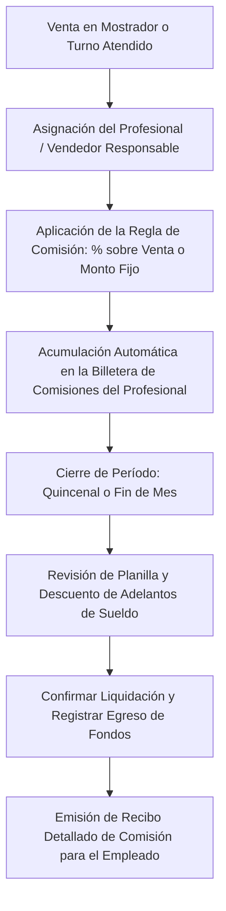

# 🪙 Manual de Uso: Comisiones y Liquidaciones al Personal

> [!info] Objetivo de la Funcionalidad
> El módulo de **Comisiones** automatiza el cálculo de incentivos económicos y pagos a profesionales (estilistas, barberos, técnicos, mecánicos o preventistas). Cada vez que se concreta una venta o se atiende un turno, el sistema liquida el porcentaje o monto correspondiente y genera la planilla de pago de comisiones semanal, quincenal o mensual.

> [!abstract] Requisitos Previos y Permisos
> - **Rol de Usuario Requerido:** `Dueño` o colaborador con acceso a administración de sueldos y finanzas.
> - **Actividad del Negocio:** Disponible principalmente en negocios con actividad de `servicios` (peluquerías, salones, clínicas, talleres).
> - **Plan Requerido:** Disponible en planes Pro y E-commerce (función `comisiones`).

---

## 🗺️ Diagrama del Flujo de Comisiones y Liquidación

---

## 📍 Flujo de Navegación

1. En el menú lateral izquierdo, sección **Gestión**, hacé clic en **"Comisiones"**.
2. Verás el panel con los totales devengados por colaborador en el período seleccionado.
3. Podés filtrar por fechas, consultar las ventas que originaron cada comisión o presionar **"Liquidar y Pagar"**.

---

## 📋 Guía Visual de Campos e Interacciones

| Control / Campo | Tipo | Obligatorio | Descripción / Regla |
| :--- | :--- | :---: | :--- |
| **Profesional / Colaborador**| Selector | Sí | Empleado al que se le computan las ventas (`[[02 - Roles, Permisos y Gestión de Equipo]]`). |
| **Porcentaje de Comisión (%)**| Numérico | Sí | % pactado (ej: `10%` en ventas generales, `45%` en mano de obra técnica). |
| **Filtro de Período** | Fechas | Sí | Rango de liquidación (ej. del 1 al 15 del mes). |
| **Adelantos de Sueldo** | Moneda ($) | No | Descuentos aplicados por anticipos de dinero otorgados previamente. |
| **Botón "Cerrar Liquidación"**| Acción | N/A | Congela los valores del período y marca las comisiones como pagadas. |

---

## 🔄 Paso a Paso: Ejecución de Casos de Uso

### Caso 1: Asignar Comisión Automática en una Venta o Turno

1. Al cobrar un servicio en la **Agenda** (`[[08 - Agenda de Turnos y Reservas Online]]`) o registrar una venta en el **Punto de Venta** (`[[05 - Punto de Venta (POS), Cobros y Facturación ARCA]]`):
2. Asegurate de que en el selector **"Profesional / Vendedor"** esté seleccionado el nombre del colaborador que atendió.
3. Al presionar **"Confirmar Venta"**:
   - El sistema calculará en segundo plano la comisión pactada (ej. si la venta fue de `$10.000` y tiene un `30%`, se le asignarán `$3.000`).
   - El dinero quedará registrado como devengado en el módulo de Comisiones.

### Caso 2: Cierre y Pago de la Liquidación Quincenal o Mensual

1. Al llegar la fecha de liquidación:
   - Dirijase a **Comisiones**.
   - Seleccioná el rango de fechas (ej: `01/10/2026` al `15/10/2026`).
2. Hacé clic en el colaborador a liquidar:
   - Verás el listado de todos los servicios o ventas que realizó, con fecha, cliente y el monto de cada comisión.
3. Si el empleado pidió un adelanto de `$5.000`, ingresalo en el campo **Adelantos / Retenciones**.
4. Presioná el botón **"Liquidar Comisiones"**:
   - Elegí el medio de pago del egreso (Efectivo de caja o Transferencia bancaria).
   - El saldo del colaborador se reiniciará a $0 para el nuevo período.
   - El sistema te generará un comprobante PDF desglosado para imprimir o enviar por WhatsApp al colaborador.

---

## ⚠️ Solución de Problemas y Errores Frecuentes

> [!faq] Consultas Frecuentes sobre Comisiones

| Situación en Pantalla | Causa Probable | Solución Sugerida |
| :--- | :--- | :--- |
| **"Una venta no sumó comisión al vendedor"** | Al momento de cobrar en el POS no se seleccionó el nombre del vendedor en el selector. | Podés ingresar al listado de ventas, editar la transacción y asignarle el vendedor correspondiente. |
| **"¿Qué ocurre si se anula una venta ya comisionada?"** | El cliente devolvió el artículo o se canceló el ticket. | El sistema resta automáticamente la comisión correspondiente del saldo acumulado del vendedor. |

---

## 🔗 Manuales y Documentos Relacionados

- `[[00 - Índice General y Guía de Navegación]]`
- `[[02 - Roles, Permisos y Gestión de Equipo]]`
- `[[05 - Punto de Venta (POS), Cobros y Facturación ARCA]]`
- `[[08 - Agenda de Turnos y Reservas Online]]`
- `[[17 - Metas y Objetivos de Venta]]`

---

🔍 <b>Ficha Técnica y Trazabilidad (Para Equipos de Soporte y QA)</b>

### 🖥️ Frontend (Interfaz de Usuario)
- **Componente:** `apps/web/src/features/comisiones/Comisiones.tsx`
- **Ruta de Navegación (URL):** `/comisiones`

### ⚙️ Backend (Servicio y API)
- **Controlador:** `ComisionesController` en `apps/api/src/modules/comisiones/comisiones.controller.ts`
- **Endpoints:**
  - `GET /comisiones` (Listado consolidado por profesional y período).
  - `GET /comisiones/:usuarioId/detalle` (Desglose operación por operación).
  - `POST /comisiones/:usuarioId/liquidar` (Cierre y registro de egreso contable).
- **DTOs:** `LiquidarComisionesDto`

