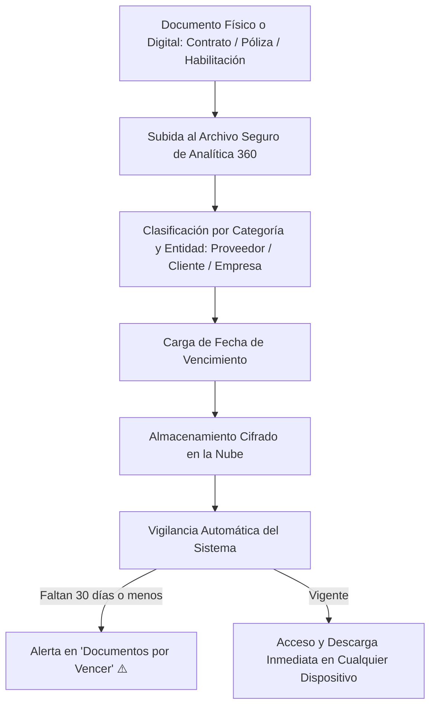

# 📁 Manual de Uso: Archivo Digital de Documentos y Contratos

> [!info] Objetivo de la Funcionalidad
> El módulo de **Archivo Digital** resguarda en la nube y de forma totalmente confidencial la documentación crítica de tu negocio: contratos de alquiler, pólizas de seguro, habilitaciones municipales, contratos con proveedores, remitos conformados y certificados fiscales, con **alertas automáticas de vencimiento** para evitar multas o suspensiones.

> [!abstract] Requisitos Previos y Permisos
> - **Acceso Restringido y Seguro:** Por seguridad, este módulo solo está visible para los roles de **Dueño** y **Contador** (`[[02 - Roles, Permisos y Gestión de Equipo]]`).
> - **Plan Requerido:** Disponible en planes Pro y E-commerce (función `archivo`).

---

## 🗺️ Diagrama del Flujo de Archivo y Monitoreo de Vencimientos

---

## 📍 Flujo de Navegación

1. En el menú lateral izquierdo, sección **Gestión**, hacé clic en **"Documentos"** (ícono de carpeta 📁).
2. Si tenés documentos próximos a caducar, verás en la parte superior la tarjeta destacada **"Documentos por Vencer"**.
3. Para subir un nuevo archivo, presioná el botón **"+ Subir Documento"**.

---

## 📋 Guía Visual de Campos e Interacciones

| Campo / Control | Tipo | Obligatorio | Descripción / Regla |
| :--- | :--- | :---: | :--- |
| **Título del Documento** | Texto | Sí | Ej: *"Contrato Alquiler Local Central 2026-2028"*, *"Póliza Incendio y ART"*. |
| **Categoría** | Selector | Sí | `Contrato`, `Habilitación`, `Seguro / Póliza`, `Impositivo / AFIP`, `Garantía`. |
| **Archivo Adjunto** | PDF o Imagen | Sí | Subí el documento escaneado (PDF, PNG o JPG hasta 25MB). |
| **Fecha de Vencimiento** | Fecha | No | Día en que caduca el contrato o seguro para activar las alertas. |
| **Vinculado a** | Selector | No | Podés asociarlo a un `Proveedor` o `Cliente` específico. |
| **Notas / Cláusulas** | Texto | No | Datos de contacto de la aseguradora, n° de póliza o cláusulas clave. |

---

## 🔄 Paso a Paso: Ejecución de Casos de Uso

### Caso 1: Carga y Protección de una Póliza de Seguros con Alerta

1. En **Documentos**, presioná **"+ Subir Documento"**.
2. Escribí el título: *"Póliza Integral de Comercio - Sancor Seguros"*.
3. Seleccioná la categoría **Seguro / Póliza**.
4. Arrastrá el PDF de la póliza emitida por la compañía.
5. Ingresá la **Fecha de Vencimiento** (ej: `15/12/2026`).
6. Presioná **"Guardar en Archivo"**:
   - El archivo se alojará cifrado en el storage de tu empresa.
   - 30 días antes del 15 de diciembre, el sistema emitirá avisos en el dashboard para que renueves la cobertura con tiempo.

### Caso 2: Resguardo de Remitos y Conformidades de Clientes

1. Si un transportista o cliente firmó de puño y letra un remito de entrega (`[[07 - Gestión de Pedidos, Picking y Despachos]]`):
2. Tomá una foto con tu teléfono y subila a la ficha del cliente en el archivo digital.
3. El documento quedará respaldado para siempre, listo para ser exhibido ante cualquier reclamo o auditoría comercial.

---

## ⚠️ Solución de Problemas y Errores Frecuentes

> [!faq] Consultas Frecuentes de Documentos

| Situación en Pantalla | Causa Probable | Solución Sugerida |
| :--- | :--- | :--- |
| **"No veo el botón Documentos en el menú"** | Tu usuario tiene rol de Colaborador común. | Por confidencialidad legal y bancaria, solo Dueño y Contador tienen acceso. |
| **"Error: Archivo supera el tamaño permitido"** | El PDF escaneado supera los 25MB. | Reducí la resolución del escaneo o comprimí el PDF antes de subirlo. |

---

## 🔗 Manuales y Documentos Relacionados

- `[[00 - Índice General y Guía de Navegación]]`
- `[[02 - Roles, Permisos y Gestión de Equipo]]`
- `[[07 - Gestión de Pedidos, Picking y Despachos]]`
- `[[14 - Directorio de Proveedores y Cuentas Corrientes]]`
- `[[21 - Configuración General, Datos Fiscales y Parámetros]]`

---

🔍 <b>Ficha Técnica y Trazabilidad (Para Equipos de Soporte y QA)</b>

### 🖥️ Frontend (Interfaz de Usuario)
- **Componentes:** `apps/web/src/features/archivo/ArchivoVista.tsx`, `SubirDocumento.tsx`, `ListaDocumentos.tsx`, `PorVencerCard.tsx`
- **Ruta de Navegación (URL):** `/documentos`
- **Hook:** `useArchivo()` en `apps/web/src/features/archivo/use-archivo.ts`

### ⚙️ Backend (Servicio y API)
- **Controlador:** `ArchivoController` en `apps/api/src/modules/archivo/archivo.controller.ts`
- **Controlador Vencimientos:** `VencimientosController` en `apps/api/src/modules/vencimientos/vencimientos.controller.ts`
- **Endpoints:**
  - `GET /archivo/documentos` (Listado y filtros con enlace firmado de descarga segura).
  - `POST /archivo/upload` (Carga multipart con verificación de tipos MIME autorizados).
  - `GET /vencimientos/alertas` (Detección de plazos menores a 30 días).
- **DTOs:** `SubirDocumentoDto`

