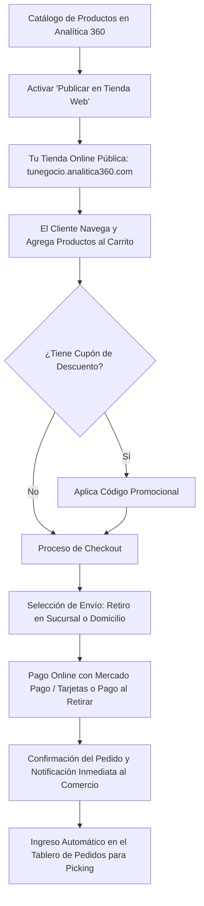

# 🌐 Manual de Uso: Tienda Online y Storefront Multi-Negocio

> [!info] Objetivo de la Funcionalidad
> **Analítica 360** incluye tu propia **Tienda Online (E-commerce)** lista para vender las 24 horas del día. Tus productos se publican con un solo clic, el stock se descuenta automáticamente para no sobrevender, cobrás con **Mercado Pago** y recibís las compras directamente en tu panel de control de `[[07 - Gestión de Pedidos, Picking y Despachos]]`.

> [!abstract] Requisitos Previos y Permisos
> - **Rol de Usuario Requerido:** `Dueño` o colaborador con acceso a `Configuración`.
> - **Plan Requerido:** Disponible en el plan **E-commerce** (función `tienda`).

---

## 🗺️ Diagrama del Flujo de la Tienda Online

---

## 📍 Flujo de Navegación

1. En el menú lateral izquierdo, sección **Cuenta**, hacé clic en **"Configuración"**.
2. Diríjase a la pestaña **"Tienda Online"**.
3. Verás la URL pública de tu tienda (ej: `https://tienda.analitica360.com/tu-comercio`), el botón para activarla/pausarla y las opciones de diseño, cupones y pasarela de pago.

---

## 📋 Guía Visual de Campos e Interacciones

### 1. Identidad Visual y Estilo

| Campo / Control | Tipo | Descripción | Regla |
| :--- | :--- | :--- | :--- |
| **Nombre de la Tienda** | Texto | Nombre público visible en el encabezado. | Mínimo 3 caracteres. |
| **Subdominio / Slug** | Texto | Dirección web (ej: `mishop` -> `tienda.analitica360.com/mishop`). | Solo letras minúsculas y guiones. |
| **Color de Marca (Acento)**| Selector de color | Tono de los botones de compra y banners (ej: verde, violeta, negro). | Código HEX (ej. `#10b981`). |
| **Banner Principal** | Imagen | Portada publicitaria superior de bienvenida. | Recomendado 1920x600 px. |
| **WhatsApp de Consultas** | Teléfono | Botón flotante para que los clientes te pregunten directo desde la tienda. | Formato internacional con código de área. |

### 2. Formas de Envío y Pagos Online

| Opción | Configuración Disponible |
| :--- | :--- |
| **Retiro en Tienda** | Habilitá las sucursales donde los compradores pueden pasar a buscar su paquete sin costo. |
| **Envíos a Domicilio** | Definí un costo fijo de envío o envío gratis a partir de cierto monto de compra (ej: *"Gratis superando los $50.000"*). |
| **Mercado Pago** | Conectá tu cuenta de Mercado Pago con 1 clic para recibir el dinero de las ventas directo en tu billetera. |

---

## 🔄 Paso a Paso: Ejecución de Casos de Uso

### Caso 1: Publicar un Producto en la Tienda Web

1. Diríjase a **Productos** (`[[11 - Catálogo de Productos, Servicios y Variantes]]`).
2. Abrí el producto que deseás vender online.
3. Marcá la casilla **"Mostrar en la tienda online"**.
4. Asegurate de que tenga al menos una foto clara y una descripción atractiva.
5. Guardá el producto:
   - Ya estará visible para todos tus clientes en la web con su precio de lista y talles disponibles.

### Caso 2: Crear un Cupón de Descuento Promocional

1. En **Configuración** > **Tienda Online**, hacé clic en la sub-pestaña **"Cupones"**.
2. Presioná **"+ Nuevo Cupón"**:
   - *Código:* `BIENVENIDA15` (lo que escribe el cliente en el carrito).
   - *Tipo:* Porcentaje (`15%`) o Monto fijo (`$3.000`).
   - *Monto Mínimo de Compra:* (ej: compras superiores a `$20.000`).
   - *Vigencia:* Fecha de inicio y fin de la promoción.
3. Compartí el cupón en tus redes sociales:
   - Cuando el cliente ingrese el código al comprar, el carrito recalculará el total al instante.

### Caso 3: Gestión de un Pedido Ingresado por la Web

1. Cuando un cliente completa una compra en tu tienda:
   - El sistema emitirá un aviso sonoro y visual en el panel.
   - El pedido aparecerá en **Pedidos** (`[[07 - Gestión de Pedidos, Picking y Despachos]]`) con el rótulo *"Tienda Online - Pagado por Mercado Pago"*.
2. Tu personal de depósito realiza el picking y remito para despachar el paquete.

---

## ⚠️ Solución de Problemas y Errores Frecuentes

> [!faq] Consultas Frecuentes sobre la Tienda Online

| Situación en Pantalla | Causa Probable | Solución Sugerida |
| :--- | :--- | :--- |
| **"Un producto con stock no aparece en la tienda"** | No tiene tildada la opción "Mostrar en la tienda online". | Editá el producto en el catálogo y activá la casilla de publicación. |
| **"Error al conectar Mercado Pago"** | La sesión de Mercado Pago expiró o no cuenta con los permisos requeridos. | Hacé clic en "Reconectar cuenta de Mercado Pago" en la pestaña de configuración de la tienda. |

---

## 🔗 Manuales y Documentos Relacionados

- `[[00 - Índice General y Guía de Navegación]]`
- `[[05 - Punto de Venta (POS), Cobros y Facturación ARCA]]`
- `[[07 - Gestión de Pedidos, Picking y Despachos]]`
- `[[11 - Catálogo de Productos, Servicios y Variantes]]`
- `[[21 - Configuración General, Datos Fiscales y Parámetros]]`

---

🔍 <b>Ficha Técnica y Trazabilidad (Para Equipos de Soporte y QA)</b>

### 🖥️ Frontend (Interfaz de Usuario)
- **Panel de Control:** `apps/web/src/features/configuracion/components/TiendaOnlineConfig.tsx`, `EstiloTienda.tsx`, `CuponesTiendaConfig.tsx`
- **Storefront Público:** `apps/tienda/` (Next.js con SSR y renderizado dinámico de catálogo)
- **Ruta de Navegación (URL):** `/configuracion?tab=tienda` y URL pública del comercio

### ⚙️ Backend (Servicio y API)
- **Controlador Tienda Admin:** `TiendaAdminController` en `apps/api/src/modules/tienda/tienda-admin.controller.ts`
- **Controlador Tienda Público:** `TiendaController` en `apps/api/src/modules/tienda/tienda.controller.ts`
- **Controlador Mercado Pago:** `MpTiendaController` en `apps/api/src/modules/mercadopago-tienda/mp-tienda.controller.ts`
- **Endpoints:**
  - `GET /tienda/config` (Lectura de estilo, slug y parámetros).
  - `PUT /tienda/config` (Actualización de banners, redes y zonas de entrega).
  - `POST /tienda/cupones` (Creación de cupones con tope y validación).
  - `POST /mercadopago-tienda/preferencia` (Generación de Checkout Pro en Mercado Pago).
- **DTOs:** `ActualizarTiendaConfigDto`, `CrearCuponDto`

