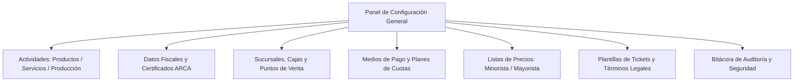

# ⚙️ Manual de Uso: Configuración General, Datos Fiscales y Parámetros

> [!info] Objetivo de la Funcionalidad
> En este panel central se definen los cimientos de tu empresa en **Analítica 360**: qué actividades realiza tu comercio (para ocultar lo que no usás y simplificar la pantalla), tus datos fiscales para facturar en **ARCA / AFIP**, puntos de venta, medios de pago con cuotas e intereses, listas de precios y la **bitácora de auditoría** de seguridad.

> [!abstract] Requisitos Previos y Permisos
> - **Rol de Usuario Requerido:** Exclusivo para el **Dueño** del comercio (`[[02 - Roles, Permisos y Gestión de Equipo]]`).

---

## 🗺️ Mapa de Secciones de Configuración

---

## 📍 Flujo de Navegación

1. En el menú lateral izquierdo, sección inferior **Cuenta**, hacé clic en **"Configuración"**.
2. Verás las distintas pestañas organizadas por temáticas operativas.

---

## 📋 Guía Visual de Pestañas Principales

### 1. ¿Qué hace mi negocio? (Actividades y Rubros)

| Actividad | Si la activás, habilita en el sistema: |
| :--- | :--- |
| **Venta de Productos** | Catálogo con stock, Control de Inventario, Compras a proveedores y Pedidos. |
| **Servicios** | Agenda de turnos interactiva, Abonos mensuales, Órdenes de trabajo y Comisiones. |
| **Producción / Taller** | Recetas maestras (BOM), costeo de mano de obra y Órdenes de fabricación. |

> [!tip] Menú Limpio y Personalizado
> Lo que tu negocio no realiza no aparece en el menú lateral ni genera estorbo. Si en el futuro incorporás servicios o fabricación, podés activarlo acá en 1 segundo.

### 2. Datos Fiscales y ARCA (AFIP)

| Campo | Descripción |
| :--- | :--- |
| **CUIT del Comercio** | Número tributario de 11 dígitos. |
| **Razón Social** | Denominación legal inscripta ante ARCA. |
| **Condición Tributaria** | `Monotributo`, `Responsable Inscripto` o `Exento`. |
| **Punto de Venta Fiscal** | Número de 4 o 5 dígitos habilitado en AFIP para Facturación Web Services. |
| **Certificado Digital (.crt) y Clave (.key)** | Archivos generados con el CUIT del comercio para autorizar a Analítica 360 a emitir facturas legales. |

### 3. Medios de Pago y Cuotas

| Configuración | Utilidad |
| :--- | :--- |
| **Medios Habilitados** | Marcá qué cobros aceptás en mostrador: Efectivo, Débito, Crédito, Transferencia, Mercado Pago, Cuenta Corriente. |
| **Planes de Tarjeta** | Definí cuántas cuotas ofrecés (ej: 3 cuotas fijas) y el coeficiente de interés o recargo que se sumará automáticamente en el POS. |

---

## 🔄 Paso a Paso: Ejecución de Casos de Uso

### Caso 1: Conectar el Sistema con ARCA para Emitir Facturas Electrónicas

1. En **Configuración**, abrí la pestaña **"Datos Fiscales"**.
2. Ingresá tu CUIT y Razón Social oficial.
3. Indicá el **Punto de Venta** que diste de alta en la web de AFIP con la opción *"Factura Electrónica - Web Services"*.
4. Subí el certificado digital emitido (`.crt`) y su clave privada (`.key`).
5. Presioná **"Probar Conexión con ARCA"**:
   - El sistema enviará una consulta de prueba a los servidores de AFIP.
   - Si la respuesta es verde, ¡felicitaciones! A partir de ese momento podrás emitir Facturas A, B o C con CAE en 1 clic desde el Punto de Venta (`[[05 - Punto de Venta (POS), Cobros y Facturación ARCA]]`).

### Caso 2: Configurar Cuotas con Tarjeta de Crédito

1. Diríjase a la pestaña **"Medios de Pago y Cuotas"**.
2. Presioná **"+ Agregar Plan de Cuotas"**:
   - *Nombre:* *"3 Cuotas Ahora"*
   - *Cantidad de cuotas:* `3`
   - *Recargo / Interés (%):* `15%`
3. Presioná **"Guardar"**:
   - Cuando cobres con tarjeta de crédito en el mostrador, al elegir "3 cuotas" el sistema calculará solo el total con el 15% de recargo y el valor de cada cuota para informar al cliente.

### Caso 3: Consulta de la Bitácora de Auditoría

1. En la pestaña **"Auditoría y Seguridad"**:
2. Podés filtrar por fecha o usuario para auditar:
   - Quién anuló una venta.
   - Quién modificó el precio de un producto.
   - Quién realizó un ajuste manual de stock.
   - Quién eliminó un cliente.
   - Esto brinda total transparencia y previene fraudes internos en tu equipo.

---

## ⚠️ Solución de Problemas y Errores Frecuentes

> [!faq] Consultas Frecuentes de Configuración

| Situación en Pantalla | Causa Probable | Solución Sugerida |
| :--- | :--- | :--- |
| **"Error de conexión con ARCA: Certificado vencido o no delegado"** | El certificado superó los 2 años de vigencia o falta asociar el servicio en la web de AFIP (Administrador de Relaciones de Clave Fiscal). | Generá un nuevo certificado digital en AFIP o consultá a tu contador para delegar el alias fiscal. |
| **"Un colaborador no puede ingresar a Configuración"** | Es el comportamiento esperado por diseño de seguridad. | Solo el dueño tiene acceso para evitar alteraciones en datos impositivos o borrado de cuenta. |

---

## 🔗 Manuales y Documentos Relacionados

- `[[00 - Índice General y Guía de Navegación]]`
- `[[02 - Roles, Permisos y Gestión de Equipo]]`
- `[[05 - Punto de Venta (POS), Cobros y Facturación ARCA]]`
- `[[11 - Catálogo de Productos, Servicios y Variantes]]`
- `[[22 - Suscripción, Planes y Límites del Sistema]]`

---

🔍 <b>Ficha Técnica y Trazabilidad (Para Equipos de Soporte y QA)</b>

### 🖥️ Frontend (Interfaz de Usuario)
- **Componentes:** `apps/web/src/features/configuracion/components/ConfiguracionVista.tsx`, `ActividadesConfig.tsx`, `RemitenteFiscalConfig.tsx`, `MediosCuotasConfig.tsx`, `AuditoriaConfig.tsx`
- **Ruta de Navegación (URL):** `/configuracion`

### ⚙️ Backend (Servicio y API)
- **Controlador Configuración:** `ConfiguracionController` en `apps/api/src/modules/configuracion/configuracion.controller.ts`
- **Controlador Auditoría:** `AuditoriaController` en `apps/api/src/modules/auditoria/auditoria.controller.ts`
- **Endpoints:**
  - `GET /configuracion` (Lectura de actividades, datos fiscales y sucursales).
  - `PUT /configuracion` (Actualización de parámetros operativos).
  - `POST /arca/test-conexion` (Ping a servidores de AFIP con certificado del tenant).
  - `GET /auditoria` (Extracción de eventos inmutables de auditoría).
- **DTOs:** `ActualizarConfiguracionDto`

