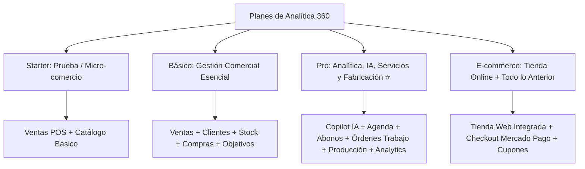

# ⭐ Manual de Uso: Suscripción, Planes y Límites del Sistema

> [!info] Objetivo de la Funcionalidad
> En esta sección podés consultar el estado de tu suscripción a **Analítica 360**, comparar las características de cada plan (**Starter, Básico, Pro y E-commerce**), cambiar la frecuencia de pago (mensual, trimestral o anual con descuento) y desbloquear funciones avanzadas al instante.

> [!abstract] Requisitos Previos y Permisos
> - **Rol de Usuario Requerido:** Visible para todos los usuarios; la contratación y cambio de plan está reservada al **Dueño** del comercio.

---

## 🗺️ Matriz de Planes y Funcionalidades

---

## 📍 Flujo de Navegación

1. En el menú lateral izquierdo, sección inferior **Cuenta**, hacé clic en **"Planes"** (ícono de estrella ⭐).
2. Verás tu plan actual destacado, la fecha de próxima renovación y el cuadro comparativo de planes.

---

## 📋 Comparativa Detallada de Planes

| Característica / Módulo | Plan Starter | Plan Básico | Plan Pro ⭐ *(Popular)* | Plan E-commerce |
| :--- | :---: | :---: | :---: | :---: |
| **Ventas, POS y Clientes** | ✅ | ✅ | ✅ | ✅ |
| **Stock, Compras e Inventario** | Limitado | ✅ | ✅ | ✅ |
| **Facturación Electrónica ARCA** | Opcional | ✅ | ✅ | ✅ |
| **Objetivos de Venta** | ❌ | ✅ | ✅ | ✅ |
| **Copilot IA (Analítica IA)** | ❌ | ❌ | ✅ | ✅ |
| **Agenda de Turnos y Citas** | ❌ | ❌ | ✅ | ✅ |
| **Abonos y Membresías** | ❌ | ❌ | ✅ | ✅ |
| **Órdenes de Trabajo (Taller)** | ❌ | ❌ | ✅ | ✅ |
| **Producción y Fórmulas BOM** | ❌ | ❌ | ✅ | ✅ |
| **Liquidación de Comisiones** | ❌ | ❌ | ✅ | ✅ |
| **Archivo Digital de Contratos** | ❌ | ❌ | ✅ | ✅ |
| **Tienda Online Pública** | ❌ | ❌ | ❌ | ✅ |
| **Límite de Colaboradores** | 1 usuario | Hasta 3 usuarios | Hasta 10 usuarios | Ilimitados |
| **Estudio Contable (Contador)**| Gratis | Gratis | Gratis | Gratis |

---

## 🔄 Paso a Paso: Ejecución de Casos de Uso

### Caso 1: Mejorar a un Plan Superior (Upgrade)

1. En la pantalla de **Planes**, revisá las columnas de opciones.
2. Elegí el ciclo de facturación:
   - **Mensual:** Flexibilidad total mes a mes.
   - **Trimestral:** Descuento por pago adelantado.
   - **Anual:** Máximo ahorro (equivalente a 2 meses bonificados).
3. Hacé clic en el botón **"Mejorar a Pro"** (o al plan deseado).
4. El sistema abrirá la pasarela segura de pago (Mercado Pago o datos de transferencia bancaria).
5. Tras confirmar el pago, las nuevas funciones y candados se desbloquearán de inmediato sin esperas ni reinstalaciones.

### Caso 2: ¿Qué significa un ícono de Candado en el Menú?

1. Si navegás por la plataforma y ves un ítem en gris con un pequeño candado (ej. en *Copilot IA* o *Producción*):
2. Significa que esa función pertenece a un plan superior al que tiene contratado tu comercio actualmente.
3. Al hacer clic en el botón con candado, se abrirá un cuadro informativo explicándote los beneficios de esa herramienta y dándote la opción de probarla o mejorar el plan.

---

## ⚠️ Solución de Problemas y Errores Frecuentes

> [!faq] Consultas Frecuentes sobre Facturación del Sistema

| Situación en Pantalla | Causa Probable | Solución Sugerida |
| :--- | :--- | :--- |
| **"Suscripción en período de gracia / Pendiente de pago"** | No se registró el pago automático de la cuota mensual. | Ingresá a Planes para regularizar el pago con tarjeta o enviar el comprobante de transferencia bancaria. |
| **"¿Pierdo mis datos si bajo de plan?"** | No. Si decidís cambiar de plan, toda tu información histórica queda a salvo en la base de datos de tu empresa. | Podés volver a mejorar tu plan cuando lo desees y reactivar las funciones. |

---

## 🔗 Manuales y Documentos Relacionados

- `[[00 - Índice General y Guía de Navegación]]`
- `[[02 - Roles, Permisos y Gestión de Equipo]]`
- `[[04 - Copilot IA - Asistente Estratégico de Negocio]]`
- `[[20 - Tienda Online y Storefront Multi-Negocio]]`
- `[[24 - Programa de Referidos (Recomendá y Ganá)]]`

---

🔍 <b>Ficha Técnica y Trazabilidad (Para Equipos de Soporte y QA)</b>

### 🖥️ Frontend (Interfaz de Usuario)
- **Componentes:** `apps/web/src/features/planes/planes.ts`, `apps/web/src/components/shared/mejorar-plan.tsx`, `use-plan.ts`
- **Ruta de Navegación (URL):** `/planes`

### ⚙️ Backend (Servicio y API)
- **Controlador Suscripción:** `SuscripcionController` en `apps/api/src/modules/planes/suscripcion.controller.ts`
- **Controlador Precios:** `PreciosPlanController` en `apps/api/src/modules/planes/precios-plan.controller.ts`
- **Endpoints:**
  - `GET /planes/precios` (Catálogo dinámico de valores por ciclo con descuentos aplicados).
  - `GET /planes/mi-suscripcion` (Estado de la suscripción, fecha de renovación y módulos activos).
  - `POST /planes/cambiar` (Upgrade/Downgrade de plan con prorrateo).
- **DTOs:** `CambiarPlanDto`, `NotificacionPagoDto`

