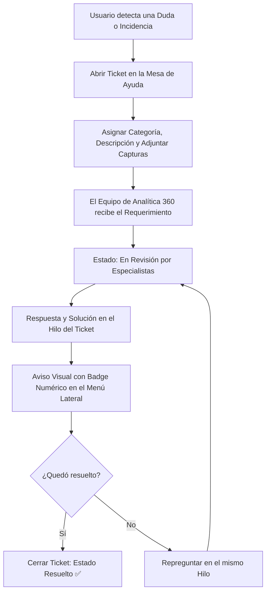

# 🎫 Manual de Uso: Mesa de Ayuda y Soporte Técnico

> [!info] Objetivo de la Funcionalidad
> El módulo de **Soporte** es tu vía directa de contacto con el equipo de especialistas de **Analítica 360**. Podés abrir consultas operativas, reportar comportamientos inesperados, adjuntar capturas de pantalla y seguir el estado de resolución en un hilo de conversación en tiempo real.

> [!abstract] Requisitos Previos y Permisos
> - **Acceso Universal:** Disponible para todos los usuarios y planes activos en la plataforma.

---

## 🗺️ Diagrama del Flujo de Atención y Tickets

---

## 📍 Flujo de Navegación

1. En el menú lateral izquierdo, sección inferior **Cuenta**, hacé clic en **"Soporte"** (ícono de ticket 🎫).
2. Si un agente de soporte te respondió un ticket, verás un **badge numérico** indicando mensajes sin leer.
3. Para iniciar una consulta, presioná **"+ Nuevo Ticket de Soporte"**.

---

## 📋 Guía Visual de Campos e Interacciones

| Campo / Control | Tipo | Obligatorio | Descripción / Regla |
| :--- | :--- | :---: | :--- |
| **Asunto** | Texto | Sí | Resumen corto de la consulta (ej: *"Duda al conectar certificado AFIP"*). |
| **Categoría** | Selector | Sí | `Consulta operativa`, `Problema técnico / Error`, `Facturación`, `Sugerencia`. |
| **Prioridad** | Selector | Sí | `Normal`, `Alta`, `Urgente` (ej. si la caja está detenida). |
| **Mensaje Detallado** | Texto multilínea | Sí | Explicá con la mayor cantidad de detalles lo ocurrido y los pasos realizados. |
| **Adjuntos / Capturas** | Imágenes / PDF | No | Subí una foto del error en pantalla para resolverlo con mayor rapidez. |

---

## 🔄 Paso a Paso: Ejecución de Casos de Uso

### Caso 1: Abrir un Ticket por Duda de Configuración

1. En **Soporte**, hacé clic en **"+ Nuevo Ticket"**.
2. Escribí el asunto (ej: *"¿Cómo emitir Nota de Crédito por devolución parcial?"*).
3. Seleccioná la categoría **Consulta Operativa**.
4. Detallá tu pregunta en el cuerpo del mensaje.
5. Presioná **"Enviar Ticket"**:
   - Se creará un identificador de seguimiento (ej: `#TKT-00891`).
   - El equipo de soporte recibirá la notificación al instante.

### Caso 2: Responder y Continuar una Conversación

1. Cuando recibas respuesta de un técnico:
   - Aparecerá el aviso en el menú **Soporte**.
   - Hacé clic sobre el ticket para leer el mensaje del agente.
2. Si la respuesta soluciona tu consulta, podés presionar **"Marcar como Resuelto"**.
3. Si necesitás aclarar algo más, escribí tu réplica en la caja de texto inferior y presioná **"Enviar Respuesta"**.

---

## ⚠️ Solución de Problemas y Buenas Prácticas

> [!tip] Consejos para una atención más rápida
> - Adjuntar una captura de pantalla clara del error o mensaje en pantalla reduce a la mitad el tiempo de resolución.
> - Si tu consulta es sobre una venta o cliente específico, indicá el número de venta o CUIT correspondiente.

---

## 🔗 Manuales y Documentos Relacionados

- `[[00 - Índice General y Guía de Navegación]]`
- `[[21 - Configuración General, Datos Fiscales y Parámetros]]`
- `[[22 - Suscripción, Planes y Límites del Sistema]]`
- `[[25 - Glosario de Términos y Preguntas Frecuentes]]`

---

🔍 <b>Ficha Técnica y Trazabilidad (Para Equipos de Soporte y QA)</b>

### 🖥️ Frontend (Interfaz de Usuario)
- **Componentes:** `apps/web/src/features/soporte/components/`, `useTicketsNoLeidos()` en `apps/web/src/hooks/use-tickets-no-leidos.ts`
- **Ruta de Navegación (URL):** `/soporte`, `/soporte/:ticketId`

### ⚙️ Backend (Servicio y API)
- **Controlador:** `TicketController` en `apps/api/src/modules/soporte/ticket.controller.ts`
- **Endpoints:**
  - `GET /soporte/tickets` (Listado de tickets de la organización).
  - `POST /soporte/tickets` (Apertura de nuevo ticket).
  - `POST /soporte/tickets/:id/mensajes` (Intercambio de mensajes en el hilo).
  - `GET /soporte/no-leidos` (Conteo de respuestas no leídas para el badge del menú lateral).
- **DTOs:** `CrearTicketDto`, `AgregarMensajeTicketDto`

