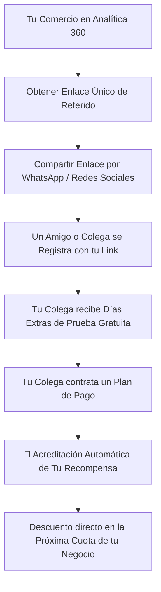

# 🎁 Manual de Uso: Programa de Referidos (Recomendá y Ganá)

> [!info] Objetivo de la Funcionalidad
> El programa **Recomendá y Ganá** te premia por recomendar **Analítica 360** a otros comerciantes, distribuidores, amigos o clientes. Compartiendo tu enlace exclusivo, los nuevos comercios acceden a beneficios de bienvenida y vos acumulás créditos y descuentos directos en tu suscripción mensual.

> [!abstract] Requisitos Previos y Permisos
> - **Rol de Usuario Requerido:** Disponible para usuarios con permiso sobre `Configuración` / Cuenta (`[[02 - Roles, Permisos y Gestión de Equipo]]`).

---

## 🗺️ Diagrama del Flujo de Recomendación y Recompensas

---

## 📍 Flujo de Navegación

1. En el menú lateral izquierdo, sección inferior **Cuenta**, hacé clic en **"Recomendá y ganá"** (ícono de regalo 🎁).
2. Verás tu enlace personal, botones de difusión rápida y el tablero con el estado de tus amigos recomendados.

---

## 📋 Guía Visual de Campos y Paneles

| Panel / Control | Tipo | Descripción |
| :--- | :--- | :--- |
| **Tu Enlace Exclusivo** | Enlace copiable | Dirección única personalizada (ej: `https://app.analitica360.com/r/TUCOMERCIO`). |
| **Botón "Copiar Enlace"**| Acción | Copia la URL al portapapeles de tu dispositivo en un clic. |
| **Botón "Compartir por WhatsApp"**| Acción | Abre WhatsApp con un mensaje amigable prediseñado listo para enviar. |
| **Comercios Registrados**| Contador | Cantidad de amigos que crearon su cuenta con tu recomendación. |
| **Comercios Activos** | Contador | Amigos que ya están operando con planes de pago. |
| **Saldo Bonificado ($)**| Moneda ($) | Créditos ganados que se descontarán de tus próximas facturas de Analítica 360. |

---

## 🔄 Paso a Paso: Ejecución de Casos de Uso

### Caso 1: Invitar a un Colega Comerciante por WhatsApp

1. Diríjase a **Recomendá y ganá**.
2. Hacé clic en el botón verde **"Compartir por WhatsApp"**.
3. Seleccioná el contacto o grupo de comerciantes:
   - Se enviará un mensaje invitándolo a probar el sistema con beneficios exclusivos de bienvenida.
4. Cuando tu colega abra el link y cree su cuenta (`[[01 - Primeros Pasos, Registro y Acceso]]`), figurará en tu lista de recomendaciones.

### Caso 2: Aplicación del Descuento en tu Factura

1. Tan pronto como tu comercio recomendado abone su primer mes de abono:
   - El sistema te enviará una notificación felicitándote.
   - En tu siguiente ciclo de cobro (`[[22 - Suscripción, Planes y Límites del Sistema]]`), el monto bonificado se descontará automáticamente de tu cuota.

---

## ⚠️ Solución de Problemas y Errores Frecuentes

> [!faq] Consultas Frecuentes sobre Referidos

| Duda Frecuente | Explicación |
| :--- | :--- |
| **"Un amigo se registró pero no aparece en mi lista"** | Asegurate de que haya completado el registro haciendo clic directamente en tu enlace de referido y no entrando por la portada general. |
| **"¿Hay límite de amigos que puedo recomendar?"** | No, podés invitar a todos los comercios que desees. ¡Muchos comercios logran que su suscripción a Analítica 360 sea 100% gratuita gracias a sus recomendaciones! |

---

## 🔗 Manuales y Documentos Relacionados

- `[[00 - Índice General y Guía de Navegación]]`
- `[[01 - Primeros Pasos, Registro y Acceso]]`
- `[[21 - Configuración General, Datos Fiscales y Parámetros]]`
- `[[22 - Suscripción, Planes y Límites del Sistema]]`

---

🔍 <b>Ficha Técnica y Trazabilidad (Para Equipos de Soporte y QA)</b>

### 🖥️ Frontend (Interfaz de Usuario)
- **Componente:** `apps/web/src/features/referidos/RecomendarVista.tsx`
- **Ruta de Navegación (URL):** `/recomendar`

### ⚙️ Backend (Servicio y API)
- **Controlador:** `ReferidosController` en `apps/api/src/modules/alianzas/referidos.controller.ts`
- **Endpoints:**
  - `GET /alianzas/mi-enlace` (Generación y lectura del código de afiliado).
  - `GET /alianzas/estadisticas` (Conteo de conversiones, comisiones acumuladas y créditos).
- **DTOs:** `AplicarRecompensaDto`

