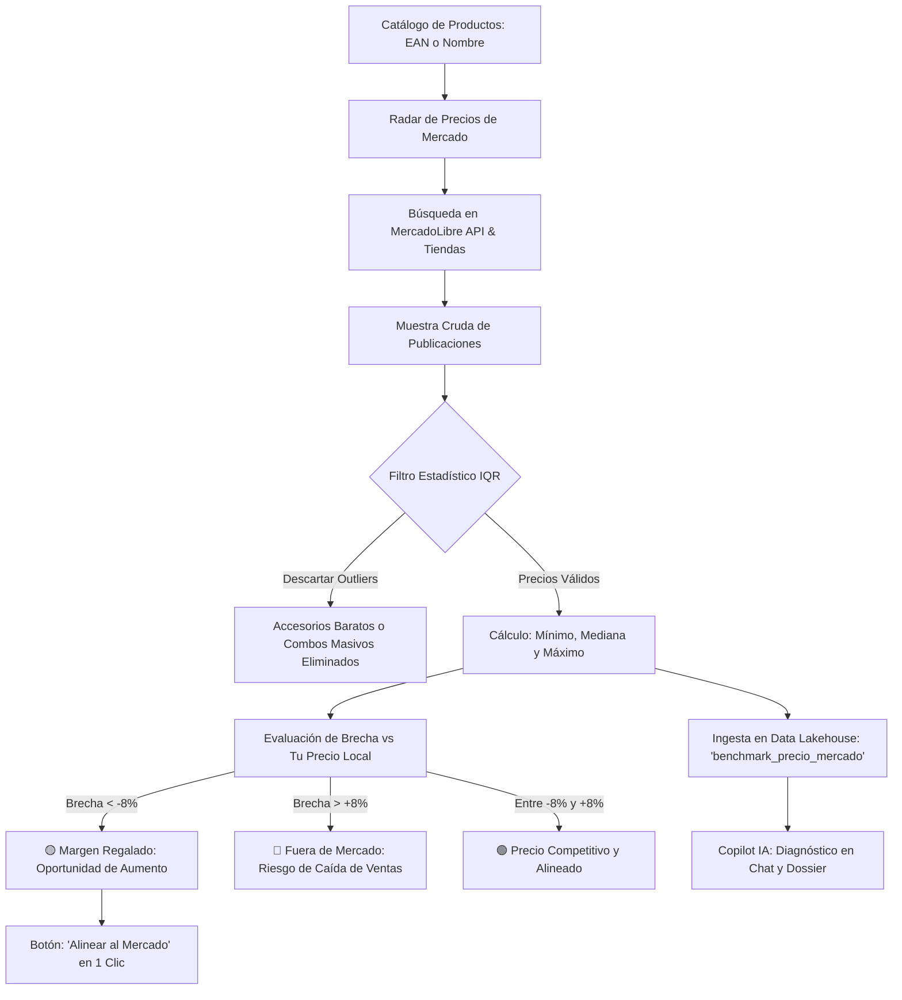

# 🎯 Manual de Uso: Radar de Precios de Mercado y Benchmark Competitivo

> [!info] Objetivo de la Funcionalidad
> El **Radar de Precios** rastrea y compara continuamente los precios de tus productos frente al mercado real (MercadoLibre y tiendas competidoras). Utiliza un **motor estadístico con filtro intercuartil (IQR)** para descartar publicaciones engañosas y calcula la mediana de mercado para detectar:
> 1. **Oportunidades de Margen (Precio Regalado):** Artículos que vendés muy por debajo del mercado donde podés subir el precio sin perder ventas.
> 2. **Riesgo de Competitividad (Fuera de Mercado):** Productos más caros que la competencia donde las ventas cayeron.
> 3. **Alineación en 1 Clic:** Actualización inmediata del precio del catálogo al valor sugerido del mercado.

> [!abstract] Requisitos Previos y Permisos
> - **Rol de Usuario Requerido:** `Dueño` o colaborador con permiso de `Productos`.
> - Los productos con **Código de Barras (EAN-13)** o marca/modelo claro en su nombre obtienen una coincidencia mucho más precisa.

---

## 🗺️ Flujo de Scraping, Limpieza IQR y Data Lakehouse

---

## 📍 Flujo de Navegación

1. En el menú lateral izquierdo, sección **Stock y compras**, hacé clic en **"Productos"**.
2. En la barra superior de acciones, presioná el botón **"Radar de precios"** (destacado con ícono de radar verde esmeralda ✨).
3. Accederás a la pantalla `/productos/radar`, donde verás el panel de KPIs consolidados, el buscador y la tabla interactiva de benchmarking.

---

## 📋 Guía Visual de Componentes y Funciones

| Elemento Visual | Tipo | Descripción | Ejemplo de Uso |
| :--- | :--- | :--- | :--- |
| **Botón "Escanear Lote Activo"** | Acción Principal | Escanea automáticamente un bloque de productos del catálogo contra la API pública de MercadoLibre. | Analizar de una sola vez los productos más vendidos. |
| **Tarjeta "Margen Regalado"** | KPI Filtro | Muestra cuántos productos vendés a un precio significativamente menor al del mercado (&gt;8% más barato). | Filtrar para ver qué artículos podés aumentar hoy mismo. |
| **Tarjeta "Fuera de Mercado"** | KPI Filtro | Muestra cuántos productos tuyos están más caros que la mediana de mercado (&gt;8% más caro). | Evaluar si las bajas ventas de un producto se deben a su precio. |
| **Rango de Mercado** | Barra Gráfica | Muestra visualmente el precio mínimo, la mediana (punto central) y el máximo detectados en publicaciones reales. | Comprobar la dispersión de precios en la calle. |
| **Referencias Detectadas** | Links Clickeables | Enlaces directos a las publicaciones de MercadoLibre para verificar el vendedor, fotos y condiciones. | Abrir la publicación en una pestaña nueva con un clic. |
| **Botón "Alinear"** | Acción Rápida | Modifica el precio de venta en el catálogo fijándolo exactamente en la mediana de mercado y actualiza el historial. | Ajustar el precio de venta en 1 solo segundo. |

---

## 🔄 Paso a Paso: Casos de Uso Frecuentes

### Caso 1: Escanear un Lote y Ajustar Precios con Margen Regalado

1. Ingresá a **Productos** &gt; **Radar de precios**.
2. Presioná el botón **"Escanear Lote Activo"**:
   - El sistema consultará el catálogo de MercadoLibre en tiempo real.
   - En pocos segundos, la tabla se poblará con las publicaciones y la mediana de precios.
3. Hacé clic en la tarjeta **"Margen Regalado"** para filtrar solo las oportunidades:
   - Verás, por ejemplo, que vendés un artículo a `$5.200` y la mediana de mercado es `$6.400` (brecha de `-18.7%`).
4. Hacé clic en **"Alinear"** en esa fila:
   - El sistema actualizará el precio de venta a `$6.400` en tu catálogo.
   - Quedará registrado en el historial de precios con el motivo *"Alineado con mediana de mercado"*.
   - A partir de ese momento, el POS (`[[05 - Punto de Venta (POS), Cobros y Facturación ARCA]]`) cobrará el nuevo valor.

### Caso 2: Consultar a Copilot IA sobre Precios Desfasados

1. Abrí **Copilot IA** (`[[04 - Copilot IA - Asistente Estratégico de Negocio]]`) desde el menú lateral.
2. Preguntá en el chat:
   > *"¿Qué productos tengo desfasados con los precios de la calle y cuánto margen estoy perdiendo?"*
3. **Resultado:**
   - Copilot leerá los insights precomputados del Data Lakehouse y te responderá con los nombres exactos de los artículos, la brecha porcentual y el impacto monetario estimado en tu facturación mensual.

---

## ⚠️ Solución de Problemas y Buenas Prácticas

> [!tip] Consejos para obtener las mejores comparativas
> - **Cargá siempre el Código de Barras (EAN-13):** Es el identificador universal. Cuando un producto tiene código de barras, el matching es 100% exacto y no se confunde con variantes o modelos parecidos.
> - **Nombres claros:** Si el producto no tiene código de barras, asegurate de que el nombre incluya la marca y la medida (ej: *"Taladro Percutor DeWalt DWD024 650W"* en vez de solo *"Taladro"*).
> - **Filtro IQR automático:** No te preocupes por publicaciones engañosas (ej. fundas de $500 o combos mayoristas de $500.000); el filtro intercuartil las purga automáticamente antes de calcular la mediana.

---

🔍 <b>Ficha Técnica y Trazabilidad (Soporte / Devs)</b>

- **Módulo Backend:** `apps/api/src/modules/radar-precios/` (`RadarPreciosService`, `RadarPreciosController`).
- **Endpoints:**
  - `GET /radar-precios/comparativas`: devuelve los últimos benchmarks guardados en el Data Lake.
  - `POST /radar-precios/escanear/:id`: escaneo puntual por ID de producto.
  - `POST /radar-precios/escanear-lote`: escaneo masivo de catálogo.
  - `POST /radar-precios/alinear/:id`: actualiza precio y emite evento en Lake.
- **Evento en Data Lakehouse:** `lake_eventos` con `tipoEvento = 'benchmark_precio_mercado'`.
- **Feature Store IA:** `copilot_insights_cache` con categoría `oportunidad_margen` y `desfasaje_competitivo`.
- **Componentes Frontend:** `RadarPreciosVista.tsx`, hook `use-radar-precios.ts`, ruta `/productos/radar`.

