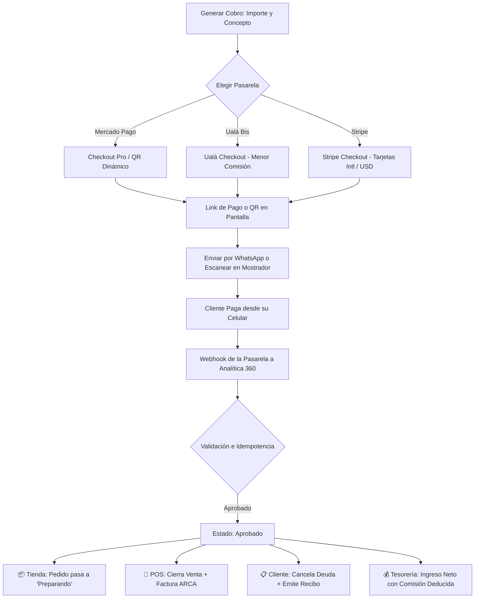

# 💳 Manual de Uso: Centro de Cobros y Pasarelas de Pago

> [!info] Objetivo de la Funcionalidad
> El **Centro de Cobros** centraliza en una sola pantalla todos los medios de cobro digitales de tu empresa (**Mercado Pago**, **Ualá Bis** y **Stripe**). Te permite:
> 1. **Generar Links de Pago y Códigos QR en 1 Clic:** Para enviar por WhatsApp, compartir por email o cobrarle al cliente frente al mostrador.
> 2. **Trazabilidad y Conciliación en Vivo:** Seguimiento en tiempo real de qué cliente pagó, por qué medio, qué comisión te cobró la pasarela y cuánto dinero neto ingresó.
> 3. **Omnicanalidad Automática:** Al acreditarse el pago por webhook, el sistema actualiza automáticamente el pedido de la tienda online, la factura electrónica en el POS o cancela la deuda de la cuenta corriente.

> [!abstract] Requisitos Previos y Permisos
> - **Permiso Requerido:** Colaborador con módulo de `Ventas` o rol `Dueño`.
> - Para configurar credenciales y claves de pasarelas se requiere rol `Dueño`.

---

## 🗺️ Diagrama del Flujo de Cobro y Automatización

---

## 📍 Flujo de Navegación

1. En el menú lateral izquierdo (sidebar), dentro del grupo **"Ventas"**, hacé clic en **"Cobros"** (ícono de tarjeta de crédito 💳).
2. Accederás al panel `/cobros`, donde disponés de 4 pestañas operativas:
   - **Historial de Transacciones:** Tabla en vivo de todos los cobros emitidos.
   - **Generar Link / QR Rápido:** Formulario para emitir un cobro y enviarlo por WhatsApp.
   - **Configuración de Pasarelas:** Conexión de Mercado Pago, Ualá Bis y Stripe.
   - **Comisiones & Auditoría:** Comparativa de comisiones financieras retenidas.

---

## 📋 Guía Visual de Componentes y Funciones

| Elemento Visual | Tipo | Descripción | Ejemplo de Uso |
| :--- | :--- | :--- | :--- |
| **Pestaña "Historial de Transacciones"** | Tabla Interactiva | Lista todas las transacciones con filtros por pasarela, estado y canal. | Auditar si el cliente que dice haber pagado ya tiene el dinero acreditado. |
| **Botón "Generar Link de Cobro"** | Acción Principal | Abre el formulario para emitir un cobro personalizado. | Cobrar una seña de un trabajo a medida antes de empezar. |
| **Botón "Enviar por WhatsApp"** | Acción Rápida | Abre una conversación de WhatsApp con el mensaje y link prearmado. | Reclamar un saldo a un cliente con cuenta corriente impaga. |
| **Tarjeta "Mercado Pago"** | Configuración | Conecta tu cuenta mediante Access Token para cobros locales. | Aceptar dinero en cuenta y tarjetas de crédito locales. |
| **Tarjeta "Ualá Bis"** | Configuración | Configura `User Name`, `Client ID` y `Client Secret` con tasas reducidas (~3.5%). | Ahorrar comisiones en cobros de mostrador frente a MP. |
| **Tarjeta "Stripe"** | Configuración | Conecta `Secret Key` y `Publishable Key` para ventas internacionales. | Cobrar en dólares a clientes del exterior con Visa/Mastercard/Apple Pay. |
| **Tarjetas KPI Superiores** | Métricas en Vivo | Muestra Cobrado este Mes, Comisiones Retenidas y Neto Acreditado. | Conocer exactamente cuánta plata limpia ingresó a tu negocio. |

---

## 🔄 Paso a Paso: Casos de Uso Frecuentes

### Caso 1: Generar un Link de Cobro y Mandarlo por WhatsApp

1. Ingresá a **Ventas** > **Cobros**.
2. Hacé clic en la pestaña **"Generar Link / QR Rápido"**.
3. Ingresá el monto (ej. `$25.000`) y el concepto (ej. *"Seña mueble petiribí"*).
4. Seleccioná la pasarela con la que deseás cobrar (ej. **Ualá Bis** para pagar menor comisión).
5. Opcionalmente, ingresá el nombre y correo del cliente.
6. Presioná **"Generar Link de Cobro"**.
7. Hacé clic en **"Enviar por WhatsApp"**:
   - Se abrirá WhatsApp Web o la app en tu celular con el link listo para enviar.
8. Cuando el cliente pague, la tabla de transacciones cambiará automáticamente a estado **Aprobado** (verde).

### Caso 2: Conectar Ualá Bis para Bajar Costos de Comisión

1. En el panel de Cobros, abrí la pestaña **"Configuración de Pasarelas"**.
2. En la tarjeta de **Ualá Bis**, ingresá:
   - Tu email de usuario Ualá.
   - Tu `Client ID` y `Client Secret` (obtenidos en el portal de desarrolladores de Ualá Bis).
3. Presioná **"Guardar"**:
   - Las claves se cifran con estándar bancario AES-256-GCM.
   - La pasarela quedará activa y disponible tanto en el generador de cobros como en el checkout de la tienda online.

---

## ⚠️ Solución de Problemas y Preguntas Frecuentes

> [!faq] Preguntas frecuentes sobre cobros digitales
>
> **¿Qué pasa si un cliente dice que pagó pero figura "Pendiente"?**
> - Los cobros con tarjeta o dinero en cuenta se acreditan en segundos. Si figura pendiente, el cliente puede tener la operación en revisión por su banco o no haber concluido el checkout. Podés tocar el botón de "Actualizar" en la tabla para consultar el estado en la pasarela.
>
> **¿Analítica 360 retiene dinero de las ventas?**
> - No. El dinero viaja directo desde la pasarela (Mercado Pago, Ualá o Stripe) a tu propia cuenta bancaria o virtual. Analítica 360 no cobra comisiones intermedias.
>
> **¿Cómo evitan cobros duplicados si la pasarela reintenta el aviso?**
> - El sistema cuenta con control de idempotencia nativo: cada transacción tiene un identificador único que impide duplicar ingresos o emitir comprobantes repetidos.

---

## 🔗 Manuales Relacionados

- `[[00 - Índice General y Guía de Navegación]]`
- `[[05 - Punto de Venta (POS), Cobros y Facturación ARCA]]`
- `[[06 - Gestión de Clientes, Cuentas Corrientes y Difusiones]]`
- `[[20 - Tienda Online y Storefront Multi-Negocio]]`

---

🔍 <b>Ficha Técnica y Trazabilidad (Para Equipos de Soporte y QA)</b>

### 🖥️ Frontend (Interfaz de Usuario)
- **Ruta de Navegación:** `/cobros`
- **Pestaña en Menú Lateral:** `apps/web/src/components/shared/app-sidebar.tsx` (icono `CreditCard`, grupo `Ventas`).
- **Componentes:** `apps/web/src/features/cobros/components/CobrosVista.tsx`
- **Hooks React Query:** `usePasarelasConfig`, `useTransaccionesCobros`, `useMetricasCobros`, `useCrearCobro`, `useGuardarPasarela` en `apps/web/src/features/cobros/hooks/use-cobros.ts`.

### ⚙️ Backend (Servicio y API)
- **Módulo NestJS:** `apps/api/src/modules/pasarelas/` (`PasarelasModule`, `PasarelasController`, `PasarelasWebhookController`).
- **Orquestador:** `PasarelasCoordinadorService` (manejo de credenciales con AES-256-GCM y eventos en el Data Lake).
- **Adapters:**
  - `MercadoPagoAdapter`: Checkout Preferences API + notificaciones IPN.
  - `UalaAdapter`: Autenticación OAuth client credentials + Checkout v2 Orders.
  - `StripeAdapter`: Checkout Sessions API + validación criptográfica de firmas `Stripe-Signature` (HMAC-SHA256).
- **Modelos de Base de Datos:**
  - `empresa_pasarelas_config`: Configuración de credenciales cifradas por empresa y proveedor.
  - `pasarela_transacciones`: Historial omnicanal de cobros vinculados polimórficamente a `pedido_tienda`, `venta_pos`, `cobro_cuenta_corriente`, `reserva_turno` o `link_rapido`.
- **Endpoints de la API:**
  - `GET /pasarelas/config`: Estado de conexión de pasarelas.
  - `POST /pasarelas/config`: Guardar credenciales cifradas.
  - `DELETE /pasarelas/config/:proveedor`: Desconectar pasarela.
  - `POST /pasarelas/cobros`: Emisión de cobro rápido.
  - `GET /pasarelas/transacciones`: Listado paginado con filtros.
  - `GET /pasarelas/metricas`: Métricas y comisiones del mes.
  - `POST /pasarelas/webhook/:proveedor`: Receptor público de webhooks con idempotencia.

