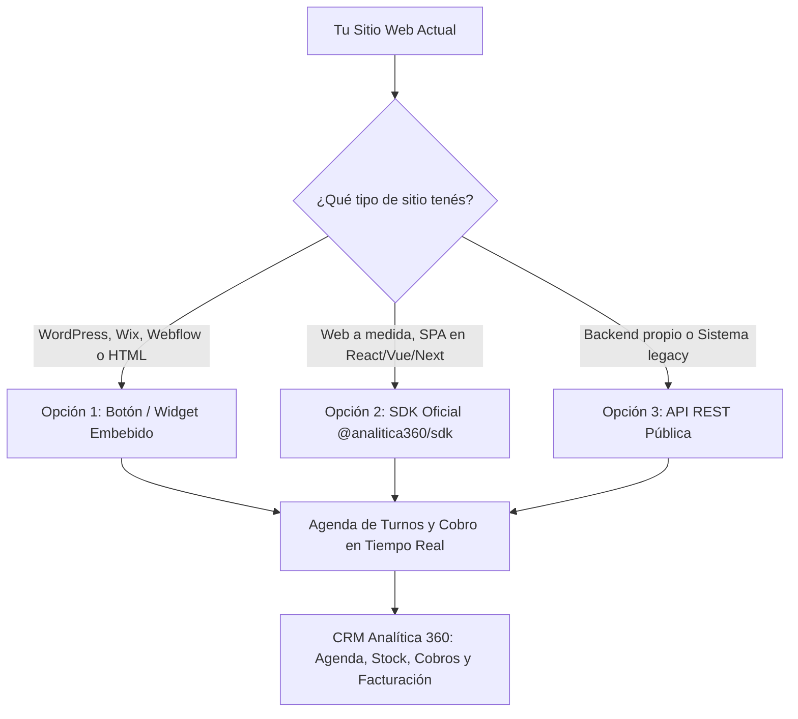

# 🔌 Integraciones API, SDK y Widgets para Sitios Web y SPAs Externas

> [!info] **Propósito del Módulo**
> Si tu negocio (un centro de estética o spa, consultorio médico, barbería, comercio minorista o empresa de servicios) ya cuenta con una página web existente (desarrollada en WordPress, Wix, Webflow, Shopify o una aplicación a medida tipo SPA en React/Vue), **no necesitás abandonar tu sitio web ni empezar de cero**. 
> 
> Analítica 360 te permite conectar tu sitio actual de forma instantánea para que tus clientes puedan **reservar turnos online**, ver el **catálogo con precios en vivo** y **comprar productos**, sincronizando todo automáticamente con tu agenda, tu stock, tus cobros de Mercado Pago y tu facturación fiscal.

---

> [!prereq] **Requisitos Previos y Configuración**
> 1. Tener una cuenta activa en Analítica 360 con los módulos de **[[08 - Agenda de Turnos y Reservas Online]]** o **[[20 - Tienda Online y Storefront Multi-Negocio]]** habilitados en tu plan.
> 2. Contar con al menos un servicio o producto cargado en **[[11 - Catálogo de Productos, Servicios y Variantes]]** y marcado como visible para la web.
> 3. Conocer el **ID de tu Empresa** (`empresaId`), disponible en **[[21 - Configuración General, Datos Fiscales y Parámetros]]**.

---

## 🗺️ Mapa de Integración y Opciones Disponibles

Podés integrar Analítica 360 con tu web según el nivel técnico que prefieras:



---

## 🛠️ Opción 1: Widget Embebido de Turnos (Cero Código)

Ideal para negocios sin programadores propios. Te permite agregar un botón flotante de **"Reservar Turno"** o **"Agendá tu Cita"** en cualquier página web existente.

### Paso a paso para instalarlo en tu web:
1. Copiá el siguiente bloque de código.
2. Pegalo en el editor de tu web (en la sección de código HTML personalizado o antes de la etiqueta de cierre `</body>`):

```html
<!-- Widget Oficial de Reservas Online Analítica 360 -->
<script 
  src="https://cdn.analitica360.app/widget.js" 
  data-empresa="TU_ID_DE_EMPRESA"
  data-color="#059669"
  data-position="bottom-right"
  data-button-text="Reservar Turno"
></script>
```

### Parámetros de Personalización:
| Parámetro | Ejemplo | Qué hace |
|---|---|---|
| `data-empresa` | `123e4567-e89b-12d3...` | Identifica tu comercio de forma segura sin revelar contraseñas. |
| `data-color` | `#059669` o `#ec4899` | Cambia el color del botón y acentos para combinar con la marca de tu negocio. |
| `data-position` | `bottom-right` o `bottom-left` | Define en qué esquina de la pantalla flota el botón. |
| `data-button-text` | `"Reservar Turno"`, `"Agendá tu Cita"` | El texto visible del botón de reserva. |

> [!tip] **¿Qué ve tu cliente al hacer clic?**
> Se despliega una ventana moderna y elegante donde tu cliente:
> 1. Elige el **servicio** (ej. *Masaje descontracturante*, *Corte y peinado*, *Consulta nutricional*).
> 2. Selecciona el **profesional** o elige *"Cualquiera disponible"*.
> 3. Elige el **día y horario libre** en tiempo real.
> 4. Ingresa su **nombre y WhatsApp**.
> 5. Recibe la **confirmación instantánea** con opción de guardarlo en Google Calendar y link para cancelar si le surge un imprevisto.

---

## 💻 Opción 2: SDK Oficial en TypeScript / JavaScript (`@analitica360/sdk`)

Si tu equipo cuenta con desarrolladores o contrataste una agencia para armar una **Single Page Application (SPA)** en Next.js, React, Vue, Svelte o Astro, pueden utilizar el SDK oficial preinstalado en el monorepo.

### Instalación en el proyecto:
```bash
npm install @analitica360/sdk
# o
pnpm add @analitica360/sdk
```

### Ejemplo de uso para reservas de turnos:
```typescript
import { Analitica360Client } from '@analitica360/sdk';

const crm = new Analitica360Client({
  empresaId: 'TU_ID_DE_EMPRESA'
});

// 1. Obtener la lista de servicios y profesionales
const opciones = await crm.turnos.opciones();

// 2. Consultar horarios libres para una fecha
const libres = await crm.turnos.libres({
  fecha: '2026-10-30',
  servicioId: 'id-del-servicio'
});

// 3. Confirmar la reserva del cliente
const reserva = await crm.turnos.reservar({
  servicioId: 'id-del-servicio',
  fecha: '2026-10-30',
  hora: '15:30',
  nombre: 'Mariana López',
  telefono: '2615554321',
  notas: 'Alergia a cremas con perfume'
});

console.log('Turno registrado:', reserva.cuando, 'con', reserva.profesional);
```

### Ejemplo de uso para catálogo y venta de productos:
```typescript
// 1. Consultar productos disponibles con precios actualizados y ofertas
const productos = await crm.catalogo.listar();

// 2. Crear un pedido desde la web externa
const pedido = await crm.pedidos.crear({
  clienteNombre: 'Carlos Ruiz',
  clienteEmail: 'carlos@ejemplo.com',
  clienteTelefono: '2614445566',
  direccionEnvio: 'Av. Libertador 450',
  codigoPostal: '5500',
  localidad: 'Mendoza',
  provincia: 'Mendoza',
  formaPago: 'mercadopago',
  items: [
    { productoId: 'uuid-producto', cantidad: 1 }
  ]
});

// 3. Si paga con Mercado Pago, redirigir a la pantalla de pago
if (pedido.pagoUrl) {
  window.location.href = pedido.pagoUrl;
}
```

---

## ⚡ Qué ocurre en el CRM cuando entra una reserva o pedido externo

1. **Agenda Diaria:** El turno aparece automáticamente en el calendario del profesional asignado, bloqueando ese horario para evitar solapamientos (`[[08 - Agenda de Turnos y Reservas Online]]`).
2. **Directorio de Clientes:** Si es un cliente nuevo, se crea automáticamente su ficha con su número de contacto y notas en `[[06 - Gestión de Clientes, Cuentas Corrientes y Difusiones]]`.
3. **Notificación:** Los administradores del negocio reciben un correo de aviso informando la nueva reserva o pedido.
4. **Pedidos y Stock:** Si compró un producto físico, se descuenta el stock del depósito principal y entra en la cola de empaque de `[[07 - Gestión de Pedidos, Picking y Despachos]]`.

---

## ❓ Preguntas Frecuentes

> [!faq] **¿El cliente puede manipular los precios desde su navegador?**
> **No.** El backend de Analítica 360 valida y recalcula en el servidor todos los precios, descuentos, stock y disponibilidad horaria. No se confía en ningún dato de precio enviado desde el cliente.

> [!faq] **¿Se pueden bloquear días feriados o vacaciones?**
> Sí. Cualquier bloqueo de fecha o profesional configurado en la pantalla de Agenda del CRM se refleja de inmediato en el widget o la web externa, impidiendo que reserven en días no laborables.

> [!faq] **¿Qué pasa si dos clientes intentan reservar el mismo horario a la vez?**
> El sistema cuenta con control de concurrencia a nivel de base de datos. Si un horario es tomado en el mismo instante, al segundo cliente se le informa amablemente que el turno acaba de ser reservado y se le ofrece el siguiente turno libre.

---

## 🔗 Manuales y Documentos Relacionados

- `[[00 - Índice General y Guía de Navegación]]`
- `[[08 - Agenda de Turnos y Reservas Online]]`
- `[[11 - Catálogo de Productos, Servicios y Variantes]]`
- `[[20 - Tienda Online y Storefront Multi-Negocio]]`
- `[[27 - Centro de Cobros y Pasarelas de Pago (Mercado Pago, Ualá y Stripe)]]`

---

<details>
<summary>🔍 <b>Ficha Técnica y Trazabilidad (Para Equipos de Desarrollo, Soporte y QA)</b></summary>

### 📦 Paquetes y Código Fuente
- **SDK Oficial:** `packages/sdk` en el monorepo (`@analitica360/sdk`)
- **Bundle Standalone / Widget:** `packages/sdk/dist/widget.standalone.js` (25 KB minificado y sin dependencias externas)
- **Componentes del Widget:** `packages/sdk/src/widget/index.ts`, `styles.ts`
- **Cliente HTTP Isomórfico:** `packages/sdk/src/client.ts`

### ⚙️ Endpoints Consumidos en Backend
- **Controlador Público:** `TiendaController` en `apps/api/src/modules/tienda/tienda.controller.ts`
- **Servicios:** `AgendaOnlineService` (`apps/api/src/modules/agenda/agenda-online.service.ts`), `TiendaService` (`apps/api/src/modules/tienda/tienda.service.ts`)
- **Rutas Principales:**
  - `GET /tienda/:empresaId/turnos`
  - `GET /tienda/:empresaId/turnos/libres`
  - `POST /tienda/:empresaId/turnos`
  - `GET /tienda/:empresaId/turnos/cancelar/:token`
  - `POST /tienda/:empresaId/turnos/cancelar/:token`
  - `GET /tienda/:empresaId/catalogo`
  - `GET /tienda/:empresaId/condiciones`
  - `POST /tienda/:empresaId/cupones/validar`
  - `POST /tienda/:empresaId/envios/cotizar`
  - `POST /tienda/:empresaId/pedidos`
  - `POST /tienda/:empresaId/pedidos/:id/pago`

</details>
