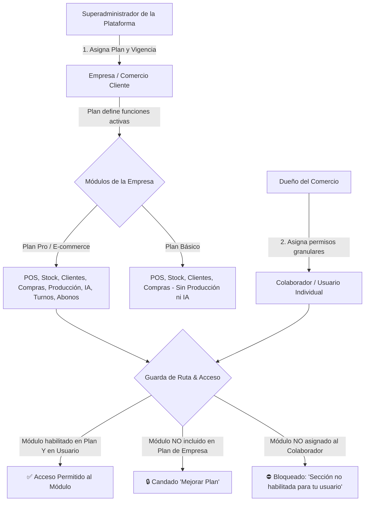

# 🛡️ Manual de Uso: Consola Superadmin y Control de Módulos por Usuario

> [!info] Objetivo de la Funcionalidad y Arquitectura de Acceso
> Analítica 360 implementa un modelo de control de acceso en **dos niveles jerárquicos**:
> 1. **Nivel Superadmin (Dueño de la Plataforma):** Habilita módulos y capacidades contratadas a **nivel Empresa / Tenant** mediante la asignación de Planes de Suscripción (`Starter`, `Básico`, `Pro`, `E-commerce`) y estados de cuenta (`activa`, `prueba`, `vencida`, `pausada`).
> 2. **Nivel Dueño de Comercio (Tenant Admin):** Dentro de los módulos permitidos por el plan de su empresa, el **Dueño** da de alta o baja los módulos y permisos operativos a cada **colaborador o usuario individual** de su equipo.

> [!abstract] Requisitos Previos y Permisos
> - **Para gestionar Empresas y Planes (Nivel 1):** Rol Superadmin del sistema (`@RequireAdminApp()`, acceso a `/admin`).
> - **Para gestionar Usuarios y Módulos individuales (Nivel 2):** Rol `Dueño` del comercio (`@Roles('dueno')`, acceso a `/configuracion` > `Equipo y Permisos`).

---

## 🗺️ Diagrama de Cascada de Autorización (Plataforma ↔ Empresa ↔ Usuario)

---

## 📍 Flujos de Navegación

### Flujo A: Superadmin gestionando la Empresa (`/admin`)
1. Inicie sesión con la cuenta de superadministrador de la plataforma.
2. Ingrese a la consola del producto: `https://analitica360.app/admin` (o `/admin/clientes`).
3. Localice la empresa cliente en la tabla de comercios y haga clic en su nombre para abrir la **Ficha del Cliente** (`/admin/clientes/:id`).
4. En el panel lateral derecho **"Acciones"**, seleccione el plan a asignar y la fecha límite de vigencia.

### Flujo B: Dueño de Comercio gestionando a sus Usuarios (`/configuracion`)
1. Ingrese a la plataforma con rol de **Dueño** de la empresa (`/inicio`).
2. En el menú lateral izquierdo, diríjase a **Configuración** (ícono de engranaje).
3. Seleccione la pestaña **"Equipo y Permisos"** (`/configuracion`).
4. Verá la nómina de usuarios con sus perfiles rápidos (`Vendedor`, `Encargado`, `Todo`) y los selectores individuales de módulos y acciones.

---

## 📋 Guía Visual de Campos e Interacciones

### 1. Panel de Acciones Superadmin (`/admin/clientes/:id`)

| Control / Campo | Tipo | Nivel | Descripción / Función | Reglas y Efecto |
| :--- | :--- | :---: | :--- | :--- |
| **Poner en un plan** | Selector | Empresa | Starter, Básico, Pro, E-commerce o planes a medida. | Otorga o restringe módulos a todo el comercio en bloque. |
| **Fecha de Vencimiento** | Fecha | Empresa | Día hasta el cual la empresa tiene cobertura activa. | Al vencerse, la plataforma restringe el acceso al panel. |
| **Estado Suscripción** | Selector | Empresa | `activa`, `prueba`, `vencida`, `cancelada`, `pausada`. | Permite dar de baja temporal o definitiva a un cliente moroso. |
| **Empresa DEMO** | Checkbox | Empresa | Marca comercios de testeo interno o showrooms. | Excluye a la empresa de los KPIs globales de facturación. |

### 2. Panel de Permisos por Usuario (`/configuracion` > Equipo y Permisos)

| Control / Selector | Tipo | Nivel | Opciones Disponibles | Comportamiento |
| :--- | :--- | :---: | :--- | :--- |
| **Perfiles Rápidos** | Botones | Usuario | `Vendedor`, `Encargado`, `Todo`. | Aplica de un clic un conjunto predeterminado de módulos. |
| **Qué secciones ve** | Checkboxes | Usuario | `Inicio`, `Ventas`, `Productos`, `Clientes`, `Compras`, `Proveedores`, `Pedidos`, `Inventario`, `Producción`, `Analytics`, `Insights`, `Contabilidad`. | Si se desmarca, la sección desaparece del menú y la URL queda bloqueada. |
| **Qué puede hacer** | Checkboxes | Usuario | `Registrar ventas`, `Anular ventas`, `Cargar y editar clientes`, `Crear pedidos`, `Armar pedidos`, `Editar productos y precios`, `Ver costos y ganancias`, `Importar Excel`, `Ver reportes`. | Permisos operativos que ocultan botones o bloquean mutaciones. |
| **Botón "Guardar permisos"** | Botón | Usuario | Persiste la matriz de acceso del colaborador. | Se activa automáticamente solo si hay cambios pendientes. |

---

## 🔄 Paso a Paso: Ejecución de Casos de Uso

### Caso 1: Como Superadmin, activar o desactivar módulos a un Comercio

1. Ingrese a **Consola Admin** > **Clientes** (`/admin/clientes`).
2. Busque el comercio cliente (por ejemplo *"Distribuidora Cuyo"*).
3. En el bloque **Acciones**:
   - Para **dar de alta módulos avanzados** (Producción, IA Copilot, Órdenes de Trabajo, Abonos): elija el plan **Pro** o **E-commerce**.
   - Para **dar de baja módulos avanzados**: conmute el plan a **Básico** o reduzca la fecha de vencimiento.
4. Presione **"Asignar"**.
   > [!tip] Efecto Inmediato
   > En el momento en que se guarda el nuevo plan, cualquier usuario de esa empresa que intente ingresar a un módulo no incluido verá la pantalla con el candado informativo de suscripción sin necesidad de reiniciar sesión.

---

### Caso 2: Como Dueño (o Superadmin operando la empresa), dar de alta o baja módulos a un Empleado

1. En la barra superior, conmute a la empresa correspondiente.
2. Diríjase a **Configuración** > **Equipo y Permisos**.
3. Localice al colaborador (por ejemplo *"Martín - Cajero"*).
4. **Para dar de baja módulos específicos:**
   - Desmarque la casilla del módulo que no debe ver (ej: desmarcar `Analytics`, `Compras` y `Contabilidad`).
   - Desmarque la acción operativa sensible (ej: desmarcar `Ver costos y ganancias` y `Anular ventas`).
5. **Para dar de alta nuevos módulos:**
   - Marque los módulos deseados (ej: marcar `Inventario` y `Pedidos`).
6. Presione el botón **"Guardar permisos de Martín"**.
   > [!check] Confirmación
   > El sistema mostrará la notificación *"Permisos de Martín guardados"*. A partir de ese segundo, si Martín intenta ingresar a `/analytics`, el sistema le mostrará el bloqueo: *"Esta sección no está habilitada para tu usuario. Si la necesitás, pedile al dueño de la cuenta que te dé acceso"*.

---

## ⚠️ Solución de Problemas y Preguntas Frecuentes

> [!faq] Consultas Frecuentes sobre Control de Módulos
> 
> **¿Por qué el Dueño no puede editar los permisos del rol Contador?**  
> El rol Contador es de solo lectura por diseño legal y tributario. Tiene acceso fijo a comprobantes, compras, libros y analíticas impositivas para evitar inconsistencias contables.
> 
> **¿Por qué un Colaborador ve el candado 'Mejorar Plan' si el Dueño le tildó el módulo?**  
> Porque la autorización requiere doble validación: primero el **Plan de la Empresa** debe incluir el módulo, y luego el **Colaborador** debe tenerlo activo en su usuario. Si la empresa tiene Plan Básico, el módulo Producción no abrirá aunque esté tildado en el usuario.
> 
> **¿Existe una pantalla en el panel Superadmin para editar colaboradores de clientes directamente?**  
> En la consola `/admin` la gestión es multi-tenant a nivel de Organización/Plan. Para modificar un usuario específico de un cliente, el Superadmin debe cambiar su empresa activa en el conmutador superior a la del cliente y operar desde `/configuracion` > `Equipo y Permisos`.

---

## 🔗 Manuales y Documentos Relacionados

- `[[00 - Índice General y Guía de Navegación]]`
- `[[02 - Roles, Permisos y Gestión de Equipo]]`
- `[[21 - Configuración General, Datos Fiscales y Parámetros]]`
- `[[22 - Suscripción, Planes y Límites del Sistema]]`

---

🔍 <b>Ficha Técnica y Trazabilidad (Para Equipos de Soporte y QA)</b>

### 🖥️ Frontend (Interfaz de Usuario)
- **Consola Superadmin:** `apps/web/src/features/admin/components/ClienteFichaVista.tsx` (`useAccionesAdmin`)
- **Gestión de Permisos por Usuario:** `apps/web/src/features/configuracion/components/PermisosEquipo.tsx`
- **Barrera de Protección (Guard):** `apps/web/src/components/shared/requiere-modulo.tsx` (`GuardaDeRuta`, `RequiereModulo`)
- **Hook de Permisos en Cliente:** `apps/web/src/hooks/use-acceso.ts` (`useAcceso().puede(modulo)`)

### ⚙️ Backend (Servicio y API)
- **Controlador Superadmin:** `AdminSuscripcionController` en `apps/api/src/modules/planes/admin-suscripcion.controller.ts`
  - Decorador de seguridad: `@RequireAdminApp()` (verifica pertenencia a la empresa administradora de la plataforma).
  - Endpoint de asignación de plan: `POST /admin/suscripciones/asignar`
  - Endpoint de estado de suscripción: `PATCH /admin/suscripciones/:id/estado`
- **Controlador de Equipo:** `EquipoController` en `apps/api/src/modules/usuarios/equipo.controller.ts`
  - Decorador de seguridad: `@Roles('dueno')` (restringido al titular de la cuenta).
  - Endpoint de consulta: `GET /equipo`
  - Endpoint de guardado de módulos/acciones: `PUT /equipo/:usuarioId/permisos`
  - Validación de Payload: `permisosSchema` (Zod Validation Pipe).

### 🗄️ Modelo de Base de Datos (Prisma)
- **Tabla `Suscripcion` / `Plan`:** Define `funciones` (módulos permitidos a la empresa), `maxUsuarios` y `maxUbicaciones`.
- **Tabla `ColaboradorPermiso`:**
  - `usuarioId` (UUID, clave foránea a `Usuario`).
  - `empresaId` (UUID, clave foránea a `Empresa`).
  - `modulos` (JSONB con matriz booleana de `ModuloClave`).
  - `acciones` (JSONB con matriz booleana de `AccionClave`).

