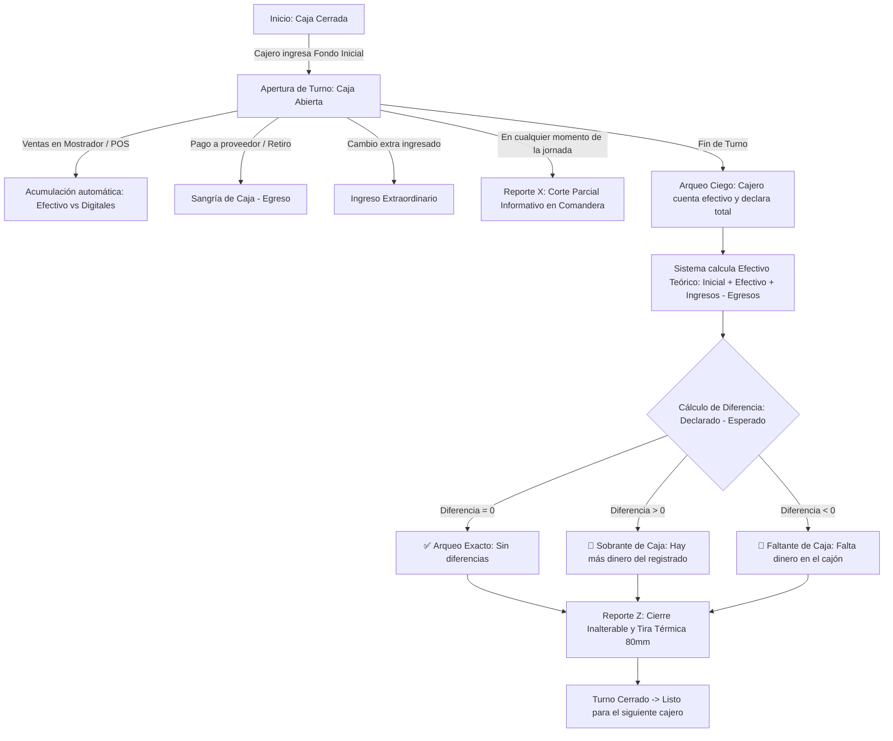

# 💰 Manual de Uso: Control de Cajas, Turnos y Arqueo de Efectivo (Cierre X y Z)

> [!info] Objetivo de la Funcionalidad
> El módulo de **Control de Cajas y Turnos** resuelve la gestión de dinero físico para comercios minoristas y gastronómicos con uno o múltiples turnos de atención (ej. turno mañana y turno tarde):
> 1. **Apertura de Turno:** Registro del fondo inicial de cambio en efectivo.
> 2. **Control de Sangrías y Egresos:** Registro al instante de salidas de dinero de la caja (pagos rápidos a proveedores de panadería, hielo, repartidores o retiros de seguridad del dueño).
> 3. **Trazabilidad de Ventas por Medio de Pago:** Clasificación automática de cobranzas en Efectivo, Débito, Crédito, Mercado Pago/QR y Transferencias vinculadas a la sesión del cajero.
> 4. **Arqueo Ciego de Caja:** Al terminar la jornada, el cajero cuenta los billetes y monedas físicos e ingresa el importe **sin que el sistema le revele el saldo teórico esperado**, previniendo manipulaciones.
> 5. **Emisión de Reportes X y Z:** Emisión de corte parcial (*Reporte X*) o cierre definitivo (*Reporte Z*) con cálculo de diferencias (sobrante, faltante o exacto) e impresión en comanderas térmicas de 80mm.

> [!abstract] Requisitos Previos y Permisos
> - **Rol requerido:** `Dueño` o `Colaborador` con permiso asignado sobre el módulo `Ventas`.
> - **Impresora térmica (Opcional):** Impresora comandera de 80mm o 58mm conectada para emisión física de los tickets de corte X y cierre Z.
> - **Navegación:** Menú lateral izquierdo > **Ventas** > **Caja y Turnos** (`/caja`).

---

## 🗺️ Diagrama del Ciclo de Vida del Turno de Caja

---

## 📍 Flujos Operativos Paso a Paso

### Caso 1: Apertura de Turno con Fondo de Cambio
1. Ingresá a **Ventas** > **Caja y Turnos** (`/caja`).
2. Si no hay turno abierto, verás el panel con el botón **"+ Abrir Turno de Caja"**.
3. En el formulario modal:
   - **Fondo Inicial de Caja:** Ingresá el cambio en efectivo presente en el cajón (ej. `$15.000`).
   - **Nombre del Turno:** Indicá una etiqueta clara (ej. *"Caja 1 - Turno Mañana"*).
   - **Notas:** Podés aclarar denominaciones (ej. *"Billetes chicos de $500 y $1.000"*).
4. Hacé clic en **"Abrir Turno"**.
5. La caja pasa a estado **ABIERTA** con indicador visual en tiempo real. A partir de este momento, todas las ventas registradas en el POS se computarán dentro de esta sesión.

---

### Caso 2: Registro de una Sangría (Retiro de Efectivo)
Cuando durante el turno se deba pagar a un proveedor menor o el dueño retire dinero por seguridad:
1. En la pantalla de **Caja y Turnos**, presioná el botón **"Movimiento / Sangría"**.
2. Seleccioná el tipo **"Sangría (Retiro)"**.
3. Indicá el **Monto a retirar** (ej. `$4.500`).
4. Ingresá el **Concepto / Motivo** (ej. *"Pago de flete / hielo"*).
5. (Opcional) Cargá el **N° de Comprobante / Recibo** recibido.
6. Hacé clic en **"Registrar Sangría"**.
7. El movimiento se refleja al instante: descuenta del saldo en cajón y queda registrado con la hora exacta y el nombre del cajero.

---

### Caso 3: Consulta de Corte Parcial (Reporte X)
El encargado o dueño del local puede auditar cómo viene la recaudación a mitad de turno sin cerrar la caja:
1. En la pantalla de **Caja y Turnos**, hacé clic en **"Reporte X"**.
2. Se abrirá la previsualización del ticket térmico con:
   - Total facturado en el turno.
   - Desglose por medio de pago (Efectivo, Débito, Crédito, QR, etc.).
   - Detalle de sangrías e ingresos extraordinarios.
   - Efectivo teórico esperado en ese minuto.
3. Podés imprimir la tira física con el botón **"Imprimir Comandera (80mm)"** o simplemente cerrarla. La caja continúa abierta.

---

### Caso 4: Arqueo Ciego y Cierre de Turno (Reporte Z)
Al finalizar el turno de trabajo:
1. El cajero abre el cajón portabilletes y realiza el conteo físico de todo el dinero en efectivo.
2. Presiona el botón **"Cerrar Turno (Arqueo)"**.
3. **Pantalla de Arqueo Ciego:**
   - Ingresa el número total que contó (ej. `$48.200`).
   - *Nota:* La pantalla no le muestra cuánto debería haber, evitando redondeos intencionales.
4. Presiona **"Confirmar Arqueo y Cerrar Turno"**.
5. **Resultado Instantáneo:** El sistema compara lo declarado contra el cálculo teórico y muestra el cartel oficial:
   - **Diferencia = $0:** *"¡Arqueo Exacto! Caja sin diferencias"*.
   - **Diferencia < $0:** *"Faltante de Caja: -$1.500"*.
   - **Diferencia > $0:** *"Sobrante de Caja: +$800"*.
6. **Reporte Z Definitivo:** Se genera la tira fiscal definitiva inalterable lista para imprimir y archivar en el sobre de recaudación.

---

### Caso 5: Auditoría Histórica y Reimpresión
1. En la pestaña **"Historial de Cierres Z"** de la pantalla `/caja`.
2. Se listan todos los turnos cerrados con fechas, cajeros, importes declarados y diferencias.
3. Haciendo clic en **"Ver Z"**, se puede consultar o reimprimir el comprobante original de cualquier jornada anterior.

---

## ⚙️ Especificaciones Técnicas y Arquitectura

| Capa | Archivo / Componente | Responsabilidad |
| :--- | :--- | :--- |
| **Página Web** | [`/caja/page.tsx`](file:///home/deibon/deibon/analitica-360/apps/web/src/app/(dashboard)/caja/page.tsx) | Server Component con metadata optimizada y renderizado de la vista de caja. |
| **Vista Principal** | [`CajaVista.tsx`](file:///home/deibon/deibon/analitica-360/apps/web/src/features/caja/components/CajaVista.tsx) | Orquestador de UI (<230 líneas) con alternancia entre turno activo e historial. |
| **Métricas** | [`CajaMetricasResumen.tsx`](file:///home/deibon/deibon/analitica-360/apps/web/src/features/caja/components/CajaMetricasResumen.tsx) | Tarjetas de fondo inicial, ventas en efectivo, ventas digitales, sangrías y saldo teórico. |
| **Arqueo Ciego** | [`ModalArqueoCierre.tsx`](file:///home/deibon/deibon/analitica-360/apps/web/src/features/caja/components/ModalArqueoCierre.tsx) | Modal interactivo en dos fases: declaración a ciegas y revelación de diferencias. |
| **Impresión Térmica** | [`TicketReporteXZ.tsx`](file:///home/deibon/deibon/analitica-360/apps/web/src/features/caja/components/TicketReporteXZ.tsx) | Tira monocromática de 80mm aislada vía `@media print` para comanderas térmicas. |
| **Servicio Backend** | [`CajasService`](file:///home/deibon/deibon/analitica-360/apps/api/src/modules/cajas/cajas.service.ts) | Cálculos financieros, validación de un solo turno abierto y congelamiento de métricas. |
| **Controlador API** | [`CajasController`](file:///home/deibon/deibon/analitica-360/apps/api/src/modules/cajas/cajas.controller.ts) | Endpoints REST protegidos por guardas de empresa y módulo ventas. |
| **Persistencia** | `cajas_sesiones` y `cajas_movimientos` | Tablas en PostgreSQL gestionadas por Prisma con claves foráneas e índices temporales. |

---

## 💡 Preguntas Frecuentes

### ¿Puedo tener dos cajas abiertas al mismo tiempo en el mismo comercio?
El sistema por defecto restringe a un turno activo por local para garantizar que no se mezclen los cobros en efectivo. Al cerrar el turno mañana, el cajero de la tarde puede abrir inmediatamente su propia sesión con su nuevo fondo de cambio.

### ¿Qué pasa si una venta se cobró con Mercado Pago o Tarjeta?
El sistema la desglosa bajo **Ventas Digitales**. Esos fondos no van al cajón físico, pero quedan registrados en el Reporte Z para cuadrar las ventas totales contra los resúmenes bancarios y de pasarelas.

### ¿Se pueden modificar las notas de un turno una vez cerrado?
No. El Reporte Z es inalterable para garantizar la seguridad contable y auditoría del dueño del negocio.
